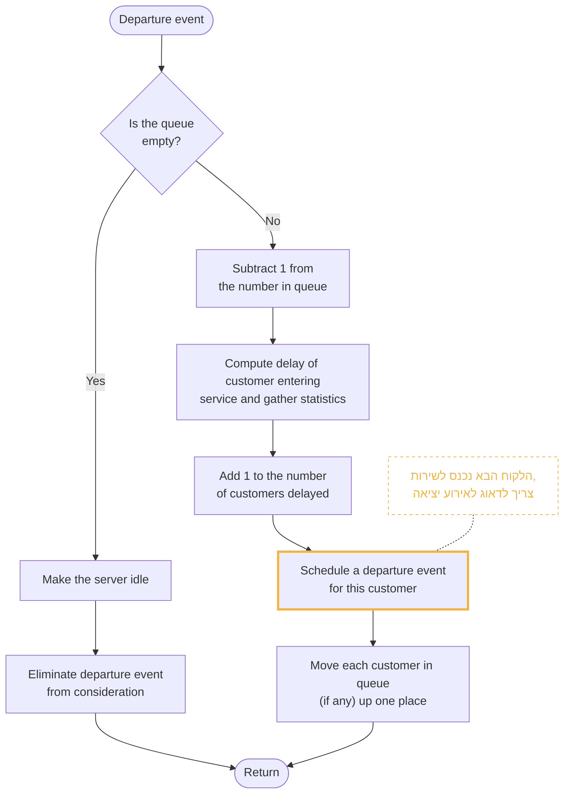

# סימולציה — תרגילי כיתה
### תשפ"ז · מחולק לפי שיעור

*סטטוס עבודה (1.9.2026): שיעורים 2–5 עברו סבב תיקונים אחד. שיעורים 6–11 הם טיוטה ראשונה שטרם נבדקה.*

**מבנה כל שיעור:** חימום (תרגילים ישירים) · שיפוט (שאלות לדיון) · אתגר (להמשך בבית)

---

## שיעור 1 — הקדמה
מצגת. אין תרגילים.

אין פזמון. תרקדו.

### מצגת — הקדמה

####
!! סימולציה — הקדמה
SIMULATION — INTRODUCTION

נמרוד טלמון

#### מבנה השיעור
- הכרות
- אדמיניסטרציה
- הקדמה בסיסית
- דוגמת צעצוע
- מבנה הקורס

#### הכרות
**נמרוד טלמון**

אני חוקר אלגוריתמים של החלטות קבוצתיות ודמוקרטיה דיגיטלית.


#### הכרות


#### אתר
[nimrodtalmon.github.io/sim-class](https://nimrodtalmon.github.io/sim-class/)


#### הרצאה
- תוכן
  - רקע, פילוסופיה וחומר תיאורטי: סרטונים שבועיים לצפייה לפני כל הרצאה (כשעה)
  - תרגול, חזרה ושאלות: בכיתה
  - שעות קבלה (מתרגלים ומרצה): בתיאום מראש דרך המייל האישי
- ספרים
  - Law, Averill M. and Kelton, W. David, *Simulation Modeling and Analysis*, McGraw-Hill, 2000
  - משה א' פולטשק, *סימולציה למהנדסי תעשייה*, האוניברסיטה הפתוחה, 2008

#### מעבדות
- תוכן
  - תזכורת החומר התיאורטי
  - תכלס: Python
- מטלות
  - תרגילי בית
  - פרויקט סימולציה

> **מייל לפניות בנושאי הקורס:** bgusimulation@gmail.com

#### אפליקציה
- חזרה
- תרגול
- ויזואליזציה
- קונקרטיזציה
- מגרש משחקים

#### סימולציה

!! Real stuff vs. simulated stuff

#### סימולציה
   

#### מה נעשה בקורס?
בגדול, פרויקט סימולציה מכיל פיסת **קוד** שמתאים ל**מודל** שמתאים ל**מערכת** מסוימת, **הרצה** של הקוד הזה ו**ניתוח** של התוצאות.

#### פרויקט/מחקר סימולציה
@svg slides/svg/cycle.svg

#### מהי מערכת
- **מערכת:** אוסף של ישויות ומשאבים (אנשים, מכונות, חלקים) שפועלים יחד ומתקשרים זה עם זה לצורך השגת מטרה לוגית.
- **למערכת יש:** מטרות, גבול, מבנה, תהליכים, מצב.
- **מצב המערכת:** אוסף המשתנים הנדרשים לתיאור המערכת ברגע מסוים בזמן.
- **מדידת ביצועי המערכת:** זמן המתנה ממוצע לקבלת השירות, נצילות ממוצעת של השרתים, מספר לקוחות לא שבעי רצון…


#### מהו מודל
מודל מייצג את המערכת:
- סט הנחות
- סט הזנחות

$S = V_{0}t + 0.5at^{2}$

> "מודל צריך להיות פשוט ככל הניתן, אך לא פשוט מכך" (איינשטיין)
  
  


####


####

!! “All models are wrong, but some are useful”
(George Box)

#### משחק בדמיון
- Simulate (Oxford): pretend, imitate
  - להתייחס אל המודל כאילו היה המערכת ("לחכות לדמות")
  - "ניסוי במחשבה" (פון נוימן)

  

#### סוגי מודלים נומריים
- סטוכסטי / דטרמיניסטי
  - האם הכול בטוח, או שיש אי־ודאות?
- דינמי / סטטי
  - האם לזמן יש תפקיד במודל?
- בדיד (דיסקרטי) / רציף
  - האם מצב המודל יכול להשתנות בכל רגע, או רק בנקודות זמן מסוימות?

> המודלים שנפתור יהיו: **סטוכסטיים, דינמיים, בדידים**

#### משחק עץ או פלי
| מספר משחק | הימור (0,1) | תוצאת ההטלה | ניצחון? | מספר ניצחונות | אחוז ניצחונות |
|---|---|---|---|---|---|
|+ 1 | 1 | 0 | 0 | 0 | 0 |
|+ 2 | 1 | 1 | 1 | 1 | 50 |
|+ 3 | 1 | 1 | 1 | 2 | 66.7 |
|+ 4 | 1 | 1 | 1 | 3 | 75 |
|+ 5 | 1 | 1 | 1 | 4 | 80 |
|+ 6 | 1 | 1 | 1 | 5 | 83.3 |
|+ 7 | 1 | 1 | 1 | 6 | 85.7 |
|+ 8 | 1 | 1 | 1 | 7 | 87.5 |
|+ 9 | 1 | 0 | 0 | 7 | 77.8 |
|+ 10 | 1 | 0 | 0 | 7 | 70 |

#### דוגמאות נוספות
- מעבד 4004 של אינטל
- תנועה בתוך קערה
- ארנבות ושועלים
- מפעל מן וטוב


#### מודלים דינמיים, סטוכסטיים, בדידים
- מפעל ייצור
- בנק
- מערכת היסעים לבית הספר
- בית חולים
- פיצרייה
- מערכת רכבות
- רשת מחשבים
- מערכת המשפט
- מערכת עסקית
- סופרמרקט
- גידולי השדה במשק


#### מפעל מן וטוב
**טבלה 1 — פעולות ייצור נדרשות**

| פעולה | תוחלת משך הפעולה (שניות) | סטיית התקן של משך הפעולה (שניות) | קודמות |
|---|---|---|---|
| A | 3 | 1 | — |
| B | 3 | 1 | — |
| C | 2 | 0.1 | A |
| D | 5 | 0.25 | A, B |
| E | 1 | 0.25 | C, D |
| F | 5 | 1.5 | D |
| G | 2 | 0.65 | F |
| H | 5 | 0.5 | E |
| I | 2 | 0.4 | F |
| J | 3 | 0.5 | H, I, G |
| הכנת מגשית | 2 | 0.01 | כולן + אפייה |

**טבלה 2 — חלוקת מכונות לתחנות**

| תחנה | 1 | 2 | 3 | 4 | 5 |
|---|---|---|---|---|---|
| פעולות | A, B | C, D | E, F, G | H | I, J |

#### מפעל מן וטוב — יש עוד
- תחזוקת קו והפסקות
  - לעובדים הפסקה של 20 דקות כל 4 שעות
  - איש תחזוקה מגיע תוך $U(20,30)$
- בדיקות איכות

**טבלה 3 — תקלות**

| זמני תקלות, מכונות A–E | זמני תקלות, מכונות F–J | זמן איבחון התקלה | MTTR (זמן ממוצע לתיקון מכונה) |
|---|---|---|---|
| מתוך הנתונים (*) | מתוך הנתונים (*) | $Exp(20)$ דקות | $U(10,30)$ דקות |

(*) קובץ נתונים מצורף

> מהן הישויות? המשאבים? התהליכים?

#### שיטות מונטה קרלו
- 1942–1946: פרויקט מנהטן
- איזה מרחק יעבור נויטרון בתוך חומר לפני שיתנגש בגרעין? כמה אנרגיה תשתחרר כתוצאה מההתנגשות?
  
 

#### שיטות מונטה קרלו
- סימולציה
- אופטימיזציה
- אינטגרציה

> *Monte Carlo is the art of approximating an expectation by the sample mean of a function of simulated random variables.* (Eric C. Anderson, 1999)


#### פרויקט/מחקר סימולציה
@svg slides/svg/cycle-goal.svg

#### איך זה נראה?
במקום הפיצרייה האמיתית, נבנה מודל ממוחשב של הפיצרייה:
- יכיל ישויות מסומלצות: לקוחות שמגיעים בקצבים שונים
- יכיל משאבים מסומלצים: טבחים, מלצרים, תנורים
- נכתוב קוד שיחקה את הפעולות והתהליכים של לקוחות


#### מה צריך כדי לגרום לקסם לקרות?
במקום הפיצרייה האמיתית, נבנה מודל ממוחשב של הפיצרייה:
  - יכיל ישויות מסומלצות: לקוחות שמגיעים בקצבים שונים
  - יכיל משאבים מסומלצים: טבחים, מלצרים, תנורים
  - נכתוב קוד שיחקה את הפעולות והתהליכים של לקוחות
- **נתונים:** קצב הגעת לקוחות, שעות פתיחה…
- **מידול תהליכים:** מודל אמין
- **ניסוי במחשב:** קוד שנאמן למודל

> נבצע הרבה הרצות של הסימולציה, ונרצה להבין את התוצאות

#### יש הרבה סוגים!!!
- Agent-based simulation
- Continuous/physical simulation
- …

!! לקורסים אחרים :]

#### כלים לבניית סימולציה ממוחשבת
  
  

#### Python


#### דוגמה "שלמה" (צעצוע)
- לקוחות מגיעים לקבל שירות אצל פקיד בנק
- קיים פקיד אחד
- לקוחות יוצאים מייד לאחר קבלת השירות
- מעוניינים לבדוק את טיב השירות


#### מטרות
- **מהן מטרות הארגון?**
- **מהן מטרות הפרויקט?**
- **מהן מטרות הסימולציה?**
  - **מדדים / שערוכים של תוחלות של משתנים מקריים!**

#### מטרות
- לקוחות מגיעים לקבל שירות אצל פקיד בנק
- קיים פקיד אחד
- לקוחות יוצאים מייד לאחר קבלת השירות
- מעוניינים לבדוק את טיב השירות

> **למשל, מספר הלקוחות שסיימו ב-8 שעות** (בפרט, הערכה סטטיסטית של התוחלת)

#### איסוף נתונים
- באיזו תדירות מגיעים לקוחות? (נשאל אנשים? נלך לשטח?)
- איזו התפלגות מתאימה לנתונים? (**טיב התאמה!**)


#### איסוף נתונים
- לקוחות מגיעים לקבל שירות אצל פקיד בנק
  - **למשל, הזמן בין הגעות מתפלג מעריכית עם פרמטר 5**
- קיים פקיד אחד
  - **למשל, זמן השירות מתפלג אחיד בין 1 ל-2**
- לקוחות יוצאים מייד לאחר קבלת השירות
- מעוניינים לבדוק את טיב השירות
  - **למשל, מספר הלקוחות שסיימו ב-8 שעות**

> התאמת התפלגות (גם טיב התאמה)

#### מידול המערכת
@svg slides/svg/bank.svg

- האם המודל המתאים הוא סטוכסטי, דינמי ובדיד?

#### קוד סימולציה מתאים למודל
```
q = new Queue()   // holding waiting customers  ## משתנים גלובליים
n = 0             // number of customers served
serverBusy = False
nextArrivalTime = sampleNextArrivalTime()
While clock = 0 to 8 step 0.0001:  ## מזיזים את השעון
    if clock == nextArrivalTime:  ## אירוע של הגעת לקוח
        q.append(new Customer())
        nextArrivalTime = sampleNextArrivalTime()
        if not serverBusy:
            serverBusy = True  ## תופסים את השרת, שמתישהו יסיים
            currentCustomer = q.pop()
            serviceFinishTime = sampleServiceFinishTime()
    else if clock == serviceFinishTime:  ## אירוע סיום טיפול של השרת
        n += 1  ## עוד לקוח מרוצה
        if not q.empty():  ## אולי יש לקוח שממתין
            currentCustomer = q.pop()
            serviceFinishTime = sampleServiceFinishTime()
        else:  ## אולי אין לקוח שממתין
            serverBusy = False
print("number of serviced customers =", n)
```

#### תכנות אירועים
- מצב המערכת משתנה רק על ידי **אירוע**
  - התרחשות בזמן מסוים, שאינה אורכת זמן
  - ומשנה את מצב המערכת
- קידום השעון לאירוע הבא

> **תכנות אירועים!**

@svg slides/svg/eg-basic.svg

#### אלגוריתמי דגימה
```
q = new Queue()   // holding waiting customers
n = 0             // number of customers served
serverBusy = False
nextArrivalTime = sampleNextArrivalTime()  ## דגימה
While clock = 0 to 8 step 0.0001:
    if clock == nextArrivalTime:
        q.append(new Customer())
        nextArrivalTime = sampleNextArrivalTime()  ## דגימה
        if not serverBusy:
            serverBusy = True
            currentCustomer = q.pop()
            serviceFinishTime = sampleServiceFinishTime()  ## דגימה
    else if clock == serviceFinishTime:
        n += 1
        if not q.empty():
            currentCustomer = q.pop()
            serviceFinishTime = sampleServiceFinishTime()  ## דגימה
        else:
            serverBusy = False
print("number of serviced customers =", n)
```
> פונקציה (קוד) שלא מקבלת פרמטרים, וכל פעם מחזירה מספר. המספרים מתפלגים לפי התפלגות מסוימת.

#### תכנון ניסוי
!! כמה פעמים צריך להריץ?

#### הרצה וחישוב מטרות
| הרצה | הגעה |
|---|---|
| 1 | **20** |
| 2 | **15** |
| 3 | **17** |
| 4 | **21** |
| 5 | **24** |
| 6 | **27** |
| 7 | **21** |

!! רווח סמך…

#### הבנת הפלט
- לאיזו רמת ביטחון אפשר להגיע?
- לאיזו רמת דיוק אפשר להגיע?


#### השוואה בין חלופות
- איזו חלופה עדיפה? באיזו רמת מובהקות?

| מצב קיים | חלופה א |
|---|---|
| 15 | **20** |
| 17 | **15** |
| 12 | **17** |
| 6 | **21** |
| 88 | **24** |
| 65 | **27** |
| 24 | **21** |


#### מציאת חלופה
- מראה מראה שעל הקיר, מי היא החלופה הכי טובה בעיר?


#### יתרונות וחסרונות של סימולציה
- **לרוב יותר זמין, קל וזול (מאשר ביצוע ניסוי)**
  - אפשר לבדוק הרבה דברים
  - יש יותר חופש (למשל, זמן! מספר הרצות!)
  - לפעמים אין דרך אחרת
- **לא אמיתי**
  - צריך לדעת להבין את התוצאה
  - צריך לעבוד כדי לשפר את רמת האמינות

#### אתר
[nimrodtalmon.github.io/sim-class](https://nimrodtalmon.github.io/sim-class/)


####
!! סימולציה — הקדמה
SIMULATION — INTRODUCTION

נמרוד טלמון

---

## שיעור 2 — חזרה על הסתברות והתאמת התפלגות למודל
מצגת: [התפלגויות נחמדות](https://drive.google.com/file/d/1N4ohVMZTzbwMZclJrtPaBBIXXDpouXyG/view)

### חימום

**2.1** נתונה פונקציית הצפיפות שבאיור של משתנה מקרי Y.
א. מצאו את c.
ב. מצאו את פונקציית ההתפלגות המצטברת.
ג. חשבו P(Y ≤ 5), P(Y ≥ 7).


**2.2** נתונה פונקציית הצפיפות שבאיור.
א. מצאו את c.
ב. פונקציית ההתפלגות המצטברת.
ג. P(1.0 ≤ X ≤ 5.0), P(X ≥ 2.0), P(X ≥ 4).


**2.3** f(x) = x²/4 עבור 1 ≤ x ≤ 2, ו-f(x) = kx עבור 2 < x ≤ 3.
א. מצאו את k.
ב. פונקציית ההתפלגות המצטברת.
ג. P(X > 2.5).

**2.4** לכל אחת משלוש ההיסטוגרמות (איור) — איזו משפחת התפלגות סבירה? נמקו.

  

**2.5** נתונים זמני בין-הגעות (דקות): 2.1, 0.4, 5.3, 1.1, 0.9. הניחו התפלגות מעריכית וחשבו אנ"מ ל-λ.

### שיפוט

**2.6 איזו משפחה?**
לכל מצב — איזו משפחת התפלגות הייתם בוחרים (אחיד / מעריכי / נורמלי / פואסון / בינומי / אחר), ולמה? ומה הטיעון הטוב ביותר *נגד* הבחירה שלכם?
- זמן בין אוטובוסים בתחנה ללא לוח זמנים
- ציוני בחינה בקורס גדול
- מספר שגיאות כתיב בעמוד
- זמן שירות בדלפק בנק
- מספר לקוחות שנכנסים לחנות בשעה
- זמן עד תקלה בנורה

**2.7 טנקים גרמניים.**
אתם בריטים במלחמת העולם השנייה. ראיתם ארבעה טנקים גרמניים עם המספרים הסידוריים 14, 31, 55, 71. כמה טנקים יש לאויב? כתבו מספר ונימוק.

**2.8 פרדוקס ההמתנה.**
אוטובוסים מגיעים לתחנה בממוצע כל 10 דקות, לפי תהליך פואסון. אתם מגיעים לתחנה ברגע אקראי. כמה תחכו בממוצע — 5 דקות? 10? משהו אחר? נמקו.

**2.9 ציד באגים.**
סטודנטית מדדה זמני שירות בדלפק, קיבלה ממוצע 3 דקות וסטיית תקן 2 דקות, והתאימה התפלגות נורמלית N(3, 2²). הסימולציה שלה רצה. מה הבעיה, ואיך היה צריך לגלות אותה *לפני* שהריצה?

### אתגר

**2.10** נתונה משפחת הצפיפויות f_{θ}(x) = θx^{θ−1} על הקטע [0,1], עם פרמטר חיובי θ.
א. גזרו את אנ"מ ל-θ מתוך מדגם x₁,…,xₙ.
ב. (הצצה לשיעור 4) מצאו את F(x) והציעו דרך לדגום מ-X בעזרת U~U(0,1).
ג. בפייתון: קבעו θ=2, דגמו n ערכים, אמדו, וחזרו 1000 פעמים. ציירו את ההטיה הממוצעת של האומד כפונקציה של n עבור n=5,10,20,50,100. מה אתם רואים?

---

## שיעור 3 — מבחני טיב התאמה
מצגות: [חי בריבוע](https://drive.google.com/file/d/1aUr9J_IZetVP8PKLfYOxUPirboZA13So/view) · [קולמוגורוב-סמירנוב](https://drive.google.com/file/d/18KU9xCkl3YrkLg8o28swUlPAF7xPQ_Z5/view)

### חימום

**3.1** נמדדו 40 ערכים וחולקו ל-5 תאים ברוחב 1 על הקטע [0,5]. השכיחויות הנצפות: 11, 6, 9, 4, 10.
הריצו מבחן χ² ברמת ביטחון 90% לבדיקת ההשערה שהנתונים מתפלגים U(0,5).

**3.2** נתונים 5 ערכים (ממוינים): 0.3, 1.6, 2.4, 3.5, 4.7.
הריצו מבחן קולמוגורוב-סמירנוב ברמת ביטחון 90% לבדיקת ההשערה שהם מתפלגים U(0,5).

### שיפוט

**3.3 טוב מדי?**
סטודנטית הביאה 20 מדידות: 0.5, 1.5, 2.5, 3.5, 4.5, 0.1, 1.1, 2.1, 3.1, 4.1, 0.9, 1.9, 2.9, 3.9, 4.9, 0.2, 1.2, 2.2, 3.2, 4.2. היא הריצה χ² מול U(0,5) עם 5 תאים וקיבלה סטטיסטי 0 בדיוק. "התאמה מושלמת!"
האם זו בשורה טובה? מה ההתפלגות של סטטיסטי χ² *כשההשערה נכונה*, ומה הסיכוי לקבל בדיוק 0?

**3.4 מלחמת התאים.**
נתונות 40 מדידות על הקטע [0,5]. שלוש סטודנטיות הריצו עליהן χ² מול U(0,5): אחת עם 2 תאים, אחת עם 5, אחת עם 10.
מי צודק? האם המסקנה יכולה להשתנות בין השלוש? מה בעצם קובע כמה תאים "מותר"?

**3.5 "המבחן עבר — המודל תקין".**
סטודנטית מדדה 3 זמני שירות, הריצה K-S מול מעריכי ברמת 90%, המבחן לא דחה, והיא כתבה בדו"ח: "ההתפלגות המעריכית אומתה סטטיסטית."
האם המשפט נכון? מה מבחן טיב התאמה *כן* אומר כשהוא לא דוחה, ומה הוא *לא* אומר?

**3.6 χ² נגד K-S.**
לכל מצב — איזה מבחן מתאים יותר, ולמה?
- מספר לקוחות ביום, נתונים בדידים 0–12
- 15 זמני שירות רציפים
- 50,000 זמני בין-הגעות מקובץ לוג של שרת
- זמני שירות רציפים, כאשר את λ אמדתם *מאותם נתונים*

**3.7 ציד באגים.**
סטודנטית רצתה לבדוק אם זמני השירות שמדדה מתפלגים מעריכית. היא אמדה את λ מהנתונים, חילקה את הנתונים ל-6 תאים, חישבה את סטטיסטי χ², השוותה לערך הקריטי עם 5 דרגות חופש, והסיקה שההשערה לא נדחית.
בנוסף, חברתה הריצה K-S על 50,000 תצפיות אמיתיות, המבחן דחה כל התפלגות שניסתה, והיא כתבה: "לא קיימת התפלגות מתאימה, אי אפשר לבנות סימולציה."
מצאו את הטעות של כל אחת מהן.

### אתגר

**3.8** הניסוי: דוגמים n ערכים מ-Exp(1), אומדים λ מהנתונים, ומריצים χ² ו-K-S ברמת α=0.1 מול Exp(λ̂). חוזרים 1000 פעמים ורושמים את שיעור הדחיות. וכך עבור n = 10, 30, 100, 300, 1000.
א. לפני שכותבים שורת קוד: מה לדעתכם יצא? איזה שיעור דחיות "אמור" להתקבל אם המבחן תקין, והאם הוא ישתנה עם n? שרטטו ניחוש של הגרף.
ב. עכשיו כתבו את זה בפייתון וציירו את הגרף האמיתי. איפה הניחוש צדק ואיפה לא, ובאיזה מבחן?
ג. הסבירו את הפער. (רמז: מה קורה לערכים הקריטיים של K-S כשהפרמטר נאמד מאותו מדגם?)

---

## שיעור 4 — אלגוריתמי דגימה א

### חימום

**4.1** X בדיד עם P(3)=½, P(5)=P(6)=¼. כתבו אלגוריתם דגימה ל-X.

**4.2** X רציף עם פונקציית הצפיפות שבאיור. כתבו אלגוריתם דגימה בשיטת הטרנספורם ההופכי.


**4.3** X רציף עם f(x)=x/2 עבור 0 ≤ x ≤ 2. כתבו אלגוריתם דגימה.


**4.4** X רציף עם f(x)=2−2x עבור 0 ≤ x ≤ 1. כתבו אלגוריתם דגימה בשיטת הטרנספורם ההופכי.


**4.5** X רציף עם f(x)=2(x+2) עבור −2 ≤ x ≤ −1. כתבו אלגוריתם דגימה.


**4.6** X ~ U(0,2). Y בדיד עם P(1)=P(10)=¼, P(2)=½. כתבו אלגוריתם דגימה ל-Y שמשתמש *רק* באלגוריתם דגימה ל-X.

**4.7** Y בדיד עם P(1)=P(10)=¼, P(2)=½. Z בדיד עם P(10)=P(21)=½. כתבו אלגוריתם דגימה ל-Z שמשתמש *רק* באלגוריתם דגימה ל-Y.

### שיפוט

**4.8 לה ביסקוט** (שאלה ממבחן).
קונדיטוריית "לה ביסקוט" מייצרת קינוחים בשני מטבחים: 60% במטבח הלונדוני, 40% בפריזאי. במטבח הלונדוני זמן ההכנה מתפלג U(20,40) דקות. במטבח הפריזאי זמן ההכנה מתפלג לפי הצפיפות f(t) = t/50 עבור 0 ≤ t ≤ 10.

א. פתחו אלגוריתם דגימה לזמן ההכנה של קינוח, ללא קבלה-דחייה.
ב. סטודנטית א' משתמשת בשני מספרים אקראיים לכל דגימה. סטודנטית ב' טוענת שמספיק אחד: "אם u<0.6, אז u/0.6 הוא בעצמו אחיד על (0,1) — נשתמש בו שוב." מי צודק?
ג. מתי מותר "למחזר" מספר אקראי, ומתי זה מקלקל את הדגימה?

**4.9 הטרנספורם ההופכי תמיד מנצח?**
לכל מקרה — איזו שיטה עדיפה, טרנספורם הופכי או קומפוזיציה, ולמה?
א. f(x) = 2−2x על [0,1].
ב. f(x) = x⁴/8 + x³/4 + x²/2 + 179/240 עבור 0 ≤ x ≤ 1.
ג. משתנה בדיד עם מיליון ערכים אפשריים.
ד. משתנה בדיד עם שני ערכים.

**4.10 האם האלגוריתם נכון?**
*מטרה:* X בדיד עם P(3)=½, P(5)=P(6)=¼.
*האלגוריתם:* דגום u. אם u<0.5 החזר 3. אחרת: דגום v; אם v<0.5 החזר 5, אחרת החזר 6.
האם האלגוריתם דוגם נכון מההתפלגות המבוקשת? אם לא — מאיזו התפלגות הוא דוגם בפועל?

**4.11 שני אחידים.**
לכל אלגוריתם — האם הוא דוגם נכון מההתפלגות המבוקשת? אם לא — מאיזו התפלגות הוא דוגם בפועל?
א. *מטרה:* U(1,3). דגום u₁, u₂. החזר 1 + 2·max(u₁, u₂).
ב. *מטרה:* U(0,1). דגום u₁, u₂. החזר (u₁+u₂)/2.

**4.12 מינוס שורש.**
*מטרה:* f(x)=2−2x על [0,1].
*האלגוריתם:* דגום u. החזר 1 − √u.
האם האלגוריתם דוגם נכון מההתפלגות המבוקשת? אם לא — מאיזו התפלגות הוא דוגם בפועל?

**4.13 מקוביה מוטה לכל דבר.**
בידיכם רק אלגוריתם דגימה ל-Y בדיד עם P(1)=P(10)=¼, P(2)=½ (שלושה ערכים, לא סימטרי). טענה: "אפשר לייצר ממנו U(0,1) מדויק, ולכן כל התפלגות שהיא." האם הטענה נכונה? אם כן — איך? אם לא — מה חסר?

### אתגר

**4.14** עבור הצפיפות f(x) = x⁴/8 + x³/4 + x²/2 + 179/240 על [0,1]:
א. כתבו אלגוריתם דגימה בשיטת הקומפוזיציה. כמה מספרים אקראיים הוא צורך בממוצע לדגימה?
ב. כתבו אלגוריתם בטרנספורם הופכי (F(x) פולינום ממעלה 5 — פתרו נומרית).
ג. בפייתון: ממשו את שניהם, דגמו 100,000 פעמים מכל אחד, השוו היסטוגרמות לצפיפות, ומדדו זמן ריצה. מי ניצח, ולמה?

---

## שיעור 5 — אלגוריתמי דגימה ב
בסוף השיעור, אחרי שנסיים עם אלגוריתמי דגימה: [הרצאה על MCMC](https://docs.google.com/presentation/d/1_5Rz3Mw6DlqAI6UbcWmMFCkNZFMuaihqE4PeVv57KeI/edit?usp=drive_link)

### חימום

**5.1** בכד 5 כדורים ממוספרים 1–5. בשלב הראשון נבחר כדור באקראי. אם מספרו זוגי — זהו המספר הסופי. אם אי-זוגי — מוציאים כדור נוסף, ומספרו הוא המספר הסופי. כתבו אלגוריתם דגימה שמדמה את התהליך.

**5.2** X עם צפיפות f(x) = 1.5x² + x עבור 0 < x < 1. כתבו אלגוריתם דגימה בשיטת הקומפוזיציה.

**5.3** בחנות 70% תפוחים ו-30% תפוזים. משקל תפוח ~ U(3,5), משקל תפוז ~ U(4,8). כתבו אלגוריתם דגימה למשקל של פרי אקראי:
א. בשיטת קבלה-דחייה. מה שיעור הקבלה?
ב. בשיטת הקומפוזיציה.

**5.4** X רציף עם פונקציית הצפיפות שבאיור. כתבו אלגוריתם דגימה.


**5.5** הריצו 3 צעדים של LCG(a=3, c=0, m=32, z₀=1).

**5.6** מה אורך המחזור של LCG(a=1, c=512, m=1024, z₀=1)?

### שיפוט

**5.7 מי מהיר יותר?**
עבור f(x)=2−2x על [0,1] יש לנו שני אלגוריתמים: טרנספורם הופכי (x = 1−√u) וקבלה-דחייה עם פונקציה חוסמת קבועה 2.
א. כמה מספרים אקראיים צורך כל אחד בממוצע?
ב. על מחשב אמיתי — מי לדעתכם מהיר יותר, ולמה?
ג. האם יש פונקציה חוסמת טובה יותר מקבוע 2? מה זה בכלל אומר "פונקציה חוסמת טובה"?

**5.8 האם כל צפיפות ניתנת לדגימה בקבלה-דחייה?**
לכל מקרה: האם קבלה-דחייה עובדת? האם טרנספורם הופכי עובד? מה אפשר ומה אי אפשר?
א. Exp(1) על [0,∞). מהי הפונקציה החוסמת?
ב. f(x) = 1/(2√x) על (0,1).
ג. f(x) ∝ exp(−x⁴) על ℝ — הקבוע המנרמל לא ידוע לכם.

**5.9 מחזור מלא = מחולל טוב?**
א. LCG(a=4, c=1, m=9, z₀=1). מה אורך המחזור?
ב. LCG(a=1, c=1, m=16, z₀=0). מה אורך המחזור?
ג. שני המחוללים הגיעו לאורך מחזור מקסימלי. האם שניהם טובים באותה מידה לסימולציה? מה עוד נדרש ממחולל, מעבר לאורך מחזור?

**5.10 מלחמת הסידים.**
משווים שתי חלופות של מערכת. סטודנטית א' הריצה את שתיהן עם seed=42. סטודנטית ב': "טעות — צריך סידים שונים, אחרת ההרצות תלויות." סטודנטית ג': "להפך — אותו סיד זה בדיוק מה שצריך." מי צודק, ולמה?

**5.11 אקראיות אמיתית.**
המחולל שלכם עובר כל מבחן סטטיסטי שניסיתם. מציעים לכם במקומו רכיב חומרה שמייצר אקראיות אמיתית מרעש תרמי. מה תעדיפו לסימולציה, ולמה?

### אתגר

**5.12** בפייתון:
א. ממשו קבלה-דחייה למשקל של פרי אקראי — 70% תפוחים במשקל U(3,5) ו-30% תפוזים במשקל U(4,8) — עם פונקציה חוסמת קבועה. מדדו את שיעור הקבלה האמפירי והשוו לחישוב.
ב. תכננו פונקציה חוסמת מדרגתית (לא קבועה) והראו כמה שיעור הקבלה משתפר.
ג. ממשו LCG(a=3, c=0, m=32) וציירו את כל הזוגות (zᵢ, zᵢ₊₁) במישור. חזרו עם numpy.random. מה ההבדל, ולמה זה משנה?

---

## שיעור 6 — תכנות אירועים
מצגת. אין תרגילים.

אין פזמון. תרקדו.

מצגת נוספת: [תאוריה של תכנות אירועים](https://drive.google.com/file/d/1isLed1SEXF-CawwGkL1c3XZBz7Osh5PL/view)

### מצגת — תכנות אירועים

####
!! תכנות אירועים

נמרוד טלמון

#### פרדיגמת תכנות


#### פרדיגמת תכנות

!! תכנות אירועים!

> יש עוד אופציות…

#### תכנות אירועים — פילוסופיה
- מערכת (מודלים בדידים)
  - ישויות
  - משאבים
  - אירועים: משנים את מצב המערכת
  - בפרט, מצב המערכת מתואר על ידי פונקציית מדרגות

> אירועים משנים את מצב המערכת באופן "מיידי". **אירועים הם לב העניין!**

#### תכנות אירועים — רעיונות מרכזיים
- שעון סימולציה

> נרצה "להזיז את השעון" ולשנות את מצב המערכת בהתאם לאירועים


#### איך להזיז את השעון?
- אופציה אחת: באופן "רציף" — **בזבזני!**

#### דוגמה — כספומט (שעון "רציף")
```
QueueLength = 0
NJobsServed = 0
SumResidenceTimes = 0  ## מדד: זמן המתנה ממוצע
ServerBusy = false
generate NextArrivalTime   // random # generation  ## NextArrivalTime = X
NIncrements = MaxSimTime / 0.001
for SimTime = 1*0.001 to NIncrements*0.001 do  ## שעון "רציף"
   if SimTime = NextArrivalTime then  ## אירוע מסוג הגעה
      add new jobobject to queue
      QueueLength++
      generate NextArrivalTime   // random # generation
      if not ServerBusy then
         ServerBusy = true
         jobobject.ArrivalTime = SimTime
         generate ServiceFinishedtime  ## ServiceFinishedtime = Y
         currentjob = jobobject
         delete head of queue and assign to currentjob
         QueueLength--
   else
      if SimTime = ServiceFinishedtime then  ## אירוע מסוג סיום שירות
         NJobsServed++
         SumResidenceTimes += SimTime - currentjob.ArrivalTime  ## סוכם (למדד)
         if QueueLength > 0 then
            generate ServiceFinishedtime   // random # generation
            delete currentjob from queue
            QueueLength--
         else
            ServerBusy = false
print out SumResidenceTimes / NJobsServed
```

#### איך להזיז את השעון?
- אופציה אחת: באופן "רציף" — **בזבזני!**
- אופציה שנייה: לקפוץ לזמן של האירוע הבא — **!!!**

#### איך להזיז את השעון?
במקום השורה
```
for SimTime = 1*0.001 to NIncrements*0.001 do
```
!! נחליף!
```
if ServerBusy and NextArrivalTime < ServiceFinishedtime or
   not ServerBusy then
   SimTime = NextArrivalTime  ## קופצים לאירוע הבא
else
   SimTime = ServiceFinishedtime
```

#### איך להזיז את השעון?
- אופציה שנייה: לקפוץ לזמן של האירוע הבא — **!!!**

> **נשתמש ביומן אירועים כדי שהקסם יקרה:** אירועים עתידיים מסודרים לפי זמן!

- ביומן מחכים אירועים עתידיים, מסודרים לפי זמן
- נדע לקפוץ לאירוע הבא
- למשל, בדוגמת הכספומט: תמיד יש ביומן לפחות אירוע הגעה אחד, ולפעמים גם אירוע סיום שירות אחד
- מימוש: priority heap


#### דוגמה
אולי הדוגמה הכי פשוטה: תור בודד
- פקיד יחיד בבנק; לקוחות מגיעים באופן בלתי תלוי (למשל, מעריכי), וזמן השירות גם בלתי תלוי (למשל, אחיד בין 3 ל-4)
- **חשוב לזכור סיום!** למשל: יום עבודה של 8 שעות
- **חשוב לזכור מטרות!!!** למשל:
  - זמן המתנה ממוצע בתור (ללקוח)
  - אורך תור ממוצע (בזמן)
  - ניצולת שרת


#### דוגמה
בשביל להבין מה קורה:
- **מהן הישויות במערכת?**
+ לקוחות
- **מהם המשאבים במערכת?**
+ פקיד
- **מהו המצב של המערכת?**
+ האם השרת תפוס? מה יש בתור?
- **אילו אירועים יש?**
+ הגעת לקוח, סיום שירות


#### דוגמה — מה צריך טכנית?
- שעון (לזכור את הזמן "עכשיו")
- יומן אירועים (שיכיל אירועים עתידיים)
- **משתני מצב:**
  - משתנה בינארי "מצב שרת"
  - משתנה רשימה "תוכן התור"
- סוכמים:
  - זמני המתנה עד עכשיו
  - אורך התור עד עכשיו
  - ניצולת עד עכשיו
- קבועים:
  - זמן סיום (למשל, כשהשעון על 8·60)

#### דוגמה כללית — לולאה ראשית


#### דוגמת שרת בודד — אירועים
| תיאור האירוע | סוג האירוע |
|---|---|
| הגעת לקוח למערכת | 1 |
| יציאת לקוח מהמערכת לאחר סיום השירות | 2 |

> **אירועים משנים את מצב המערכת**

> כלל אצבע: סיום שירות עדיף על כניסה לשירות (ובכל מקרה, אירוע הוא נקודה בזמן, לא משהו מתמשך)

#### דוגמה — טיפול **באירוע** הגעת לקוח
> מה יקרה עם הלקוח השני?


#### דוגמה — טיפול **באירוע** סיום שירות


#### דוגמה — לולאה ראשית
| תיאור האירוע | סוג האירוע |
|---|---|
| הגעת לקוח למערכת | 1 |
| יציאת לקוח מהמערכת לאחר סיום השירות | 2 |


#### דוגמה — הרצה
- הרצת שרת יחיד עם תור, למשך 5 דקות
- זמן בין הגעות מעריכי עם תוחלת 3 דקות
- משך השירות אחיד בין 2 ל-3 דקות

#### דוגמה — הרצה
> **Q(t)**: אורך תור ממוצע (בזמן) · **B(t)**: ניצולת שרת (ממוצע בזמן) · **סך עיכוב**: בשביל זמן המתנה ממוצע (בלקוחות)

| אירוע | שעון | מצב שרת | בתור | זמני הגעה בתור | זמן אירוע אחרון | הגעה הבאה (A) | יציאה הבאה (D) | עוכבו | סך עיכוב | שטח מתחת Q | שטח מתחת B |
|---|---|---|---|---|---|---|---|---|---|---|---|
|+ אתחול | 0 | 0 | 0 | — | 0 | 0.4 | ∞ | 0 | 0 | 0 | 0 |
|+ הגעה | 0.4 | 1 | 0 | — | 0.4 | 1.6 | 2.4 | 1 | 0 | 0 | 0 |
|+ הגעה | 1.6 | 1 | 1 | 1.6 | 1.6 | 2.1 | 2.4 | 1 | 0 | 0 | 1.2 |
|+ הגעה | 2.1 | 1 | 2 | 1.6, 2.1 | 2.1 | 3.8 | 2.4 | 1 | 0 | 0.5 | 1.7 |
|+ יציאה | 2.4 | 1 | 1 | 2.1 | 2.4 | 3.8 | 3.1 | 2 | 0.8 | 1.1 | 2.0 |
|+ יציאה | 3.1 | 1 | 0 | — | 3.1 | 3.8 | 3.3 | 3 | 1.8 | 1.8 | 2.7 |
|+ יציאה | 3.3 | 0 | 0 | — | 3.3 | 3.8 | ∞ | 3 | 1.8 | 1.8 | 2.9 |
|+ הגעה | 3.8 | 1 | 0 | — | 3.8 | 4.0 | 4.9 | 4 | 1.8 | 1.8 | 2.9 |
|+ הגעה | 4.0 | 1 | 1 | 4.0 | 4.0 | 5.6 | 4.9 | 4 | 1.8 | 1.8 | 3.1 |
|+ יציאה | 4.9 | 1 | 0 | — | 4.9 | 5.6 | 8.6 | 5 | 2.7 | 2.7 | 4.0 |
|+ הגעה | 5.6 | 1 | 1 | 5.6 | 5.6 | 5.8 | 8.6 | 5 | 2.7 | 2.7 | 4.7 |
|+ הגעה | 5.8 | 1 | 2 | 5.6, 5.8 | 5.8 | 7.2 | 8.6 | 5 | 2.7 | 2.9 | 4.9 |
|+ הגעה | 7.2 | 1 | 3 | 5.6, 5.8, 7.2 | 7.2 | 9.1 | 8.6 | 5 | 2.7 | 5.7 | 6.3 |
|+ יציאה | 8.6 | 1 | 2 | 5.8, 7.2 | 8.6 | 9.1 | 9.2 | 6 | 5.7 | 9.9 | 7.7 |

#### דוגמה — מדד בזמן: אורך התור
@svg slides/svg/q-of-t.svg

> **פונקציית מדרגות!** רק אירועים משנים את המצב!

#### דוגמה — מדד בזמן: ניצולת השרת
@svg slides/svg/b-of-t.svg

> **פונקציית מדרגות!** רק אירועים משנים את המצב!

#### שיטת חמשת השלבים


#### חמשת השלבים
- שלב 1 — הבנת המודל (פישוט טקסט)
- שלב 2 — מטרות (ארגון, פרויקט, סימולציה)
- שלב 3 — אירועים (תרשים עיגולים)
- שלב 4 — משתנים (מה צריך לדעת)
- שלב 5 — תרשימי זרימה (פסאודוקוד)

> צריך לדעת מהן הישויות, המשאבים, התהליכים; שימושי להבין מה זה "מצב" (מה צריך לזכור); מהם המשתנים וה"סוכמים" (נובעים מהמדדים); להבין מה האירועים ומה הקשרים ביניהם — ואז לכתוב את הקוד.

#### תרשים אירועים (עיגולים)
דרך אלגנטית להבין את האירועים: הצגה בתור גרף מכוון.
- אירוע — קודקוד (עיגול)
- קשת זיגזג — אירוע שמאותחל
- קשת מכוונת מודגשת — אירוע שיוצר אירוע אחר

@svg slides/svg/eg-basic.svg

#### תרשים אירועים (עיגולים)
- אירוע — קודקוד (עיגול)
- קשת מכוונת מודגשת — אירוע שיכול ליצור אירוע, לאו דווקא מייד
- קשת מכוונת לא מודגשת — אירוע שמייד, בוודאות, יוצר אירוע
- קשת זיגזג — אירוע שמאותחל

@svg slides/svg/eg-enter.svg

> תקין, אבל פחות "יעיל"

#### תרשים אירועים (עיגולים)
- אירוע — קודקוד (עיגול)
- קשת מכוונת מודגשת — אירוע שיכול ליצור אירוע, לאו דווקא מייד
- קשת מכוונת לא מודגשת — אירוע שמייד, בוודאות, יוצר אירוע
- קשת זיגזג — אירוע שמאותחל

@svg slides/svg/eg-end.svg

> נוח להוסיף אירוע סיום (כשזה מתאים)

#### כמה דברים חשובים
- לא לגעת בשעון
- לדאוג שאירועים יגיעו ליומן (לא ביומן — לא קיים…)
- לדאוג לזכור את כל מה שצריך (מה עובר לאן)

####
!! תכנות אירועים

נמרוד טלמון

---

## שיעור 7 — תכנות אירועים ב

**הסיפור — בית קפה:**
- לקוחות נכנסים כל 2–5 דקות, בהתפלגות אחידה.
- לקוחה מזמינה אספרסו (70%) או קפוצ'ינו (30%). אספרסו לוקח 2 דקות להכין, קפוצ'ינו 3.
- שתי בריסטות, כל אחת עם תור משלה; מכינות לפי סדר ההגעה. לקוחה מצטרפת לתור הקצר יותר ברגע שהיא מגיעה.
- הסימולציה נגמרת כששורתו 1000 לקוחות.
- המדד: זמן ההמתנה הממוצע לקפה (מהכניסה עד קבלת המשקה, כולל זמן ההכנה).

מצגות לדוגמאות נוספות: [אבטחה](https://drive.google.com/file/d/1QLod4qTAT8RSNL25_PG6py57fD6cn5mv/view) · [מחשבים](https://drive.google.com/file/d/1M71kzLH-4lVfrI4BtOvAPjSgkliPgDWo/view)

---

## שיעור 8 — תכנון וניתוח
מצגת: [תכנון הניסוי וניתוח הפלט](https://drive.google.com/file/d/1eFYfqRMVqevG7JnU5nM_wTHM1uSFZM9V/view)

### חימום

**8.1** תוצאות 5 הרצות למספר הלקוחות המרוצים: 4, 7, 2, 3, 10. חשבו רווח סמך ברמת ביטחון 90%.

**8.2** שלוש חזרות של מערכת לא מסתיימת, זמן המתנה ממוצע בכל שעה מ-6 השעות הראשונות:
- חזרה 1: 10, 7, 6, 5, 5, 5
- חזרה 2: 12, 8, 6, 6, 5, 6
- חזרה 3: 11, 9, 7, 5, 6, 5
הריצו את שיטת ולש עם חלון 1 ועם חלון 2. מתי מסתיים החימום?

**8.3** מתוך 200 לקוחות, 30 חיכו יותר מ-5 דקות. חשבו רווח סמך ברמת 90% לפרופורציית הלקוחות שמחכים יותר מ-5 דקות.

### שיפוט

**8.4 מסתיים או לא?**
לכל מערכת — מסתיים או לא מסתיים? ומה זה משנה בתכנון הניסוי?
- בנק שפתוח 9–17
- חדר מיון
- פס ייצור בשלוש משמרות
- מוקד טלפוני שנסגר בלילה אבל התור נשמר למחר
- סימולציה של בחירות

**8.5 מיליון תצפיות.**
"הרצתי הרצה אחת ארוכה של מיליון לקוחות. יש לי מיליון תצפיות של זמן המתנה, אז רווח הסמך שלי זעיר." האם רווח הסמך תקין? מה הייתם עושים במקום?

**8.6 למה לזרוק נתונים?**
"ולש אומר לי למחוק את השעה הראשונה. אבל יותר נתונים זה תמיד יותר טוב — למה לזרוק?" מה התשובה?

**8.7 מה אומר רווח סמך?**
"רווח סמך 90% הוא [4.5, 6.1], ולכן התוחלת האמיתית נמצאת שם בהסתברות 90%." נכון או לא? אם לא — מה כן נכון?

### אתגר

**8.8** בפייתון: תור עם שרת אחד, הגעות מעריכיות בקצב 0.9 ושירות מעריכי בקצב 1. הריצו הרצה ארוכה אחת וחשבו רווח סמך לזמן ההמתנה הממוצע בשלוש דרכים: (א) כאילו התצפיות בלתי תלויות, (ב) ממוצעי אצוות, (ג) 30 חזרות בלתי תלויות. חזרו על הניסוי 200 פעמים ובדקו כמה פעמים כל רווח סמך באמת מכיל את הערך התאורטי (9). מה אתם רואים?

---

## שיעור 9 — תכנון וניתוח ב

### חימום

**9.1** שלושה מדדים, 2 חלופות, רווחי סמך להכל, והכל ברמת ביטחון כוללת של 90%. איזו רמת ביטחון לכל רווח סמך?

**9.2** מה הדיוק המוחלט והיחסי של רווח סמך מ-9 עד 11? ושל רווח סמך מ-99 עד 101?

**9.3** נתון רווח סמך 30 ± 8 שנעשה עבור 100 הרצות. כמה הרצות נוספות צריך כדי להגיע ל-± 1?

**9.4** נתון רווח סמך 10 ± 1 שנעשה עבור 1000 הרצות. כמה הרצות נוספות צריך כדי להגיע לדיוק יחסי של אחוז אחד?

### שיפוט

**9.5 בונפרוני שמרן מדי.**
"במקום 98.3% לכל רווח סמך, אדווח כל אחד ב-90% ואגיד שהכל 'בערך 90%'." מה בעצם רמת הביטחון הכוללת במקרה הזה, במקרה הגרוע? האם יש מצב שבו זה בכל זאת סביר?

**9.6 דיוק יחסי ליד אפס.**
הלקוחה דורשת דיוק יחסי של 1% על המדד "רווח חודשי". הרווח הצפוי הוא בערך 0. מה הבעיה, ומה תציעו במקום?

**9.7 6400 הרצות, שעה כל אחת.**
הנוסחה אומרת שצריך 6400 הרצות. כל הרצה לוקחת שעה. מה האפשרויות שלכם?

**9.8 להציץ.**
"אריץ 20 הרצות, אבדוק אם הרווח צר מספיק, ואם לא — אוסיף 10 ואבדוק שוב, וכן הלאה עד שזה יוצא." האם רמת הביטחון בסוף באמת 90%? למה כן או למה לא?

### אתגר

**9.9** בפייתון: ממשו את הנוהל מ-9.8 ובדקו אמפירית, על 1000 ניסויים, באיזה שיעור מהם רווח הסמך הסופי מכיל את התוחלת האמיתית. השוו לנוהל דו-שלבי (הרצות ראשוניות → חישוב n → הרצות נוספות ללא הצצה). מה ההבדל?

---

## שיעור 10 — השוואה בין שתי חלופות
מצגת: [השוואת חלופות](https://drive.google.com/file/d/1sOC69pGooGBIBf1FVGEis4jXE9D2h0Mm/view)

### חימום

**10.1** לכל מצב — טי מזווג או ולש?
א. הרצתי אצלי במעבדה חלופה אחת, והשותפה האיראנית הריצה אצלה חלופה שנייה.
ב. כמות מכירות קומיקס בשני סניפים של חנות אנימה.
ג. שתי החלופות, אותם סידים, אצלי.
ד. חלופה א' — 10 הרצות, חלופה ב' — 20 הרצות.

**10.2** טי מזווג ברמת 90%:
- חלופה א': 12, 15, 11, 14, 13
- חלופה ב': 10, 14, 9, 13, 12
(שתיהן עם אותם סידים, לפי הסדר.)

**10.3** ולש ברמת 90%:
- חלופה א': 12, 15, 11, 14, 13
- חלופה ב': 10, 14, 9, 13, 12, 11

### שיפוט

**10.4 אותם סידים.**
למה אותם סידים בשתי החלופות עוזרים? האם יש מצב שבו אותם סידים דווקא *לא* עוזרים, או אפילו מזיקים? (רמז: מה קורה אם בחלופה ב' יש בריסטה שלישית?)

**10.5 "החלופות שוות".**
רווח הסמך להפרש הוא [−0.3, 2.1]. הוא מכיל את 0, ולכן החלופות שוות. נכון?

**10.6 מובהק אבל חסר משמעות.**
ההפרש בין החלופות הוא 0.01 דקות, ורווח הסמך הוא ± 0.005. מה אתם אומרים ללקוחה?

**10.7 מזווג בכוח.**
"טי מזווג חזק יותר, אז אעשה אותו גם על הנתונים מהשותף האיראני — פשוט אזווג לפי הסדר." מה משתבש?

### אתגר

**10.8** בפייתון: על בית הקפה מ-7.7, השוו את שתי ההצעות (בריסטה שלישית / מכונה מהירה) פעם עם סידים משותפים ופעם עם סידים בלתי תלויים, 30 חזרות בכל פעם. השוו את רוחב רווח הסמך להפרש. בכמה הצטמצם?

---

## שיעור 11 — השוואה בין יותר משתי חלופות

### חימום

**11.1** יש 7 חלופות, רוצים להשוות את כולן לכולן, כולן עם אותם סידים, רמת ביטחון כוללת 90%. כמה השוואות? איזה מבחן? איזו רמת ביטחון לכל השוואה?

**11.2** 5 חלופות חדשות מול תצורה קיימת (סטנדרט), רמת ביטחון כוללת 95%. כמה השוואות, ואיזו רמת ביטחון לכל אחת?

**11.3** רווחי סמך להפרש "חלופה פחות סטנדרט" (חיובי = טוב יותר):
- A: 1.2 ± 0.8
- B: 0.3 ± 0.5
- C: −0.9 ± 0.4
- D: 2.0 ± 2.5
אילו חלופות טובות מהסטנדרט? אילו גרועות? ומה עם השאר?

### שיפוט

**11.4 מה הלקוחה באמת רוצה?**
ללקוחה 7 תכנונים והיא רוצה "את הטוב ביותר". אפשר: כולם מול כולם, כולם מול הקיים, או נוהל בחירת הטובה ביותר. מה תבחרו, ומה מבזבז כוח סטטיסטי בשתי האפשרויות האחרות?

**11.5 קודם לסנן, אחר כך לאשר.**
"21 השוואות עם בונפרוני זה 99.5% לכל אחת — בלתי אפשרי. אז קודם אעשה את כולן ב-90% כל אחת, ורק את ה'מעניינות' אאשר ברמה גבוהה." האם זה לגיטימי? מה הבעיה?

**11.6 שוות אבל אחת זולה.**
שתי חלופות שרווח הסמך להפרש ביניהן מכיל 0, ואחת מהן זולה בהרבה ליישום. מה ההמלצה, ואיך מנסחים אותה בזהירות?

**11.7 הממוצע הכי גבוה.**
"לחלופה D יש את הממוצע המדגמי הכי גבוה, אז היא הטובה ביותר." מה חסר במשפט הזה?

### אתגר

**11.8** בפייתון: 5 חלופות עם תוחלות אמיתיות 10, 10, 10, 10.5, 11 (רעש נורמלי, ס"ת 2). עבור n = 10, 30, 100 הרצות לחלופה: הריצו בונפרוני כולם-מול-כולם ברמה כוללת 90%, וחזרו 500 פעמים. באיזה שיעור מהניסויים החלופה הטובה באמת מזוהה כטובה ביותר באופן מובהק? השוו לנוהל שמשווה רק מול החלופה עם הממוצע המדגמי הגבוה ביותר.

---

## שיעור 12 — חזרה והעשרה
[מצגת הסיכום](https://docs.google.com/presentation/d/1LW4a90O1JJy65eLVlJXGNMMcWD-iTaltFXH9f34_gbY/edit?usp=drive_link)

---

## שיעור 13 — שאלות פתוחות
*(שאלות חופשיות בכיתה)*
