# סימולציה — תרגילי כיתה
### תשפ"ז · מחולק לפי שיעור

*סטטוס עבודה (1.9.2026): שיעורים 2–5 עברו סבב תיקונים אחד. שיעורים 6–11 הם טיוטה ראשונה שטרם נבדקה.*

**מבנה כל שיעור:** חימום (תרגילים ישירים) · שיפוט (שאלות לדיון) · אתגר (להמשך בבית)

---

## שיעור 1 — הקדמה
מצגת. אין תרגילים.

אין פזמון. תרקדו.

### מצגת — הקדמה

####
!! סימולציה — הקדמה
SIMULATION — INTRODUCTION

נמרוד טלמון

#### מבנה השיעור
- הכרות
- אדמיניסטרציה
- הקדמה בסיסית
- דוגמת צעצוע
- מבנה הקורס

#### הכרות
**נמרוד טלמון**

אני חוקר אלגוריתמים של החלטות קבוצתיות ודמוקרטיה דיגיטלית.


#### הכרות


#### אתר
[nimrodtalmon.github.io/sim-class](https://nimrodtalmon.github.io/sim-class/)


#### הרצאה
- תוכן
  - רקע, פילוסופיה וחומר תיאורטי: סרטונים שבועיים לצפייה לפני כל הרצאה (כשעה)
  - תרגול, חזרה ושאלות: בכיתה
  - שעות קבלה (מתרגלים ומרצה): בתיאום מראש דרך המייל האישי
- ספרים
  - Law, Averill M. and Kelton, W. David, *Simulation Modeling and Analysis*, McGraw-Hill, 2000
  - משה א' פולטשק, *סימולציה למהנדסי תעשייה*, האוניברסיטה הפתוחה, 2008

#### מעבדות
- תוכן
  - תזכורת החומר התיאורטי
  - תכלס: Python
- מטלות
  - תרגילי בית
  - פרויקט סימולציה

> **מייל לפניות בנושאי הקורס:** bgusimulation@gmail.com

#### אפליקציה
- חזרה
- תרגול
- ויזואליזציה
- קונקרטיזציה
- מגרש משחקים

#### סימולציה

!! Real stuff vs. simulated stuff

#### סימולציה
   

#### מה נעשה בקורס?
בגדול, פרויקט סימולציה מכיל פיסת **קוד** שמתאים ל**מודל** שמתאים ל**מערכת** מסוימת, **הרצה** של הקוד הזה ו**ניתוח** של התוצאות.

#### פרויקט/מחקר סימולציה
@svg slides/svg/cycle.svg

#### מהי מערכת
- **מערכת:** אוסף של ישויות ומשאבים (אנשים, מכונות, חלקים) שפועלים יחד ומתקשרים זה עם זה לצורך השגת מטרה לוגית.
- **למערכת יש:** מטרות, גבול, מבנה, תהליכים, מצב.
- **מצב המערכת:** אוסף המשתנים הנדרשים לתיאור המערכת ברגע מסוים בזמן.
- **מדידת ביצועי המערכת:** זמן המתנה ממוצע לקבלת השירות, נצילות ממוצעת של השרתים, מספר לקוחות לא שבעי רצון…


#### מהו מודל
מודל מייצג את המערכת:
- סט הנחות
- סט הזנחות

$S = V_{0}t + 0.5at^{2}$

> "מודל צריך להיות פשוט ככל הניתן, אך לא פשוט מכך" (איינשטיין)
  
  


####


####

!! “All models are wrong, but some are useful”
(George Box)

#### משחק בדמיון
- Simulate (Oxford): pretend, imitate
  - להתייחס אל המודל כאילו היה המערכת ("לחכות לדמות")
  - "ניסוי במחשבה" (פון נוימן)

  

#### סוגי מודלים נומריים
- סטוכסטי / דטרמיניסטי
  - האם הכול בטוח, או שיש אי־ודאות?
- דינמי / סטטי
  - האם לזמן יש תפקיד במודל?
- בדיד (דיסקרטי) / רציף
  - האם מצב המודל יכול להשתנות בכל רגע, או רק בנקודות זמן מסוימות?

> המודלים שנפתור יהיו: **סטוכסטיים, דינמיים, בדידים**

#### משחק עץ או פלי
| מספר משחק | הימור (0,1) | תוצאת ההטלה | ניצחון? | מספר ניצחונות | אחוז ניצחונות |
|---|---|---|---|---|---|
|+ 1 | 1 | 0 | 0 | 0 | 0 |
|+ 2 | 1 | 1 | 1 | 1 | 50 |
|+ 3 | 1 | 1 | 1 | 2 | 66.7 |
|+ 4 | 1 | 1 | 1 | 3 | 75 |
|+ 5 | 1 | 1 | 1 | 4 | 80 |
|+ 6 | 1 | 1 | 1 | 5 | 83.3 |
|+ 7 | 1 | 1 | 1 | 6 | 85.7 |
|+ 8 | 1 | 1 | 1 | 7 | 87.5 |
|+ 9 | 1 | 0 | 0 | 7 | 77.8 |
|+ 10 | 1 | 0 | 0 | 7 | 70 |

#### דוגמאות נוספות
- מעבד 4004 של אינטל
- תנועה בתוך קערה
- ארנבות ושועלים
- מפעל מן וטוב


#### מודלים דינמיים, סטוכסטיים, בדידים
- מפעל ייצור
- בנק
- מערכת היסעים לבית הספר
- בית חולים
- פיצרייה
- מערכת רכבות
- רשת מחשבים
- מערכת המשפט
- מערכת עסקית
- סופרמרקט
- גידולי השדה במשק


#### מפעל מן וטוב
**טבלה 1 — פעולות ייצור נדרשות**

| פעולה | תוחלת משך הפעולה (שניות) | סטיית התקן של משך הפעולה (שניות) | קודמות |
|---|---|---|---|
| A | 3 | 1 | — |
| B | 3 | 1 | — |
| C | 2 | 0.1 | A |
| D | 5 | 0.25 | A, B |
| E | 1 | 0.25 | C, D |
| F | 5 | 1.5 | D |
| G | 2 | 0.65 | F |
| H | 5 | 0.5 | E |
| I | 2 | 0.4 | F |
| J | 3 | 0.5 | H, I, G |
| הכנת מגשית | 2 | 0.01 | כולן + אפייה |

**טבלה 2 — חלוקת מכונות לתחנות**

| תחנה | 1 | 2 | 3 | 4 | 5 |
|---|---|---|---|---|---|
| פעולות | A, B | C, D | E, F, G | H | I, J |

#### מפעל מן וטוב — יש עוד
- תחזוקת קו והפסקות
  - לעובדים הפסקה של 20 דקות כל 4 שעות
  - איש תחזוקה מגיע תוך $U(20,30)$
- בדיקות איכות

**טבלה 3 — תקלות**

| זמני תקלות, מכונות A–E | זמני תקלות, מכונות F–J | זמן איבחון התקלה | MTTR (זמן ממוצע לתיקון מכונה) |
|---|---|---|---|
| מתוך הנתונים (*) | מתוך הנתונים (*) | $Exp(20)$ דקות | $U(10,30)$ דקות |

(*) קובץ נתונים מצורף

> מהן הישויות? המשאבים? התהליכים?

#### שיטות מונטה קרלו
- 1942–1946: פרויקט מנהטן
- איזה מרחק יעבור נויטרון בתוך חומר לפני שיתנגש בגרעין? כמה אנרגיה תשתחרר כתוצאה מההתנגשות?
  
 

#### שיטות מונטה קרלו
- סימולציה
- אופטימיזציה
- אינטגרציה

> *Monte Carlo is the art of approximating an expectation by the sample mean of a function of simulated random variables.* (Eric C. Anderson, 1999)


#### פרויקט/מחקר סימולציה
@svg slides/svg/cycle-goal.svg

#### איך זה נראה?
במקום הפיצרייה האמיתית, נבנה מודל ממוחשב של הפיצרייה:
- יכיל ישויות מסומלצות: לקוחות שמגיעים בקצבים שונים
- יכיל משאבים מסומלצים: טבחים, מלצרים, תנורים
- נכתוב קוד שיחקה את הפעולות והתהליכים של לקוחות


#### מה צריך כדי לגרום לקסם לקרות?
במקום הפיצרייה האמיתית, נבנה מודל ממוחשב של הפיצרייה:
  - יכיל ישויות מסומלצות: לקוחות שמגיעים בקצבים שונים
  - יכיל משאבים מסומלצים: טבחים, מלצרים, תנורים
  - נכתוב קוד שיחקה את הפעולות והתהליכים של לקוחות
- **נתונים:** קצב הגעת לקוחות, שעות פתיחה…
- **מידול תהליכים:** מודל אמין
- **ניסוי במחשב:** קוד שנאמן למודל

> נבצע הרבה הרצות של הסימולציה, ונרצה להבין את התוצאות

#### יש הרבה סוגים!!!
- Agent-based simulation
- Continuous/physical simulation
- …

!! לקורסים אחרים :]

#### כלים לבניית סימולציה ממוחשבת
  
  

#### Python


#### דוגמה "שלמה" (צעצוע)
- לקוחות מגיעים לקבל שירות אצל פקיד בנק
- קיים פקיד אחד
- לקוחות יוצאים מייד לאחר קבלת השירות
- מעוניינים לבדוק את טיב השירות


#### מטרות
- **מהן מטרות הארגון?**
- **מהן מטרות הפרויקט?**
- **מהן מטרות הסימולציה?**
  - **מדדים / שערוכים של תוחלות של משתנים מקריים!**

#### מטרות
- לקוחות מגיעים לקבל שירות אצל פקיד בנק
- קיים פקיד אחד
- לקוחות יוצאים מייד לאחר קבלת השירות
- מעוניינים לבדוק את טיב השירות

> **למשל, מספר הלקוחות שסיימו ב-8 שעות** (בפרט, הערכה סטטיסטית של התוחלת)

#### איסוף נתונים
- באיזו תדירות מגיעים לקוחות? (נשאל אנשים? נלך לשטח?)
- איזו התפלגות מתאימה לנתונים? (**טיב התאמה!**)


#### איסוף נתונים
- לקוחות מגיעים לקבל שירות אצל פקיד בנק
  - **למשל, הזמן בין הגעות מתפלג מעריכית עם פרמטר 5**
- קיים פקיד אחד
  - **למשל, זמן השירות מתפלג אחיד בין 1 ל-2**
- לקוחות יוצאים מייד לאחר קבלת השירות
- מעוניינים לבדוק את טיב השירות
  - **למשל, מספר הלקוחות שסיימו ב-8 שעות**

> התאמת התפלגות (גם טיב התאמה)

#### מידול המערכת
@svg slides/svg/bank.svg

- האם המודל המתאים הוא סטוכסטי, דינמי ובדיד?

#### קוד סימולציה מתאים למודל
```
q = new Queue()   // holding waiting customers  ## משתנים גלובליים
n = 0             // number of customers served
serverBusy = False
nextArrivalTime = sampleNextArrivalTime()
While clock = 0 to 8 step 0.0001:  ## מזיזים את השעון
    if clock == nextArrivalTime:  ## אירוע של הגעת לקוח
        q.append(new Customer())
        nextArrivalTime = sampleNextArrivalTime()
        if not serverBusy:
            serverBusy = True  ## תופסים את השרת, שמתישהו יסיים
            currentCustomer = q.pop()
            serviceFinishTime = sampleServiceFinishTime()
    else if clock == serviceFinishTime:  ## אירוע סיום טיפול של השרת
        n += 1  ## עוד לקוח מרוצה
        if not q.empty():  ## אולי יש לקוח שממתין
            currentCustomer = q.pop()
            serviceFinishTime = sampleServiceFinishTime()
        else:  ## אולי אין לקוח שממתין
            serverBusy = False
print("number of serviced customers =", n)
```

#### תכנות אירועים
- מצב המערכת משתנה רק על ידי **אירוע**
  - התרחשות בזמן מסוים, שאינה אורכת זמן
  - ומשנה את מצב המערכת
- קידום השעון לאירוע הבא

> **תכנות אירועים!**

@svg slides/svg/eg-basic.svg

#### אלגוריתמי דגימה
```
q = new Queue()   // holding waiting customers
n = 0             // number of customers served
serverBusy = False
nextArrivalTime = sampleNextArrivalTime()  ## דגימה
While clock = 0 to 8 step 0.0001:
    if clock == nextArrivalTime:
        q.append(new Customer())
        nextArrivalTime = sampleNextArrivalTime()  ## דגימה
        if not serverBusy:
            serverBusy = True
            currentCustomer = q.pop()
            serviceFinishTime = sampleServiceFinishTime()  ## דגימה
    else if clock == serviceFinishTime:
        n += 1
        if not q.empty():
            currentCustomer = q.pop()
            serviceFinishTime = sampleServiceFinishTime()  ## דגימה
        else:
            serverBusy = False
print("number of serviced customers =", n)
```
> פונקציה (קוד) שלא מקבלת פרמטרים, וכל פעם מחזירה מספר. המספרים מתפלגים לפי התפלגות מסוימת.

#### תכנון ניסוי
!! כמה פעמים צריך להריץ?

#### הרצה וחישוב מטרות
| הרצה | הגעה |
|---|---|
| 1 | **20** |
| 2 | **15** |
| 3 | **17** |
| 4 | **21** |
| 5 | **24** |
| 6 | **27** |
| 7 | **21** |

!! רווח סמך…

#### הבנת הפלט
- לאיזו רמת ביטחון אפשר להגיע?
- לאיזו רמת דיוק אפשר להגיע?


#### השוואה בין חלופות
- איזו חלופה עדיפה? באיזו רמת מובהקות?

| מצב קיים | חלופה א |
|---|---|
| 15 | **20** |
| 17 | **15** |
| 12 | **17** |
| 6 | **21** |
| 88 | **24** |
| 65 | **27** |
| 24 | **21** |


#### מציאת חלופה
- מראה מראה שעל הקיר, מי היא החלופה הכי טובה בעיר?


#### יתרונות וחסרונות של סימולציה
- **לרוב יותר זמין, קל וזול (מאשר ביצוע ניסוי)**
  - אפשר לבדוק הרבה דברים
  - יש יותר חופש (למשל, זמן! מספר הרצות!)
  - לפעמים אין דרך אחרת
- **לא אמיתי**
  - צריך לדעת להבין את התוצאה
  - צריך לעבוד כדי לשפר את רמת האמינות

#### אתר
[nimrodtalmon.github.io/sim-class](https://nimrodtalmon.github.io/sim-class/)


####
!! סימולציה — הקדמה
SIMULATION — INTRODUCTION

נמרוד טלמון

---

## שיעור 2 — חזרה על הסתברות והתאמת התפלגות למודל

### מצגת — התפלגויות מעניינות

####
!! התפלגויות מעניינות

נמרוד טלמון

#### התפלגויות מעניינות
**התפלגויות בדידות**
- אחידה בדידה
- ברנולי
- בינומית
- גיאומטרית
- פואסון

#### אחידה בדידה
- **סיפור:** זריקת קובייה
- **פרמטרים:** סט ערכים; לרוב a ו-b
- **הערות:**
  - מניחה שיש מספר תוצאות אפשריות, וכולן סבירות באותה מידה
  - כדאי להשתמש כשידוע טווח ערכים בדיד ואין מידע נוסף (כמודל "ראשוני")
  - עבור a=0, b=1 — זהה לברנולי 0.5


#### ברנולי
$P(X=1) = p$, $P(X=0) = 1−p$
- **סיפור:** זריקת מטבע (אולי לא הוגן) שמוציא 1 או 0
- **פרמטרים:** הסיכוי p לקבל 1
- **הערות:**
  - כדאי להשתמש כשיש "ניסוי" עם סיכוי הצלחה מסוים (במילים אחרות: שתי תוצאות אפשריות)
  - נוח בתור אבן בניין להתפלגויות אחרות: n ברנוליים בלתי תלויים נותנים בינומית; ניסיונות עד הצלחה נותנים גיאומטרית


#### בינומית
$P(X=k) = C(n,k) p^{k}(1−p)^{n−k}$, $0 ≤ k ≤ n$
- **סיפור:** מספר ה-1-ים ב-n זריקות של מטבע p
- **פרמטרים:** p — הסיכוי להצלחה בודדת; n — מספר הניסיונות
- **הערות:**
  - שימושי כשחוזרים על "ניסוי" מסוים מספר פעמים ורוצים לספור הצלחות
  - למשל, מספר תקלות ב-batch; מספר מוצרים בסל קניות
  - ברנולי p שווה לבינומית p עם n=1


#### גיאומטרית
- **סיפור:** מספר ניסיונות עד הצלחה
- **פרמטרים:** p — הסיכוי להצלחה בודדת
- **הערות:**
  - שימושי כשחוזרים על ניסוי באופן בלתי תלוי עד שמצליחים פעם אחת
  - למשל, מספר תקלות עד ייצור מושלם; מספר בדיקות עד תקלה; מספר ידיים עד פול־האוס


#### פואסון
- **סיפור:** מספר אירועים בקצב קבוע בפרק זמן
- **פרמטרים:** קצב (ולכן גם תוחלת)
- **הערות:**
  - למשל, מספר לקוחות בשעה
  - קשורה להתפלגות המעריכית


#### התפלגויות מעניינות
**התפלגויות רציפות**
- אחידה רציפה
- משולשית
- מעריכית
- נורמלית

#### אחידה רציפה
$f(x) = 1/(b−a)$ עבור $a ≤ x ≤ b$
- **סיפור:** כל ערך בתחום סביר באותה מידה
- **פרמטרים:** גבול שמאלי וגבול ימני
- **הערות:**
  - שימושית כשידוע טווח סביר ואין נתונים נוספים
  - כדאי להשתמש בה בתור מודל "ראשוני" כשאין נתונים נוספים
  - אבן בניין קריטית לאלגוריתמי דגימה


#### משולשית
- **סיפור:** "אף פעם לא יותר מ…, לא פחות מ…, ולרוב זה"
- **פרמטרים:** גבול שמאלי, גבול ימני ושכיח
- **הערות:** שימושית כשידוע טווח ערכים סביר וערך שכיח, ואין נתונים נוספים


#### מעריכית
- **סיפור:** זמן בין הגעות
- **פרמטרים:** תוחלת 1/λ
- **הערות:**
  - חסרת זיכרון
  - למשל, זמן בין הגעות של לקוחות; זמן עד תקלה


#### נורמלית
- **סיפור:** כמעט כל סיפור בעולם…
- **פרמטרים:** תוחלת וסטיית תקן
- **הערות:**
  - "חוק טבע" לפי משפט הגבול המרכזי, ולכן שימושית לסכומים ולממוצעים
  - למשל, ממוצע גבהים בכיתה; כמה תקלות במפעל


####
!! And many more…

####
!! התפלגויות מעניינות

נמרוד טלמון

### חימום

**2.1** נתונה פונקציית הצפיפות שבאיור של משתנה מקרי Y.
א. מצאו את c.
ב. מצאו את פונקציית ההתפלגות המצטברת.
ג. חשבו P(Y ≤ 5), P(Y ≥ 7).

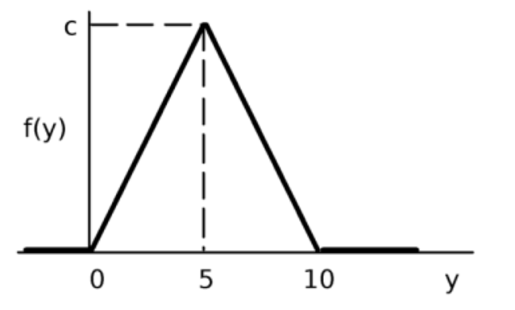

**2.2** נתונה פונקציית הצפיפות שבאיור.
א. מצאו את c.
ב. פונקציית ההתפלגות המצטברת.
ג. P(1.0 ≤ X ≤ 5.0), P(X ≥ 2.0), P(X ≥ 4).

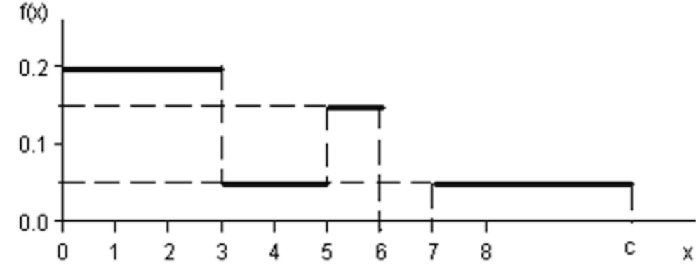

**2.3** f(x) = x²/4 עבור 1 ≤ x ≤ 2, ו-f(x) = kx עבור 2 < x ≤ 3.
א. מצאו את k.
ב. פונקציית ההתפלגות המצטברת.
ג. P(X > 2.5).

**2.4** לכל אחת משלוש ההיסטוגרמות (איור) — איזו משפחת התפלגות סבירה? נמקו.

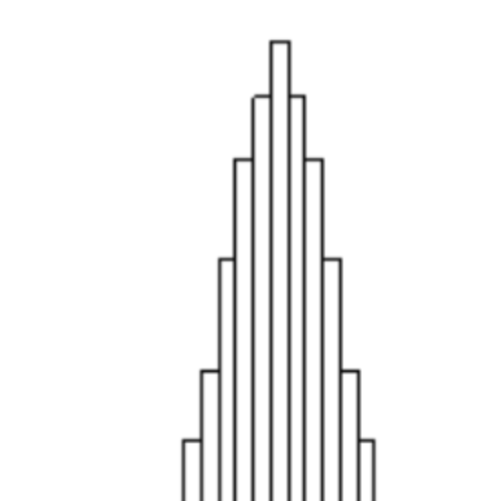 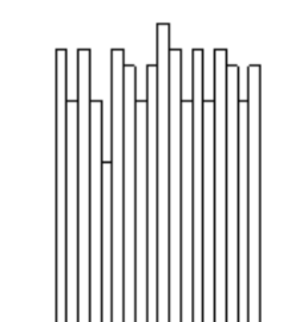 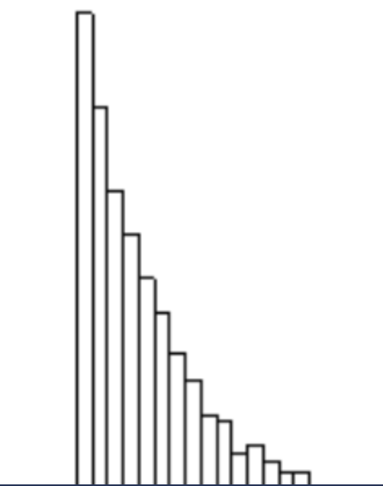

**2.5** נתונים זמני בין-הגעות (דקות): 2.1, 0.4, 5.3, 1.1, 0.9. הניחו התפלגות מעריכית וחשבו אנ"מ ל-λ.

### שיפוט

**2.6 איזו משפחה?**
לכל מצב — איזו משפחת התפלגות הייתם בוחרים (אחיד / מעריכי / נורמלי / פואסון / בינומי / אחר), ולמה? ומה הטיעון הטוב ביותר *נגד* הבחירה שלכם?
- זמן בין אוטובוסים בתחנה ללא לוח זמנים
- ציוני בחינה בקורס גדול
- מספר שגיאות כתיב בעמוד
- זמן שירות בדלפק בנק
- מספר לקוחות שנכנסים לחנות בשעה
- זמן עד תקלה בנורה

**2.7 טנקים גרמניים.**
אתם בריטים במלחמת העולם השנייה. ראיתם ארבעה טנקים גרמניים עם המספרים הסידוריים 14, 31, 55, 71. כמה טנקים יש לאויב? כתבו מספר ונימוק.

**2.8 פרדוקס ההמתנה.**
אוטובוסים מגיעים לתחנה בממוצע כל 10 דקות, לפי תהליך פואסון. אתם מגיעים לתחנה ברגע אקראי. כמה תחכו בממוצע — 5 דקות? 10? משהו אחר? נמקו.

**2.9 ציד באגים.**
סטודנטית מדדה זמני שירות בדלפק, קיבלה ממוצע 3 דקות וסטיית תקן 2 דקות, והתאימה התפלגות נורמלית N(3, 2²). הסימולציה שלה רצה. מה הבעיה, ואיך היה צריך לגלות אותה *לפני* שהריצה?

### אתגר

**2.10** נתונה משפחת הצפיפויות f_{θ}(x) = θx^{θ−1} על הקטע [0,1], עם פרמטר חיובי θ.
א. גזרו את אנ"מ ל-θ מתוך מדגם x₁,…,xₙ.
ב. (הצצה לשיעור 4) מצאו את F(x) והציעו דרך לדגום מ-X בעזרת U~U(0,1).
ג. בפייתון: קבעו θ=2, דגמו n ערכים, אמדו, וחזרו 1000 פעמים. ציירו את ההטיה הממוצעת של האומד כפונקציה של n עבור n=5,10,20,50,100. מה אתם רואים?

---

## שיעור 3 — מבחני טיב התאמה

### מצגת — טבלאות

#### חי־בריבוע: נקודות קריטיות (ν = 1–17)
$γ = P(Y_{ν} ≤ χ^{2}_{ν,γ})$, כאשר ל-$Y_{ν}$ התפלגות חי־בריבוע עם ν דרגות חופש.

| ν | 0.250 | 0.500 | 0.750 | 0.900 | 0.950 | 0.975 | 0.990 |
|---|---|---|---|---|---|---|---|
| **1** | 0.102 | 0.455 | 1.323 | 2.706 | 3.841 | 5.024 | 6.635 |
| **2** | 0.575 | 1.386 | 2.773 | 4.605 | 5.991 | 7.378 | 9.210 |
| **3** | 1.213 | 2.366 | 4.108 | 6.251 | 7.815 | 9.348 | 11.345 |
| **4** | 1.923 | 3.357 | 5.385 | 7.779 | 9.488 | 11.143 | 13.277 |
| **5** | 2.675 | 4.351 | 6.626 | 9.236 | 11.070 | 12.833 | 15.086 |
| **6** | 3.455 | 5.348 | 7.841 | 10.645 | 12.592 | 14.449 | 16.812 |
| **7** | 4.255 | 6.346 | 9.037 | 12.017 | 14.067 | 16.013 | 18.475 |
| **8** | 5.071 | 7.344 | 10.219 | 13.362 | 15.507 | 17.535 | 20.090 |
| **9** | 5.899 | 8.343 | 11.389 | 14.684 | 16.919 | 19.023 | 21.666 |
| **10** | 6.737 | 9.342 | 12.549 | 15.987 | 18.307 | 20.483 | 23.209 |
| **11** | 7.584 | 10.341 | 13.701 | 17.275 | 19.675 | 21.920 | 24.725 |
| **12** | 8.438 | 11.340 | 14.845 | 18.549 | 21.026 | 23.337 | 26.217 |
| **13** | 9.299 | 12.340 | 15.984 | 19.812 | 22.362 | 24.736 | 27.688 |
| **14** | 10.165 | 13.339 | 17.117 | 21.064 | 23.685 | 26.119 | 29.141 |
| **15** | 11.037 | 14.339 | 18.245 | 22.307 | 24.996 | 27.488 | 30.578 |
| **16** | 11.912 | 15.338 | 19.369 | 23.542 | 26.296 | 28.845 | 32.000 |
| **17** | 12.792 | 16.338 | 20.489 | 24.769 | 27.587 | 30.191 | 33.409 |

#### חי־בריבוע: נקודות קריטיות (ν = 18–100)
$γ = P(Y_{ν} ≤ χ^{2}_{ν,γ})$; עבור ν גדול משתמשים בקירוב.

| ν | 0.250 | 0.500 | 0.750 | 0.900 | 0.950 | 0.975 | 0.990 |
|---|---|---|---|---|---|---|---|
| **18** | 13.675 | 17.338 | 21.605 | 25.989 | 28.869 | 31.526 | 34.805 |
| **19** | 14.562 | 18.338 | 22.718 | 27.204 | 30.144 | 32.852 | 36.191 |
| **20** | 15.452 | 19.337 | 23.828 | 28.412 | 31.410 | 34.170 | 37.566 |
| **21** | 16.344 | 20.337 | 24.935 | 29.615 | 32.671 | 35.479 | 38.932 |
| **22** | 17.240 | 21.337 | 26.039 | 30.813 | 33.924 | 36.781 | 40.289 |
| **23** | 18.137 | 22.337 | 27.141 | 32.007 | 35.172 | 38.076 | 41.638 |
| **24** | 19.037 | 23.337 | 28.241 | 33.196 | 36.415 | 39.364 | 42.980 |
| **25** | 19.939 | 24.337 | 29.339 | 34.382 | 37.652 | 40.646 | 44.314 |
| **26** | 20.843 | 25.336 | 30.435 | 35.563 | 38.885 | 41.923 | 45.642 |
| **27** | 21.749 | 26.336 | 31.528 | 36.741 | 40.113 | 43.195 | 46.963 |
| **28** | 22.657 | 27.336 | 32.620 | 37.916 | 41.337 | 44.461 | 48.278 |
| **29** | 23.567 | 28.336 | 33.711 | 39.087 | 42.557 | 45.722 | 49.588 |
| **30** | 24.478 | 29.336 | 34.800 | 40.256 | 43.773 | 46.979 | 50.892 |
| **40** | 33.660 | 39.335 | 45.616 | 51.805 | 55.758 | 59.342 | 63.691 |
| **50** | 42.942 | 49.335 | 56.334 | 63.167 | 67.505 | 71.420 | 76.154 |
| **75** | 66.417 | 74.334 | 82.858 | 91.061 | 96.217 | 100.839 | 106.393 |
| **100** | 90.133 | 99.334 | 109.141 | 118.498 | 124.342 | 129.561 | 135.807 |

#### קולמוגורוב־סמירנוב: ערכים קריטיים מתוקנים
| מקרה | סטטיסטי מתוקן | 0.850 | 0.900 | 0.950 | 0.975 | 0.990 |
|---|---|---|---|---|---|---|
| כל הפרמטרים ידועים | $(√n + 0.12 + 0.11/√n)·D_{n}$ | 1.138 | 1.224 | 1.358 | 1.480 | 1.628 |
| $N(X̄(n), S^{2}(n))$ | $(√n − 0.01 + 0.85/√n)·D_{n}$ | 0.775 | 0.819 | 0.895 | 0.955 | 1.035 |
| $expo(X̄(n))$ | $(D_{n} − 0.2/n)·(√n + 0.26 + 0.5/√n)$ | 0.926 | 0.990 | 1.094 | 1.190 | 1.308 |

העמודות: $1 − α$.


### חימום

**3.1** נמדדו 40 ערכים וחולקו ל-5 תאים ברוחב 1 על הקטע [0,5]. השכיחויות הנצפות: 11, 6, 9, 4, 10.
הריצו מבחן χ² ברמת ביטחון 90% לבדיקת ההשערה שהנתונים מתפלגים U(0,5).

**3.2** נתונים 5 ערכים (ממוינים): 0.3, 1.6, 2.4, 3.5, 4.7.
הריצו מבחן קולמוגורוב-סמירנוב ברמת ביטחון 90% לבדיקת ההשערה שהם מתפלגים U(0,5).

### שיפוט

**3.3 טוב מדי?**
סטודנטית הביאה 20 מדידות: 0.5, 1.5, 2.5, 3.5, 4.5, 0.1, 1.1, 2.1, 3.1, 4.1, 0.9, 1.9, 2.9, 3.9, 4.9, 0.2, 1.2, 2.2, 3.2, 4.2. היא הריצה χ² מול U(0,5) עם 5 תאים וקיבלה סטטיסטי 0 בדיוק. "התאמה מושלמת!"
האם זו בשורה טובה? מה ההתפלגות של סטטיסטי χ² *כשההשערה נכונה*, ומה הסיכוי לקבל בדיוק 0?

**3.4 מלחמת התאים.**
נתונות 40 מדידות על הקטע [0,5]. שלוש סטודנטיות הריצו עליהן χ² מול U(0,5): אחת עם 2 תאים, אחת עם 5, אחת עם 10.
מי צודק? האם המסקנה יכולה להשתנות בין השלוש? מה בעצם קובע כמה תאים "מותר"?

**3.5 "המבחן עבר — המודל תקין".**
סטודנטית מדדה 3 זמני שירות, הריצה K-S מול מעריכי ברמת 90%, המבחן לא דחה, והיא כתבה בדו"ח: "ההתפלגות המעריכית אומתה סטטיסטית."
האם המשפט נכון? מה מבחן טיב התאמה *כן* אומר כשהוא לא דוחה, ומה הוא *לא* אומר?

**3.6 χ² נגד K-S.**
לכל מצב — איזה מבחן מתאים יותר, ולמה?
- מספר לקוחות ביום, נתונים בדידים 0–12
- 15 זמני שירות רציפים
- 50,000 זמני בין-הגעות מקובץ לוג של שרת
- זמני שירות רציפים, כאשר את λ אמדתם *מאותם נתונים*

**3.7 ציד באגים.**
סטודנטית רצתה לבדוק אם זמני השירות שמדדה מתפלגים מעריכית. היא אמדה את λ מהנתונים, חילקה את הנתונים ל-6 תאים, חישבה את סטטיסטי χ², השוותה לערך הקריטי עם 5 דרגות חופש, והסיקה שההשערה לא נדחית.
בנוסף, חברתה הריצה K-S על 50,000 תצפיות אמיתיות, המבחן דחה כל התפלגות שניסתה, והיא כתבה: "לא קיימת התפלגות מתאימה, אי אפשר לבנות סימולציה."
מצאו את הטעות של כל אחת מהן.

### אתגר

**3.8** הניסוי: דוגמים n ערכים מ-Exp(1), אומדים λ מהנתונים, ומריצים χ² ו-K-S ברמת α=0.1 מול Exp(λ̂). חוזרים 1000 פעמים ורושמים את שיעור הדחיות. וכך עבור n = 10, 30, 100, 300, 1000.
א. לפני שכותבים שורת קוד: מה לדעתכם יצא? איזה שיעור דחיות "אמור" להתקבל אם המבחן תקין, והאם הוא ישתנה עם n? שרטטו ניחוש של הגרף.
ב. עכשיו כתבו את זה בפייתון וציירו את הגרף האמיתי. איפה הניחוש צדק ואיפה לא, ובאיזה מבחן?
ג. הסבירו את הפער. (רמז: מה קורה לערכים הקריטיים של K-S כשהפרמטר נאמד מאותו מדגם?)

---

## שיעור 4 — אלגוריתמי דגימה א

### חימום

**4.1** X בדיד עם P(3)=½, P(5)=P(6)=¼. כתבו אלגוריתם דגימה ל-X.

**4.2** X רציף עם פונקציית הצפיפות שבאיור. כתבו אלגוריתם דגימה בשיטת הטרנספורם ההופכי.

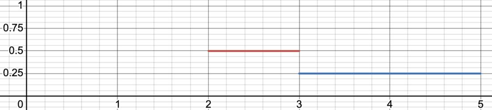

**4.3** X רציף עם f(x)=x/2 עבור 0 ≤ x ≤ 2. כתבו אלגוריתם דגימה.

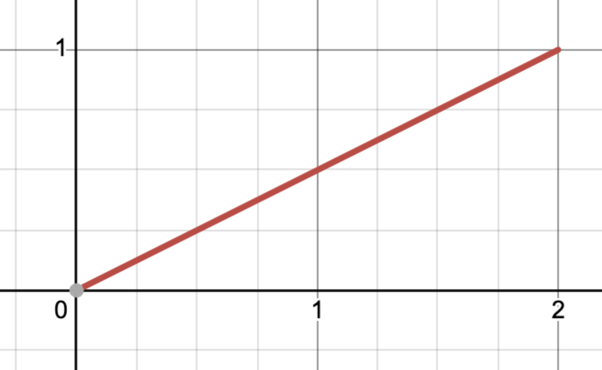

**4.4** X רציף עם f(x)=2−2x עבור 0 ≤ x ≤ 1. כתבו אלגוריתם דגימה בשיטת הטרנספורם ההופכי.

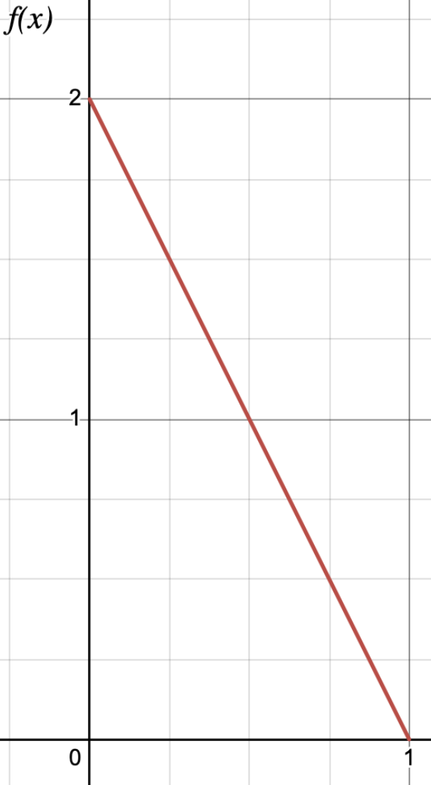

**4.5** X רציף עם f(x)=2(x+2) עבור −2 ≤ x ≤ −1. כתבו אלגוריתם דגימה.

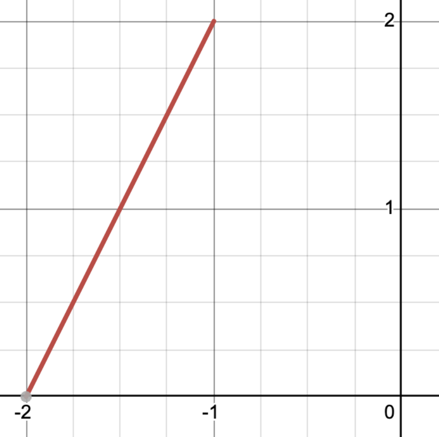

**4.6** X ~ U(0,2). Y בדיד עם P(1)=P(10)=¼, P(2)=½. כתבו אלגוריתם דגימה ל-Y שמשתמש *רק* באלגוריתם דגימה ל-X.

**4.7** Y בדיד עם P(1)=P(10)=¼, P(2)=½. Z בדיד עם P(10)=P(21)=½. כתבו אלגוריתם דגימה ל-Z שמשתמש *רק* באלגוריתם דגימה ל-Y.

### שיפוט

**4.8 לה ביסקוט** (שאלה ממבחן).
קונדיטוריית "לה ביסקוט" מייצרת קינוחים בשני מטבחים: 60% במטבח הלונדוני, 40% בפריזאי. במטבח הלונדוני זמן ההכנה מתפלג U(20,40) דקות. במטבח הפריזאי זמן ההכנה מתפלג לפי הצפיפות f(t) = t/50 עבור 0 ≤ t ≤ 10.

א. פתחו אלגוריתם דגימה לזמן ההכנה של קינוח, ללא קבלה-דחייה.
ב. סטודנטית א' משתמשת בשני מספרים אקראיים לכל דגימה. סטודנטית ב' טוענת שמספיק אחד: "אם u<0.6, אז u/0.6 הוא בעצמו אחיד על (0,1) — נשתמש בו שוב." מי צודק?
ג. מתי מותר "למחזר" מספר אקראי, ומתי זה מקלקל את הדגימה?

**4.9 הטרנספורם ההופכי תמיד מנצח?**
לכל מקרה — איזו שיטה עדיפה, טרנספורם הופכי או קומפוזיציה, ולמה?
א. f(x) = 2−2x על [0,1].
ב. f(x) = x⁴/8 + x³/4 + x²/2 + 179/240 עבור 0 ≤ x ≤ 1.
ג. משתנה בדיד עם מיליון ערכים אפשריים.
ד. משתנה בדיד עם שני ערכים.

**4.10 האם האלגוריתם נכון?**
*מטרה:* X בדיד עם P(3)=½, P(5)=P(6)=¼.
*האלגוריתם:* דגום u. אם u<0.5 החזר 3. אחרת: דגום v; אם v<0.5 החזר 5, אחרת החזר 6.
האם האלגוריתם דוגם נכון מההתפלגות המבוקשת? אם לא — מאיזו התפלגות הוא דוגם בפועל?

**4.11 שני אחידים.**
לכל אלגוריתם — האם הוא דוגם נכון מההתפלגות המבוקשת? אם לא — מאיזו התפלגות הוא דוגם בפועל?
א. *מטרה:* U(1,3). דגום u₁, u₂. החזר 1 + 2·max(u₁, u₂).
ב. *מטרה:* U(0,1). דגום u₁, u₂. החזר (u₁+u₂)/2.

**4.12 מינוס שורש.**
*מטרה:* f(x)=2−2x על [0,1].
*האלגוריתם:* דגום u. החזר 1 − √u.
האם האלגוריתם דוגם נכון מההתפלגות המבוקשת? אם לא — מאיזו התפלגות הוא דוגם בפועל?

**4.13 מקוביה מוטה לכל דבר.**
בידיכם רק אלגוריתם דגימה ל-Y בדיד עם P(1)=P(10)=¼, P(2)=½ (שלושה ערכים, לא סימטרי). טענה: "אפשר לייצר ממנו U(0,1) מדויק, ולכן כל התפלגות שהיא." האם הטענה נכונה? אם כן — איך? אם לא — מה חסר?

### אתגר

**4.14** עבור הצפיפות f(x) = x⁴/8 + x³/4 + x²/2 + 179/240 על [0,1]:
א. כתבו אלגוריתם דגימה בשיטת הקומפוזיציה. כמה מספרים אקראיים הוא צורך בממוצע לדגימה?
ב. כתבו אלגוריתם בטרנספורם הופכי (F(x) פולינום ממעלה 5 — פתרו נומרית).
ג. בפייתון: ממשו את שניהם, דגמו 100,000 פעמים מכל אחד, השוו היסטוגרמות לצפיפות, ומדדו זמן ריצה. מי ניצח, ולמה?

---

## שיעור 5 — אלגוריתמי דגימה ב
בסוף השיעור, אחרי שנסיים עם אלגוריתמי דגימה: מצגת על MCMC.

### חימום

**5.1** בכד 5 כדורים ממוספרים 1–5. בשלב הראשון נבחר כדור באקראי. אם מספרו זוגי — זהו המספר הסופי. אם אי-זוגי — מוציאים כדור נוסף, ומספרו הוא המספר הסופי. כתבו אלגוריתם דגימה שמדמה את התהליך.

**5.2** X עם צפיפות f(x) = 1.5x² + x עבור 0 < x < 1. כתבו אלגוריתם דגימה בשיטת הקומפוזיציה.

**5.3** בחנות 70% תפוחים ו-30% תפוזים. משקל תפוח ~ U(3,5), משקל תפוז ~ U(4,8). כתבו אלגוריתם דגימה למשקל של פרי אקראי:
א. בשיטת קבלה-דחייה. מה שיעור הקבלה?
ב. בשיטת הקומפוזיציה.

**5.4** X רציף עם פונקציית הצפיפות שבאיור. כתבו אלגוריתם דגימה.

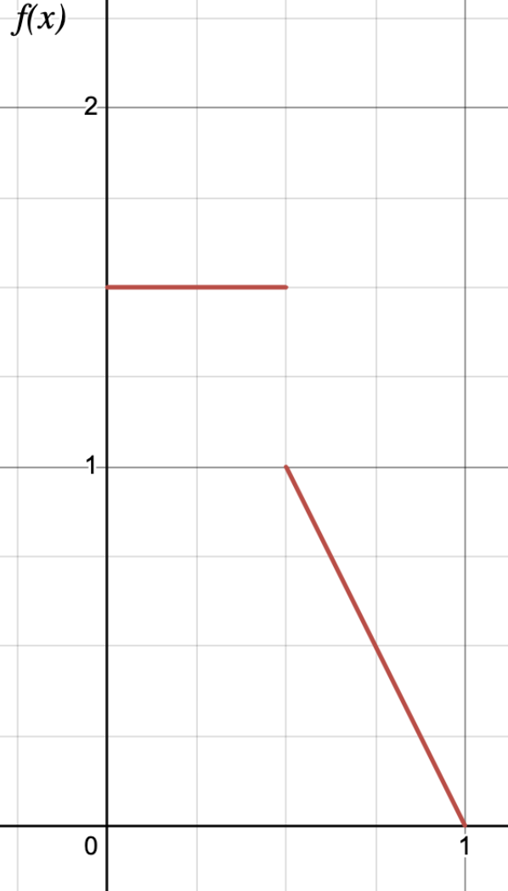

**5.5** הריצו 3 צעדים של LCG(a=3, c=0, m=32, z₀=1).

**5.6** מה אורך המחזור של LCG(a=1, c=512, m=1024, z₀=1)?

### שיפוט

**5.7 מי מהיר יותר?**
עבור f(x)=2−2x על [0,1] יש לנו שני אלגוריתמים: טרנספורם הופכי (x = 1−√u) וקבלה-דחייה עם פונקציה חוסמת קבועה 2.
א. כמה מספרים אקראיים צורך כל אחד בממוצע?
ב. על מחשב אמיתי — מי לדעתכם מהיר יותר, ולמה?
ג. האם יש פונקציה חוסמת טובה יותר מקבוע 2? מה זה בכלל אומר "פונקציה חוסמת טובה"?

**5.8 האם כל צפיפות ניתנת לדגימה בקבלה-דחייה?**
לכל מקרה: האם קבלה-דחייה עובדת? האם טרנספורם הופכי עובד? מה אפשר ומה אי אפשר?
א. Exp(1) על [0,∞). מהי הפונקציה החוסמת?
ב. f(x) = 1/(2√x) על (0,1).
ג. f(x) ∝ exp(−x⁴) על ℝ — הקבוע המנרמל לא ידוע לכם.

**5.9 מחזור מלא = מחולל טוב?**
א. LCG(a=4, c=1, m=9, z₀=1). מה אורך המחזור?
ב. LCG(a=1, c=1, m=16, z₀=0). מה אורך המחזור?
ג. שני המחוללים הגיעו לאורך מחזור מקסימלי. האם שניהם טובים באותה מידה לסימולציה? מה עוד נדרש ממחולל, מעבר לאורך מחזור?

**5.10 מלחמת הסידים.**
משווים שתי חלופות של מערכת. סטודנטית א' הריצה את שתיהן עם seed=42. סטודנטית ב': "טעות — צריך סידים שונים, אחרת ההרצות תלויות." סטודנטית ג': "להפך — אותו סיד זה בדיוק מה שצריך." מי צודק, ולמה?

**5.11 אקראיות אמיתית.**
המחולל שלכם עובר כל מבחן סטטיסטי שניסיתם. מציעים לכם במקומו רכיב חומרה שמייצר אקראיות אמיתית מרעש תרמי. מה תעדיפו לסימולציה, ולמה?

### מצגת — MCMC

####
!! מונטה קרלו מרקוב צ'יין

נמרוד טלמון

#### האלגוריתמים הכי חשובים במאה ה-20
| שנה | אלגוריתם |
|---|---|
| 1946 | The Metropolis Algorithm |
| 1947 | Simplex Method |
| 1950 | Krylov Subspace Method |
| 1951 | The Decompositional Approach to Matrix Computations |
| 1957 | The Fortran Optimizing Compiler |
| 1959 | QR Algorithm |
| 1962 | Quicksort |
| 1965 | Fast Fourier Transform |
| 1977 | Integer Relation Detection |
| 1987 | Fast Multipole Method |

#### מונטה קרלו מרקוב צ'יין
!! אלגוריתם דגימה להתפלגויות רב־ממדיות

#### התפלגויות חד־ממדיות
בהרצאות הקודמות למדנו דגימה מהתפלגות חד־ממדית.

> ✅ כל השיטות עובדות יפה עבור משתנה אחד

#### התפלגויות רב־ממדיות
לפעמים צריך לדגום מהתפלגויות רב־ממדיות:
- לדגום "מערכת בחירות"
- לדגום "קיפול חלבונים"
- לדגום "תמונה טבעית"
- לדגום "תרחיש מניות"
- …

#### למה השיטות שלנו לא מתאימות
**❌ שיטת ההופכי (Inverse CDF):**
- צריך לחשב אינטגרל על כל המרחב, ואז להפוך אותו.
- בממד אחד — קל. ב-1000 ממדים — אינטגרל על מרחב בגודל $10^{1000}$. בהצלחה.

#### למה השיטות שלנו לא מתאימות
**❌ שיטת ההרכבה (Composition):**
- דורשת פירוק ההתפלגות לסכום של התפלגויות פשוטות.
- ברוב המקרים הרב־ממדיים אין לנו מושג איך לעשות את זה.

#### למה השיטות שלנו לא מתאימות
**❌ קבלה–דחייה (Rejection Sampling):**
- צריך התפלגות "עוטפת" שמכסה את ההתפלגות שלנו.
- בממדים גבוהים, היחס בין הנפחים הולך ל-0 בקצב מעריכי.
- בפועל: נדחה 99.9999…% מהדגימות.
- (האזור המקבל קטן אקספוננציאלית בממד)

#### מה צריך?
!! שיטה חדשה

#### הרעיון העיקרי
!! במקום לדגום "וואן שוט" — נטייל


#### הרעיון העיקרי
- 🚫 במקום "דגום לי נקודה אקראית מההתפלגות" — דורש ידע גלובלי על כל המרחב.
- ✅ נתחיל מאיפשהו, ונעשה טיול אקראי במרחב. בכל צעד נחליט אם להתקדם או להישאר במקום. אם הטיול מתוכנן נכון — המסלול שלנו "יבקר" באזורים בדיוק בתדירות הנכונה!
- 🎯 **האינטואיציה:** דמיינו תייר שמטייל בעיר בלי מפה. הוא מגיע לצומת, מציץ ברחובות היוצאים, ובוחר לאן ללכת. אם הוא נוטה ללכת לאזורים "מעניינים" יותר — עם הזמן הוא יבלה יותר באזורים האלה.

> 💡 **הקסם:** צריך רק להסתכל סביבנו — לא צריך להכיר את כל העיר!

#### רענון — שרשרת מרקוב
- **הרעיון הבסיסי:** תהליך אקראי שמקפץ בין מצבים. ההסתברות לעבור למצב הבא תלויה רק במצב הנוכחי — לא בהיסטוריה.
- 🌐 **דוגמה: PageRank (גוגל).** גולש אקראי מסתובב באינטרנט. בכל דף הוא בוחר באקראי אחד מהקישורים ולוחץ עליו. הגולש לא זוכר איפה היה קודם — רק רואה את הדף הנוכחי ובוחר לאן להמשיך.
- 🔑 **המושג החשוב: התפלגות סטציונרית (Stationary Distribution).** אם הגולש ימשיך לגלוש מספיק זמן, הוא "יתייצב": ההסתברות להיות בכל דף מתכנסת לערך קבוע.
- 📊 **בדוגמת PageRank:** דפים עם הרבה קישורים נכנסים יקבלו יותר ביקורים. ההתפלגות הסטציונרית היא בדיוק ה"חשיבות" של כל דף — וככה גוגל מדרגת תוצאות!

#### הרעיון — "להנדס" שרשרת
- 🌐 **מה קרה ב-PageRank?** מבנה הרשת (מי מקשר למי) היה נתון מראש. ההתפלגות הסטציונרית נקבעה כתוצאה מהמבנה. גוגל רק חישבה מה יוצא.
- 🔄 **מה אנחנו רוצים? בדיוק הפוך!** יש לנו התפלגות שאנחנו רוצים לדגום ממנה. צריך לבנות שרשרת מרקוב שההתפלגות הסטציונרית שלה היא בדיוק ההתפלגות הזו.
- 🎯 **התוכנית:** ניצור כללי קפיצה חכמים, כך שאם נטייל מספיק זמן — המקומות שנבקר בהם יתפלגו בדיוק לפי ההתפלגות שרצינו.

> ❓ **השאלה:** איך בונים את כללי הקפיצה האלה?

#### איך לטייל על התפלגות?
- 🤔 **הבעיה:** שרשרת מרקוב קופצת בין מצבים. אבל התפלגות רציפה היא על מרחב אינסופי של נקודות!
- 💡 **הפתרון: טיול בצעדים קטנים.** בכל שלב:
  - אנחנו נמצאים בנקודה כלשהי x במרחב
  - מציעים לזוז לנקודה שכנה y (רעש קטן)
  - מחליטים: לקבל את ההצעה ולזוז, או להישאר במקום?
- 🎯 **המטרה:** לבנות את כלל ההחלטה (מתי לקבל? מתי לדחות?) כך שאם נטייל מספיק זמן — הנקודות שנבקר בהן יתפלגו בדיוק לפי ההתפלגות שרצינו.
- 📍 **במילים אחרות:** באזורים עם הסתברות גבוהה — נבקר הרבה; באזורים עם הסתברות נמוכה — מעט.


#### איך לטייל ולהתכנס להתפלגות?
- 🎯 **הרעיון הפשוט:** אם תמיד יותר קל "להיכנס" לאזור צפוף מאשר "לצאת" ממנו — נבלה שם יותר זמן!
- 🔑 **באלגוריתם שלנו:**
  - הצעה לאזור עם צפיפות גבוהה יותר? ← תמיד נקבל
  - הצעה לאזור עם צפיפות נמוכה יותר? ← לפעמים נקבל, לפעמים נדחה
- 📊 **התוצאה:** בממוצע, נבקר בכל אזור באופן פרופורציונלי לצפיפות שלו. וזה בדיוק מה שרצינו!

#### מטרופוליס
**מטרה:** לדגום מהתפלגות כלשהי. האלגוריתם:
- **אתחול:** בחרו נקודת התחלה כלשהי $x_{0}$
- **חזרו:**
  - **א. הציעו:** בחרו נקודה חדשה y באופן אקראי סביב x הנוכחי (למשל: רעש גאוסיאני). חייב להיות סימטרי: $p(y|x) = p(x|y)$
  - **ב. חשבו יחס:** $r = f(y) / f(x)$
  - **ג. החליטו:** אם $r ≥ 1$, קבלו את y (עברו ל-y); אם $r < 1$, קבלו את y בהסתברות r, אחרת הישארו ב-x

> האלגוריתם מחזיר סדרה של דגימות. זורקים את ההתחלה.

#### הדגמה
[MCMC demo: Random Walk Metropolis–Hastings](https://chi-feng.github.io/mcmc-demo/app.html?algorithm=RandomWalkMH&target=standard)

#### עוד הדגמה (ויש עוד אפליקציות)
[מטרופוליס על דיסקים](https://htmlpreview.github.io/?https://github.com/nimrodtalmon/teachingaids/blob/claude/add-metropolis-discs-html-SIc1a/metropolis-discs.html)

#### זמן חימום
- 🚀 **הבעיה:** התחלנו מנקודה כלשהי $x_{0}$ — אולי באזור עם הסתברות אפסית. הדגימות הראשונות מוטות לגמרי לפי איפה שהתחלנו.
- 🗑️ **הפתרון: זורקים את ההתחלה.**
  - מריצים את השרשרת
  - זורקים את N הראשונות (ה-"burn-in")
  - משתמשים רק בשאר
- 🤔 **כמה לזרוק?** אין תשובה מדויקת!
  - כלל אצבע: 10%–50% מהדגימות
  - בפועל: מסתכלים על trace plot ומחליטים

#### גודל צעד
- 🐻 **גדול מדי (σ גבוה):** הצעות רחוקות מהמצב הנוכחי; רוב ההצעות נוחתות באזורים עם הסתברות נמוכה; רוב ההצעות נדחות ← השרשרת "תקועה"
- 🐻 **קטן מדי (σ נמוך):** צעדים זעירים; רוב ההצעות מתקבלות, אבל… לוקח נצח לחקור את כל המרחב (לא נגיע לאזור מרוחק…)
- 🐻 **בדיוק נכון:** איזון בין קבלה לחקירה

> כלל אצבע: שאפו ל-25%–40% קבלה

#### שיפורים
- 🔧 **מטרופוליס–הייסטינגס (Metropolis–Hastings, 1970):** הכללה כשרוצים הצעות "חכמות" שמותאמות לצורת ההתפלגות (יכול להיות יעיל יותר).
- 🎯 **דגימת גיבס (Gibbs Sampling):** במקום להציע צעד בכל הממדים בו־זמנית — מעדכנים ממד אחד בכל פעם. יעיל מאוד כשיודעים לחשב את ההתפלגויות המותנות.
- 🚀 **מונטה קרלו המילטוני (Hamiltonian Monte Carlo):** משתמש בגרדיאנטים של ההתפלגות כדי "לגלוש" לכיוונים טובים. הרבה יותר יעיל בממדים גבוהים; הבסיס של ספריות מודרניות כמו Stan ו-PyMC.

#### מקום ראשון :)
| שנה | אלגוריתם |
|---|---|
| **1946** | **The Metropolis Algorithm** |
| 1947 | Simplex Method |
| 1950 | Krylov Subspace Method |
| 1951 | The Decompositional Approach to Matrix Computations |
| 1957 | The Fortran Optimizing Compiler |
| 1959 | QR Algorithm |
| 1962 | Quicksort |
| 1965 | Fast Fourier Transform |
| 1977 | Integer Relation Detection |
| 1987 | Fast Multipole Method |

####
!! מונטה קרלו מרקוב צ'יין

נמרוד טלמון

### אתגר

**5.12** בפייתון:
א. ממשו קבלה-דחייה למשקל של פרי אקראי — 70% תפוחים במשקל U(3,5) ו-30% תפוזים במשקל U(4,8) — עם פונקציה חוסמת קבועה. מדדו את שיעור הקבלה האמפירי והשוו לחישוב.
ב. תכננו פונקציה חוסמת מדרגתית (לא קבועה) והראו כמה שיעור הקבלה משתפר.
ג. ממשו LCG(a=3, c=0, m=32) וציירו את כל הזוגות (zᵢ, zᵢ₊₁) במישור. חזרו עם numpy.random. מה ההבדל, ולמה זה משנה?

---

## שיעור 6 — תכנות אירועים
מצגת. אין תרגילים.

אין פזמון. תרקדו.

### מצגת — תכנות אירועים

####
!! תכנות אירועים

נמרוד טלמון

#### פרדיגמת תכנות


#### פרדיגמת תכנות

!! תכנות אירועים!

> יש עוד אופציות…

#### תכנות אירועים — פילוסופיה
- מערכת (מודלים בדידים)
  - ישויות
  - משאבים
  - אירועים: משנים את מצב המערכת
  - בפרט, מצב המערכת מתואר על ידי פונקציית מדרגות

> אירועים משנים את מצב המערכת באופן "מיידי". **אירועים הם לב העניין!**

#### תכנות אירועים — רעיונות מרכזיים
- שעון סימולציה

> נרצה "להזיז את השעון" ולשנות את מצב המערכת בהתאם לאירועים


#### איך להזיז את השעון?
- אופציה אחת: באופן "רציף" — **בזבזני!**

#### דוגמה — כספומט (שעון "רציף")
```
QueueLength = 0
NJobsServed = 0
SumResidenceTimes = 0  ## מדד: זמן המתנה ממוצע
ServerBusy = false
generate NextArrivalTime   // random # generation  ## NextArrivalTime = X
NIncrements = MaxSimTime / 0.001
for SimTime = 1*0.001 to NIncrements*0.001 do  ## שעון "רציף"
   if SimTime = NextArrivalTime then  ## אירוע מסוג הגעה
      add new jobobject to queue
      QueueLength++
      generate NextArrivalTime   // random # generation
      if not ServerBusy then
         ServerBusy = true
         jobobject.ArrivalTime = SimTime
         generate ServiceFinishedtime  ## ServiceFinishedtime = Y
         currentjob = jobobject
         delete head of queue and assign to currentjob
         QueueLength--
   else
      if SimTime = ServiceFinishedtime then  ## אירוע מסוג סיום שירות
         NJobsServed++
         SumResidenceTimes += SimTime - currentjob.ArrivalTime  ## סוכם (למדד)
         if QueueLength > 0 then
            generate ServiceFinishedtime   // random # generation
            delete currentjob from queue
            QueueLength--
         else
            ServerBusy = false
print out SumResidenceTimes / NJobsServed
```

#### איך להזיז את השעון?
- אופציה אחת: באופן "רציף" — **בזבזני!**
- אופציה שנייה: לקפוץ לזמן של האירוע הבא — **!!!**

#### איך להזיז את השעון?
במקום השורה
```
for SimTime = 1*0.001 to NIncrements*0.001 do
```
!! נחליף!
```
if ServerBusy and NextArrivalTime < ServiceFinishedtime or
   not ServerBusy then
   SimTime = NextArrivalTime  ## קופצים לאירוע הבא
else
   SimTime = ServiceFinishedtime
```

#### איך להזיז את השעון?
- אופציה שנייה: לקפוץ לזמן של האירוע הבא — **!!!**

> **נשתמש ביומן אירועים כדי שהקסם יקרה:** אירועים עתידיים מסודרים לפי זמן!

- ביומן מחכים אירועים עתידיים, מסודרים לפי זמן
- נדע לקפוץ לאירוע הבא
- למשל, בדוגמת הכספומט: תמיד יש ביומן לפחות אירוע הגעה אחד, ולפעמים גם אירוע סיום שירות אחד
- מימוש: priority heap


#### דוגמה
אולי הדוגמה הכי פשוטה: תור בודד
- פקיד יחיד בבנק; לקוחות מגיעים באופן בלתי תלוי (למשל, מעריכי), וזמן השירות גם בלתי תלוי (למשל, אחיד בין 3 ל-4)
- **חשוב לזכור סיום!** למשל: יום עבודה של 8 שעות
- **חשוב לזכור מטרות!!!** למשל:
  - זמן המתנה ממוצע בתור (ללקוח)
  - אורך תור ממוצע (בזמן)
  - ניצולת שרת


#### דוגמה
בשביל להבין מה קורה:
- **מהן הישויות במערכת?**
+ לקוחות
- **מהם המשאבים במערכת?**
+ פקיד
- **מהו המצב של המערכת?**
+ האם השרת תפוס? מה יש בתור?
- **אילו אירועים יש?**
+ הגעת לקוח, סיום שירות


#### דוגמה — מה צריך טכנית?
- שעון (לזכור את הזמן "עכשיו")
- יומן אירועים (שיכיל אירועים עתידיים)
- **משתני מצב:**
  - משתנה בינארי "מצב שרת"
  - משתנה רשימה "תוכן התור"
- סוכמים:
  - זמני המתנה עד עכשיו
  - אורך התור עד עכשיו
  - ניצולת עד עכשיו
- קבועים:
  - זמן סיום (למשל, כשהשעון על 8·60)

#### דוגמה כללית — לולאה ראשית
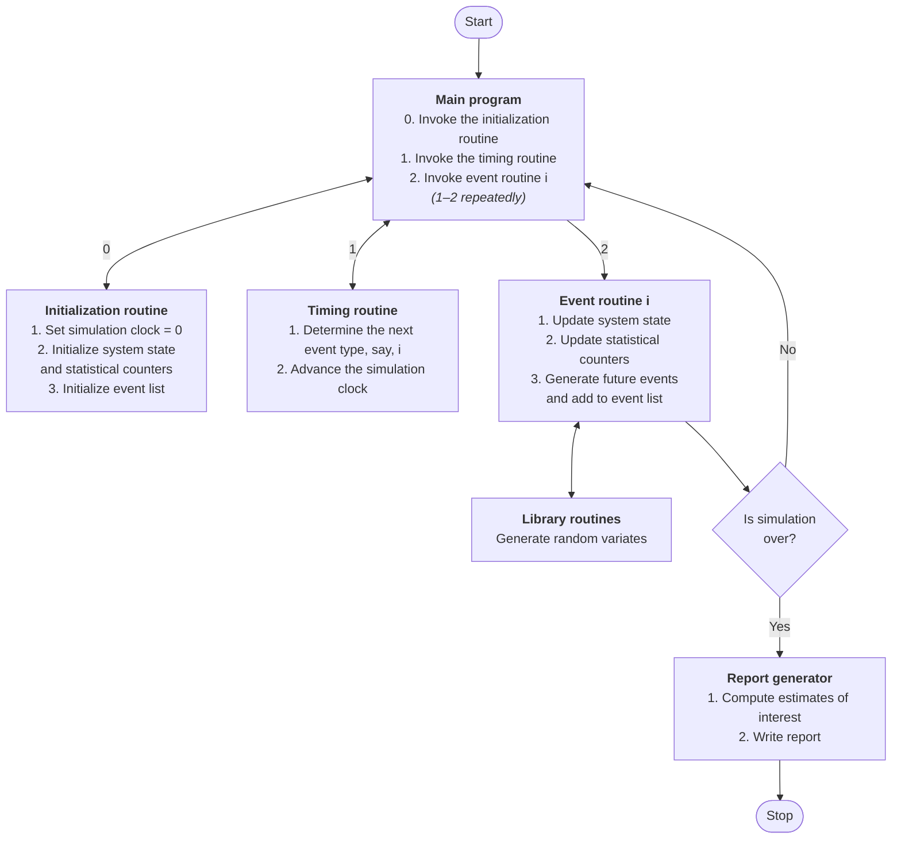

#### דוגמת שרת בודד — אירועים
| תיאור האירוע | סוג האירוע |
|---|---|
| הגעת לקוח למערכת | 1 |
| יציאת לקוח מהמערכת לאחר סיום השירות | 2 |

> **אירועים משנים את מצב המערכת**

> כלל אצבע: סיום שירות עדיף על כניסה לשירות (ובכל מקרה, אירוע הוא נקודה בזמן, לא משהו מתמשך)

#### דוגמה — טיפול **באירוע** הגעת לקוח
> מה יקרה עם הלקוח השני?
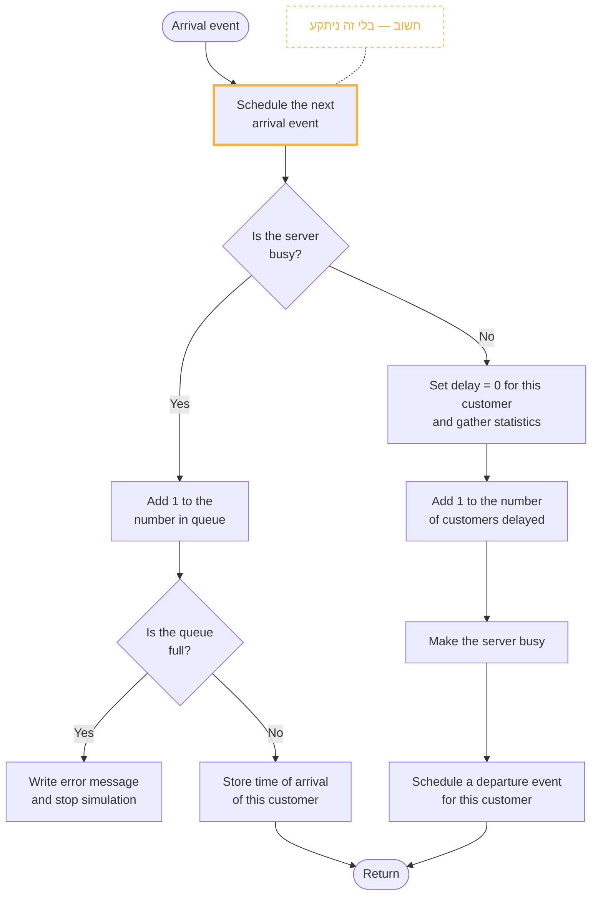

#### דוגמה — טיפול **באירוע** סיום שירות


#### דוגמה — לולאה ראשית
| תיאור האירוע | סוג האירוע |
|---|---|
| הגעת לקוח למערכת | 1 |
| יציאת לקוח מהמערכת לאחר סיום השירות | 2 |
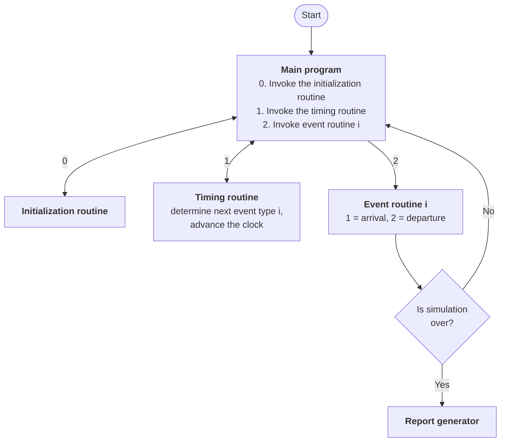

#### דוגמה — הרצה
- הרצת שרת יחיד עם תור, למשך 5 דקות
- זמן בין הגעות מעריכי עם תוחלת 3 דקות
- משך השירות אחיד בין 2 ל-3 דקות

#### דוגמה — הרצה
> **Q(t)**: אורך תור ממוצע (בזמן) · **B(t)**: ניצולת שרת (ממוצע בזמן) · **סך עיכוב**: בשביל זמן המתנה ממוצע (בלקוחות)

| אירוע | שעון | מצב שרת | בתור | זמני הגעה בתור | זמן אירוע אחרון | הגעה הבאה (A) | יציאה הבאה (D) | עוכבו | סך עיכוב | שטח מתחת Q | שטח מתחת B |
|---|---|---|---|---|---|---|---|---|---|---|---|
|+ אתחול | 0 | 0 | 0 | — | 0 | 0.4 | ∞ | 0 | 0 | 0 | 0 |
|+ הגעה | 0.4 | 1 | 0 | — | 0.4 | 1.6 | 2.4 | 1 | 0 | 0 | 0 |
|+ הגעה | 1.6 | 1 | 1 | 1.6 | 1.6 | 2.1 | 2.4 | 1 | 0 | 0 | 1.2 |
|+ הגעה | 2.1 | 1 | 2 | 1.6, 2.1 | 2.1 | 3.8 | 2.4 | 1 | 0 | 0.5 | 1.7 |
|+ יציאה | 2.4 | 1 | 1 | 2.1 | 2.4 | 3.8 | 3.1 | 2 | 0.8 | 1.1 | 2.0 |
|+ יציאה | 3.1 | 1 | 0 | — | 3.1 | 3.8 | 3.3 | 3 | 1.8 | 1.8 | 2.7 |
|+ יציאה | 3.3 | 0 | 0 | — | 3.3 | 3.8 | ∞ | 3 | 1.8 | 1.8 | 2.9 |
|+ הגעה | 3.8 | 1 | 0 | — | 3.8 | 4.0 | 4.9 | 4 | 1.8 | 1.8 | 2.9 |
|+ הגעה | 4.0 | 1 | 1 | 4.0 | 4.0 | 5.6 | 4.9 | 4 | 1.8 | 1.8 | 3.1 |
|+ יציאה | 4.9 | 1 | 0 | — | 4.9 | 5.6 | 8.6 | 5 | 2.7 | 2.7 | 4.0 |
|+ הגעה | 5.6 | 1 | 1 | 5.6 | 5.6 | 5.8 | 8.6 | 5 | 2.7 | 2.7 | 4.7 |
|+ הגעה | 5.8 | 1 | 2 | 5.6, 5.8 | 5.8 | 7.2 | 8.6 | 5 | 2.7 | 2.9 | 4.9 |
|+ הגעה | 7.2 | 1 | 3 | 5.6, 5.8, 7.2 | 7.2 | 9.1 | 8.6 | 5 | 2.7 | 5.7 | 6.3 |
|+ יציאה | 8.6 | 1 | 2 | 5.8, 7.2 | 8.6 | 9.1 | 9.2 | 6 | 5.7 | 9.9 | 7.7 |

#### דוגמה — מדד בזמן: אורך התור
@svg slides/svg/q-of-t.svg

> **פונקציית מדרגות!** רק אירועים משנים את המצב!

#### דוגמה — מדד בזמן: ניצולת השרת
@svg slides/svg/b-of-t.svg

> **פונקציית מדרגות!** רק אירועים משנים את המצב!

#### שיטת חמשת השלבים


#### חמשת השלבים
- שלב 1 — הבנת המודל (פישוט טקסט)
- שלב 2 — מטרות (ארגון, פרויקט, סימולציה)
- שלב 3 — אירועים (תרשים עיגולים)
- שלב 4 — משתנים (מה צריך לדעת)
- שלב 5 — תרשימי זרימה (פסאודוקוד)

> צריך לדעת מהן הישויות, המשאבים, התהליכים; שימושי להבין מה זה "מצב" (מה צריך לזכור); מהם המשתנים וה"סוכמים" (נובעים מהמדדים); להבין מה האירועים ומה הקשרים ביניהם — ואז לכתוב את הקוד.

#### תרשים אירועים (עיגולים)
דרך אלגנטית להבין את האירועים: הצגה בתור גרף מכוון.
- אירוע — קודקוד (עיגול)
- קשת זיגזג — אירוע שמאותחל
- קשת מכוונת מודגשת — אירוע שיוצר אירוע אחר

@svg slides/svg/eg-basic.svg

#### תרשים אירועים (עיגולים)
- אירוע — קודקוד (עיגול)
- קשת מכוונת מודגשת — אירוע שיכול ליצור אירוע, לאו דווקא מייד
- קשת מכוונת לא מודגשת — אירוע שמייד, בוודאות, יוצר אירוע
- קשת זיגזג — אירוע שמאותחל

@svg slides/svg/eg-enter.svg

> תקין, אבל פחות "יעיל"

#### תרשים אירועים (עיגולים)
- אירוע — קודקוד (עיגול)
- קשת מכוונת מודגשת — אירוע שיכול ליצור אירוע, לאו דווקא מייד
- קשת מכוונת לא מודגשת — אירוע שמייד, בוודאות, יוצר אירוע
- קשת זיגזג — אירוע שמאותחל

@svg slides/svg/eg-end.svg

> נוח להוסיף אירוע סיום (כשזה מתאים)

#### כמה דברים חשובים
- לא לגעת בשעון
- לדאוג שאירועים יגיעו ליומן (לא ביומן — לא קיים…)
- לדאוג לזכור את כל מה שצריך (מה עובר לאן)

####
!! תכנות אירועים

נמרוד טלמון

---

## שיעור 7 — תכנות אירועים ב

**הסיפור — בית קפה:**
- לקוחות נכנסים כל 2–5 דקות, בהתפלגות אחידה.
- לקוחה מזמינה אספרסו (70%) או קפוצ'ינו (30%). אספרסו לוקח 2 דקות להכין, קפוצ'ינו 3.
- שתי בריסטות, כל אחת עם תור משלה; מכינות לפי סדר ההגעה. לקוחה מצטרפת לתור הקצר יותר ברגע שהיא מגיעה.
- הסימולציה נגמרת כששורתו 1000 לקוחות.
- המדד: זמן ההמתנה הממוצע לקפה (מהכניסה עד קבלת המשקה, כולל זמן ההכנה).

### מצגת — דוגמה: בידוק בשער

####
!! תכנות אירועים — שירות

נמרוד טלמון

#### דוגמה — שירות
אוניברסיטה מצוינת מעוניינת לבחון דרכים לשיפור האווירה בקמפוס. ידוע כי בשעות שונות יש לחץ רב על שערי האוניברסיטה, אולם נסיבות ביטחוניות מחייבות בידוק בכניסה. כחלק מבחינה של שיפור תהליך הכניסה והיציאה, הזמינה האוניברסיטה מחקר באמצעות סימולציה של אחת הכניסות. השער פתוח בכל שעות היממה, אולם עיקר הלחץ להיכנס נצפה בשעות הבוקר, מהשעה 7:30 ועד 9:00, ולכן הוחלט להתמקד בבחינת זמנים אלו.

אל השער מגיעים עובדים וסטודנטים. העובדים מגיעים בממוצע כל 4 דקות בהתפלגות מעריכית, והסטודנטים מגיעים בממוצע כל דקה בהתפלגות מעריכית. ל-30% מהסטודנטים יש סקוטר, והם חובשים קסדה. כל המגיעים לשער עומדים בתור לבידוק, אבל 80% מהעובדים עוקפים את שאר העומדים בתור ועוברים לראשו.

בשער יש שתי עמדות בידוק מאוישות על ידי שומרים (שומר אחד בכל עמדה), הנמצאות משני צדי גלאי מתכות. השומרים בוחנים את העוברים ומאשרים את כניסתם. עובד צריך להציג לשומר כרטיס עובד (זמן מפולג אחיד $U(0.5,1)$ דקות) ולעבור דרך גלאי המתכות. סטודנט צריך להציג לשומר תעודת זיהוי (זמן מפולג אחיד $U(0.5,1)$ דקות), לתת לשומר את התיק לבידוק (זמן מפולג אחיד $U(1,2)$ דקות) ולעבור דרך גלאי המתכות. המעבר דרך גלאי המתכות אורך חצי דקה, והוא יכול להיעשות אחרי הבדיקה של השומר, כאשר רק אדם אחד יכול לעבור דרך גלאי המתכות בכל פעם. סטודנט עם סקוטר עובר דרך גלאי המתכות עם הסקוטר, מחנה אותו ואחר כך עובר שוב דרך הגלאי (כלומר, מבצע בזה אחר זה שני מעברים שמשכם חצי דקה).

- בצעו תכנות אירועים של המצב הקיים (שלבים 1–5), כאשר אחת ממטרות הסימולציה היא זמן ממוצע של עמידה בתור של השומרים. (25 נקודות)
- כמה אירועים מכל סוג יכולים להיות ביומן בזמן הרצה (ציינו מינימום ומקסימום)? (5 נקודות)

#### שיטת חמשת השלבים


#### בידוק — חמשת השלבים
- **שלב 1 — הבנת המודל (לפשט טקסט)**
- שלב 2 — מטרות (ארגון, פרויקט, סימולציה)
- שלב 3 — אירועים (תרשים עיגולים)
- שלב 4 — משתנים (מה צריך לדעת)
- שלב 5 — תרשימי זרימה (פסאודוקוד)

#### שלב 1 — הבנת המודל
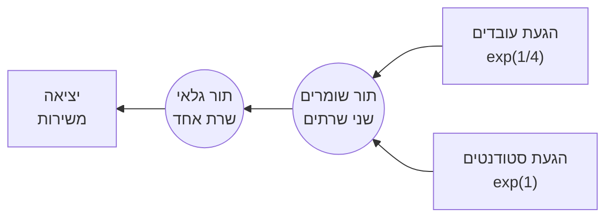
| | תור שומרים | תור גלאי |
|---|---|---|
| הגעה | לסוף התור; חוץ מ-80% מהעובדים — לתחילת התור | לסוף התור |
| זמן שירות | עובדים: $U(0.5,1)$; סטודנטים: $U(0.5,1) + U(1,2)$ | 0.5; ל-30% מהסטודנטים: 1 |

#### בידוק — חמשת השלבים
- שלב 1 — הבנת המודל (לפשט טקסט)
- **שלב 2 — מטרות (ארגון, פרויקט, סימולציה)**
- שלב 3 — אירועים (תרשים עיגולים)
- שלב 4 — משתנים (מה צריך לדעת)
- שלב 5 — תרשימי זרימה (פסאודוקוד)

#### שלב 2 — מטרות
- מטרת הארגון — ידע?
- מטרת הפרויקט — שיפור האווירה
- מטרת הסימולציה — מדדים:
  - זמן המתנה ממוצע (ממוצע על אנשים)
  - אורך תור ממוצע (אינטגרל בזמן)

#### בידוק — חמשת השלבים
- שלב 1 — הבנת המודל (לפשט טקסט)
- שלב 2 — מטרות (ארגון, פרויקט, סימולציה)
- **שלב 3 — אירועים (תרשים עיגולים)**
- שלב 4 — משתנים (מה צריך לדעת)
- שלב 5 — תרשימי זרימה (פסאודוקוד)

#### שלב 3 — אירועים
@svg slides/svg/eg-security.svg

#### בידוק — חמשת השלבים
- שלב 1 — הבנת המודל (לפשט טקסט)
- שלב 2 — מטרות (ארגון, פרויקט, סימולציה)
- שלב 3 — אירועים (תרשים עיגולים)
- **שלב 4 — משתנים (מה צריך לדעת)**
- שלב 5 — תרשימי זרימה (פסאודוקוד)

#### שלב 4 — משתנים
- קבוע: זמן סיום הסימולציה, $Tmax = 90$
- עוד קבועים: קבועים מהסיפור (להתפלגויות, לסיכויים…)
- סוכם אורך תור ממוצע: TL ו-Tlast (הזמן האחרון של שינוי אורך התור)
- סוכם זמן המתנה ממוצע: TW ו-N (מספר האנשים שיצאו משירות)
- משתנה: הזמן הנוכחי Tnow
- תור Q, כשכל אלמנט בתור הוא זוג (סטודנט/עובד, זמן הגעה לשירות)
- מספר השרתים העסוקים S (בין 0 ל-2)

#### שלב 5 — הלולאה הראשית
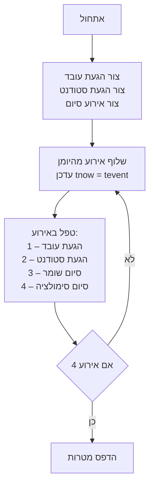

#### שלב 5 — אתחול
```
נקה יומן
tnow = 0
Tmax = 90
נקה Q
S, TL, Tlast, TW, N = 0
```

#### שלב 5 — יצירת אירועים
| אירוע | דגימה | מה שמים ביומן |
|---|---|---|
| הגעת עובד | $x ~ exp(1/4)$ | (1, Tnow + x) |
| הגעת סטודנט | $x ~ exp(1)$ | (2, Tnow + x) |
| סיום סימולציה | — | (4, Tmax) |

!! מה עם ליצור אירוע סיום שומר?

#### שלב 5 — טיפול בהגעת עובד (אירוע 1)
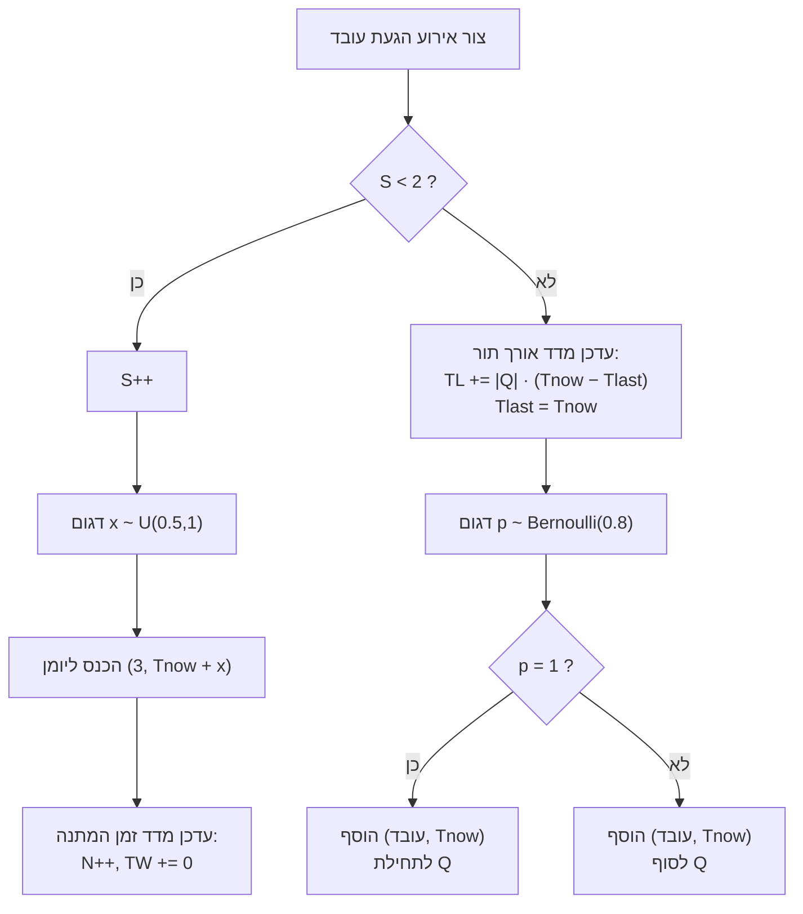

#### שלב 5 — טיפול בהגעת סטודנט (אירוע 2)
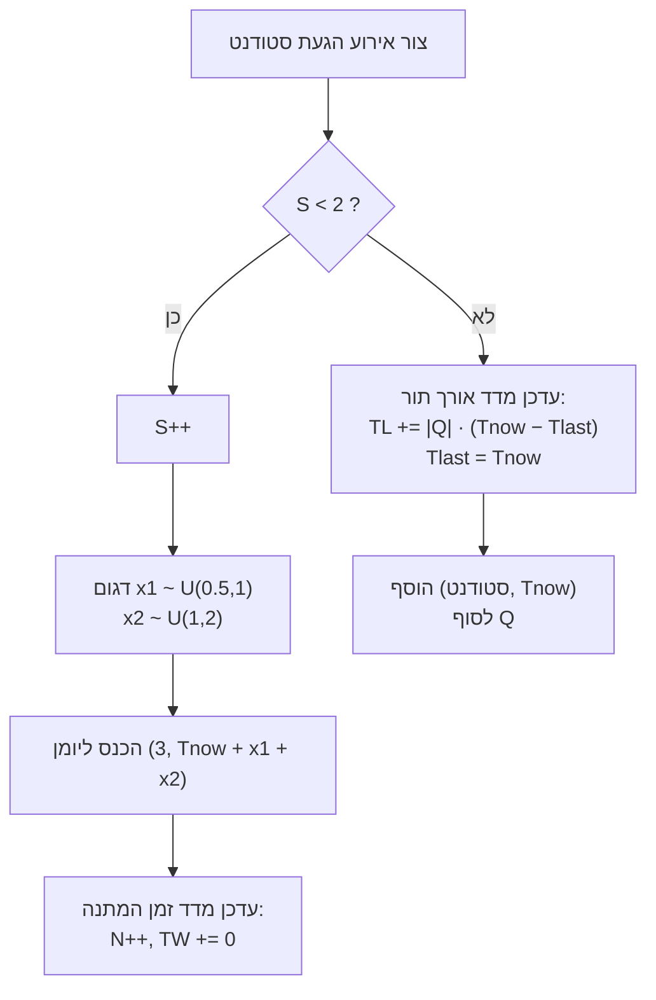

#### שלב 5 — טיפול בסיום שומר (אירוע 3)
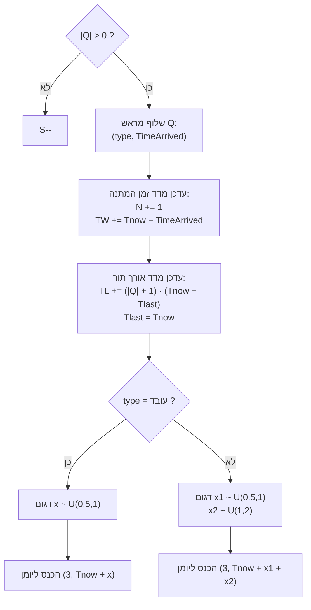

#### שלב 5 — הדפסת מטרות
- הדפס זמן המתנה ממוצע: $TW / N$
- הדפס אורך תור ממוצע: $(TL + |Q|·(Tmax − Tlast)) / Tmax$

> אפשר להסתכל גם על האנשים שעדיין בתוך התור…

#### דוגמה — שירות
- בצעו תכנות אירועים של המצב הקיים (שלבים 1–5), כאשר אחת ממטרות הסימולציה היא זמן ממוצע של עמידה בתור. (25 נקודות)
- כמה אירועים מכל סוג יכולים להיות ביומן בזמן הרצה (ציינו מינימום ומקסימום)? (5 נקודות)

!! 👍

### מצגת — דוגמה: מערכת מחשב

####
!! תכנות אירועים — מערכת מחשב

נמרוד טלמון

#### דוגמה — מערכת מחשב
מערכת מחשב מכילה CPU אחד ו-n משתמשים.

כל משתמש חושב למשך זמן מעריכי עם תוחלת חמישים שניות, ואז שולח עבודה שמשכה מתפלג מעריכית עם תוחלת שלוש מאות שניות.

העבודות לא מתבצעות FIFO אלא Round Robin, בהתאם לפרמטר קוונטה q ולפרמטר חילוף tau:
- העבודות מסודרות בתור.
- כאשר ה-CPU מתפנה, העבודה שנמצאת בראש התור, שמשך החישוב שנותר לה הוא s, נכנסת ל-CPU.
- אם $s < q$, ה-CPU עובד עליה $s + tau$ שניות, מחזיר אותה למשתמש (שמייד מתחיל לחשוב על עבודה חדשה), ולוקח את העבודה הבאה בתור.
- אם $s ≥ q$, ה-CPU עובד עליה $q + tau$ שניות, שם אותה בסוף התור (עם זמן חישוב נותר $s − q$), ולוקח את העבודה הבאה בתור.

רוצים לדעת (1) נצילות (2) זמן תגובה ממוצע, עבור 1000 עבודות.

#### מערכת מחשב — חמשת השלבים
- **שלב 1 — הבנת המודל (לפשט טקסט — תהליך)**
- שלב 2 — מטרות (ארגון, פרויקט, סימולציה)
- שלב 3 — אירועים (תרשים עיגולים)
- שלב 4 — משתנים (מה צריך לדעת)
- שלב 5 — תרשימי זרימה (פסאודוקוד)

#### שלב 1 — הבנת המודל
- one server (CPU)
- n users
- ישויות — עבודות
- thinking time: $exp(1/50)$
- processing time: $exp(1/300)$
- round-robin with quanta q and context-switch time tau
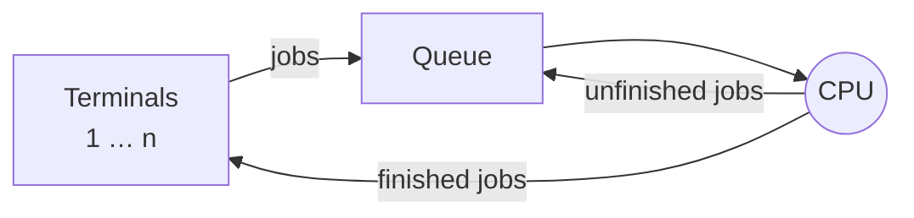

#### מערכת מחשב — חמשת השלבים
- שלב 1 — הבנת המודל (לפשט טקסט)
- **שלב 2 — מטרות (ארגון, פרויקט, סימולציה)**
- שלב 3 — אירועים (תרשים עיגולים)
- שלב 4 — משתנים (מה צריך לדעת)
- שלב 5 — תרשימי זרימה (פסאודוקוד)

#### שלב 2 — מטרות
- מטרת הארגון — להשתלט על העולם
- מטרת הפרויקט — שיפור היעילות של מערכת המחשב
- מטרת הסימולציה — מדדים:
  - **זמן תגובה ממוצע (בעבודות)**
  - **נצילות (בזמן)**

#### מערכת מחשב — חמשת השלבים
- שלב 1 — הבנת המודל (לפשט טקסט)
- שלב 2 — מטרות (ארגון, פרויקט, סימולציה)
- **שלב 3 — אירועים (תרשים עיגולים)**
- שלב 4 — משתנים (מה צריך לדעת)
- שלב 5 — תרשימי זרימה (פסאודוקוד)

#### שלב 3 — אירועים
@svg slides/svg/eg-computer.svg

#### מערכת מחשב — חמשת השלבים
- שלב 1 — הבנת המודל (לפשט טקסט)
- שלב 2 — מטרות (ארגון, פרויקט, סימולציה)
- שלב 3 — אירועים (תרשים עיגולים)
- **שלב 4 — משתנים (מה צריך לדעת)**
- שלב 5 — תרשימי זרימה (פסאודוקוד)

#### שלב 4 — משתנים
- קבוע: זמן סיום הסימולציה, Tend = ???
- קבוע: תנאי סיום הסימולציה, JobsEnd = 1000
- עוד קבועים: קבועים מהסיפור (להתפלגויות…)
- משתנה: הזמן הנוכחי Tnow
- תור Q ב-CPU, כשכל אלמנט בתור הוא עבודה, שמכילה:
  - מי יצר אותה (מספר i בין 1 ל-n)
  - מתי נוצרה, Tjob
  - כמה זמן חישוב נותר לה, s
- האם ה-CPU עסוק, IsBusy (בינארי: 1 עסוק, 0 לא)
- סוכם זמן תגובה SR; סוכם נצילות SU; מספר העבודות שסיימו N

#### שלב 5 — הלולאה הראשית
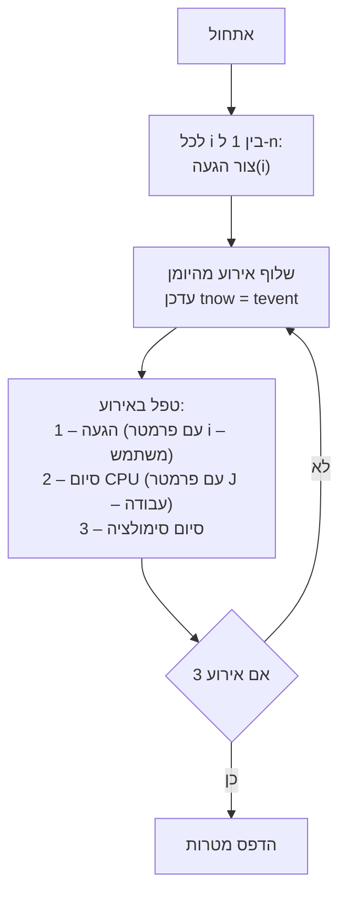

#### שלב 5 — אתחול ויצירת אירועים
**אתחול**
```
נקה יומן
Tnow = 0
נקה Q
IsBusy = 0
SR = SU = N = 0
```
| אירוע | דגימה | מה שמים ביומן |
|---|---|---|
| הגעה(i) | $x ~ exp(1/50)$ | (1, Tnow + x, i) |
| סיום סימולציה | — | (3, Tnow) |

#### שלב 5 — טיפול בהגעה(i)
> מה עם ליצור אירוע הגעה?
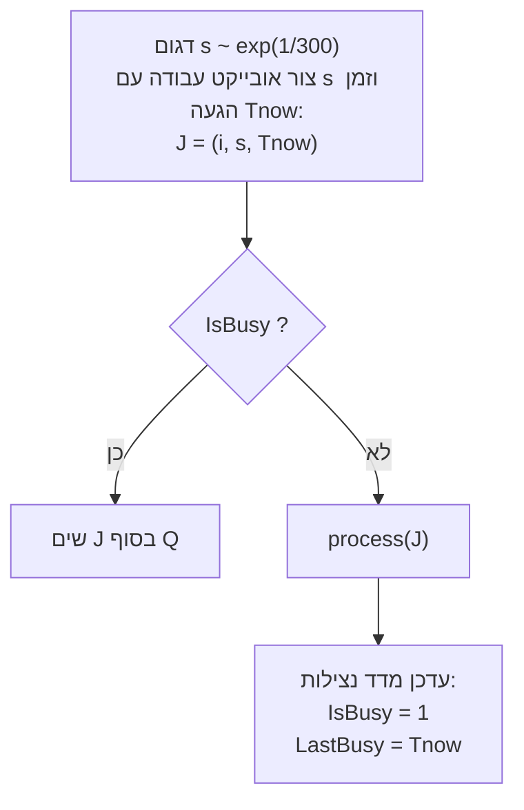

#### שלב 5 — הפונקציה process(J)
$J = (i, s, Tjob)$
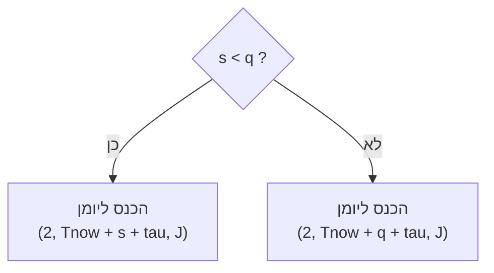

#### שלב 5 — טיפול בסיום CPU (J)
$J = (i, s, Tjob)$
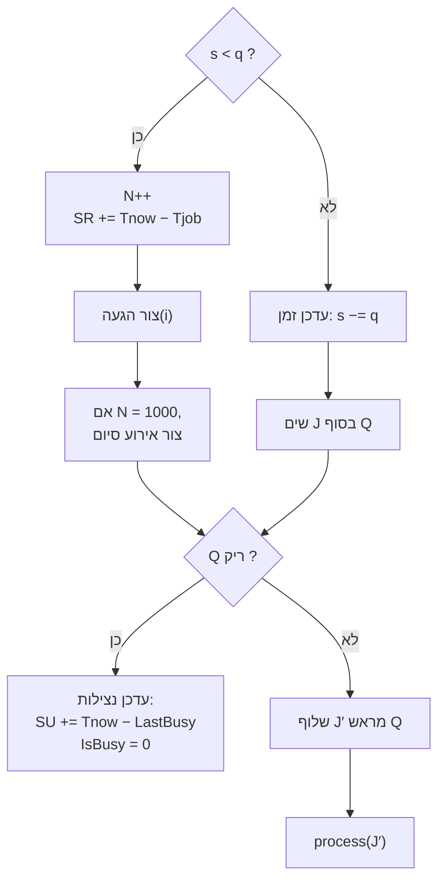

#### שלב 5 — הדפסת מטרות
- הדפס זמן תגובה ממוצע: $SR / 1000$
- הדפס נצילות: $SU / Tnow$

#### דוגמה — מערכת מחשב
רוצים לדעת (1) נצילות (2) זמן תגובה ממוצע, עבור 1000 עבודות.

!! 👍

---

## שיעור 8 — תכנון וניתוח

### מצגת — תכנון הניסוי וניתוח הפלט

#### פרויקט/מחקר סימולציה
@svg slides/svg/cycle-goal.svg

#### תכנון ניסוי וניתוח מערכת בודדת
- **ניתוח פלט מערכת בודדת**
  - איך להבין את הפלט למדד אחד
  - איך להבין את הפלט לכמה מדדים
- **תכנון הניסוי למערכת מסתיימת**
  - חישוב מספר ההרצות הנדרש
- **תכנון הניסוי למערכת לא מסתיימת**
  - חישוב זמן חימום

#### סוגי מודלים
| מודל | Terminating — מסתיים: תנאי הסיום חלק מהמודל | Non-terminating — לא מסתיים: תנאי הסיום חלק מתכנון הניסוי |
|---|---|---|
| חנות הפעילה בשעות 8–16 | הנחה: מלאי אינסופי | המלאי סופי, ויש תהליך של הזמנת מלאי |
| מפעל המייצר הזמנות המגיעות עד הצהריים | בכל יום מסיימים לעבוד אחרי סיום העבודה על כל ההזמנות; אין שחיקה של ציוד | יום העבודה מסתיים בשעה 16, ו/או יש שחיקה של ציוד |

> האם ברור מתי (בזמן סימולציה) לסיים כל הרצה?

#### תכנון ניסוי
- מספר ההרצות
- משך של הרצה/חזרה בודדת (למערכת לא מסתיימת)
- משך זמן החימום (למערכת לא מסתיימת)

> נחזור לזה בהמשך. קודם כל — ניתוח התוצאות של מודל בודד.

#### ניתוח הרצות, דוגמה: בנק
> דברים שצריך להבין ולהחליט לפני שמתחילים לרוץ…
- מטרת הארגון — רווח
- מטרת המחקר — טיב השירות
- מטרת הסימולציה (מדדים!) — כמות לקוחות ביום, משך יום עבודה, אורך תור ממוצע, זמן המתנה ממוצע בתור, פרופורציית הלקוחות שחיכו פחות מחמש דקות
- סוג המודל — מסתיים (שירות לקוחות אחרי סגירת הדלתות)
- המודל:
  - 5 כספרים
  - תור בודד, מדיניות FIFO
  - פותח שערים ב-9, סוגר ב-5, וממשיך לשרת לקוחות אחרי סגירת הדלתות
  - זמן בין הגעות של לקוחות מעריכי, ממוצע דקה אחת
  - זמן שירות מעריכי, ממוצע 4 דקות

#### ניתוח הרצות, דוגמה: בנק
אז החלטנו על מטרות הסימולציה, תיקפנו מודל, בחרנו זמן סיום להרצה, בנינו קוד לסימולציה, והרצנו אותו עם אלגוריתמי דגימה מתאימים…

!! מה הולכים לקבל?

#### פלט
- בפרט — הפלט עצמו הוא משתנה מקרי!!!


#### פלט
נתונות 10 חזרות **בלתי תלויות** עם תנאי התחלה זהים:

| חזרה | לקוחות ששורתו | זמן סיום (שעות) | זמן המתנה ממוצע בתור (דקות) | אורך תור ממוצע | פרופורציית הלקוחות שהמתינו פחות מ-5 דקות |
|---|---|---|---|---|---|
| 1 | 484 | 8.12 | 1.53 | 1.52 | 0.917 |
| 2 | 475 | 8.14 | 1.66 | 1.62 | 0.916 |
| 3 | 484 | 8.19 | **1.24** | 1.23 | **0.952** |
| 4 | 483 | 8.03 | 2.34 | 2.34 | 0.822 |
| 5 | 455 | 8.03 | 2.00 | 1.89 | 0.840 |
| 6 | 461 | 8.32 | 1.69 | 1.56 | 0.866 |
| 7 | 451 | 8.09 | 2.69 | 2.50 | 0.783 |
| 8 | 486 | 8.19 | 2.86 | 2.83 | 0.782 |
| 9 | 502 | 8.15 | 1.70 | 1.74 | 0.873 |
| 10 | 475 | 8.24 | **2.60** | 2.50 | **0.779** |

!! ?

#### ניתוח פלט
- נקבל תוצאות מ-n ריצות בלתי תלויות
- $X_{j}$ — התוצאה של הריצה ה-j

!! מה אפשר לעשות?

#### ניתוח פלט
- נקבל תוצאות מ-n ריצות בלתי תלויות; $X_{j}$ — התוצאה של הריצה ה-j
$$\bar X(n) = \frac{\sum_{j=1}^{n} X_j}{n} \qquad S^2(n) = \frac{\sum_{j=1}^{n} \left(X_j - \bar X(n)\right)^2}{n-1}$$
- רווח סמך ברמת ביטחון $1−α$:
$$\bar X(n) \pm t_{n-1,\,1-\alpha/2}\,\frac{S(n)}{\sqrt n}$$
- בגלל משפט הגבול המרכזי (לצורכנו): עבור מדדים שהם ממוצע ניתן להניח נורמליות

> מניחים נורמליות, אבל יש רק אומד של השונות — לכן רווח סמך עם t

#### ניתוח הפלט — זמן המתנה ממוצע בתור
- לא תוצאה של ריצה אחת
- לא ממוצע תוצאות של מספר ריצות
- **ממוצע + רווח סמך!**

עבור רמת ביטחון של 90% ($α = 0.1$): $t_{9,0.95} = 1.833$
$$\bar x(10) = 2.031;\quad S(10) = 0.556;\quad \delta = 1.833 \cdot \frac{0.556}{\sqrt{10}} = 0.322$$
> זמן ההמתנה הממוצע בתור הוא 2.031 פלוס מינוס 0.322, ברמת ביטחון של 90%

#### מדדים שאינם הממוצע
| חזרה | זמן המתנה ממוצע בתור (ממוצע על לקוחות) | אורך תור ממוצע (אינטגרל על הזמן) | **פרופורציית הלקוחות שהמתינו פחות מ-5 דקות** |
|---|---|---|---|
| 1 | 1.53 | 1.52 | 0.917 |
| 2 | 1.66 | 1.62 | 0.916 |
| 3 | 1.24 | 1.23 | 0.952 |
| 4 | 2.34 | 2.34 | 0.822 |
| 5 | 2.00 | 1.89 | 0.840 |
| 6 | 1.69 | 1.56 | 0.866 |
| 7 | 2.69 | 2.50 | 0.783 |
| 8 | 2.86 | 2.83 | 0.782 |
| 9 | 1.70 | 1.74 | 0.873 |
| 10 | 2.60 | 2.50 | 0.779 |

> **עבור מדדים שאינם ממוצע לא ניתן להניח נורמליות** — צריך לבדוק, ולנתח בהתאם

#### פרופורציה של לקוחות שהתעכבו בתור
פרופורציית הלקוחות שהתעכבו פחות מ-5 דקות ($D_{i}$ — זמן ההמתנה של הלקוח ה-i):
$$E(x) = E\left(\frac{\sum_{i=1}^{m} I_i[0,5)}{m}\right) \qquad I_i[0,5) = \begin{cases} 1 & D_i < 5 \\ 0 & \text{else} \end{cases}$$
- נקבל "כנורמלי" ברמת ביטחון 95% בעקבות בדיקת מבחן קולמוגורוב–סמירנוב (וגם כי ממוצע על האינדיקטורים)
- (הערה: אם לא נורמלי, נקווה להרבה חזרות — גדול מ-30)
- תשובה: עבור רמת ביטחון של 90% ($α = 0.1$): $t_{9,0.95} = 1.833$
$$\bar x(10) = 0.853;\quad S(10) = 0.062;\quad \delta = 1.833 \cdot \frac{0.062}{\sqrt{10}} = 0.036$$
> פרופורציית הלקוחות שהתעכבו בתור פחות מ-5 דקות היא 0.853 פלוס מינוס 0.036, ברמת ביטחון של 90%

#### חשיבות מדדי פרופורציה
בדיקת תור אחד משותף, או תור לכל כספר עם מעברי תור (אותה נצילות שרתים) — דוגמת הבנק:

| מדד ביצוע | חמישה תורים | תור אחד |
|---|---|---|
| זמן פעולה צפוי, שעות | 8.14 | 8.14 |
| זמן המתנה ממוצע צפוי, דקות | 5.57 | 5.57 |
| מספר ממוצע צפוי בתור | 5.52 | 5.52 |

#### מדדי פרופורציה
אומדנים לפרופורציות הצפויות של זמני ההמתנה בכל מרווח:

| מרווח (דקות) | חמישה תורים | תור אחד |
|---|---|---|
| [0,5) | 0.626 | 0.597 |
| [5,10) | 0.182 | 0.188 |
| [10,15) | 0.076 | 0.107 |
| [15,20) | 0.047 | 0.095 |
| [20,25) | 0.031 | 0.013 |
| [25,30) | 0.020 | 0 |
| [30,35) | 0.015 | 0 |
| [35,40) | 0.003 | 0 |
| [40,45) | 0 | 0 |

#### ניתוח מספר מדדים ביחד
!! ✍️
> לחתום על רווח סמך אחד זה לא כמו לחתום על כמה רווחי סמך

#### לחתום על רווח סמך אחד
> **הריני חותם בזאת:** בסיכוי א־פריורי 90%, הערך האמיתי נמצא בתוך רווח הסמך הנ"ל. ✍️

המשפט המתמטי אומר, עבור מדדים נורמליים: אם נעשה הרבה ניסויים, כשבכל ניסוי נדגום n נקודות ונבנה רווח סמך, אז ב-90% מרווחי הסמך הערך האמיתי יימצא בפנים.

#### לחתום על כמה רווחי סמך
> **הריני חותם בזאת:** בסיכוי א־פריורי 90%: (1) הערך האמיתי של X נמצא בתוך רווח הסמך הנ"ל; (2) הערך האמיתי של Y נמצא בתוך רווח הסמך הנ"ל; (3) הערך האמיתי של Z נמצא בתוך רווח הסמך הנ"ל. ✍️

!! מתחייבים ששלושת רווחי הסמך תקינים!

#### ניתוח מספר מדדים ביחד
- עבור מדד בודד נקבע רמת ביטחון $1−α$
- עבור k מדדים: על פי אי־שוויון בונפרוני (union bound)
$$\alpha = \sum_i \alpha_i$$
$$\mathbb{P}(\text{at least one CI is wrong}) = \mathbb{P}(\exists\, 1 \le i \le k:\ \mu_i \notin I_i) \le \sum_{1 \le i \le k} \mathbb{P}(\mu_i \notin I_i) = \sum_{1 \le i \le k} \alpha_i$$
$$\mathbb{P}(\mu_i \in I_i \text{ for all } 1 \le i \le k) \ge 1 - \sum_{1 \le i \le k} \alpha_i$$

#### דוגמת הבנק: זמן המתנה ממוצע בתור ואורך תור ממוצע
$$\bar x_W(10) = 2.031,\ S_W(10) = 0.556 \qquad \bar x_L(10) = 1.973,\ S_L(10) = 0.531$$
- **מדד יחיד:** זמן ההמתנה הממוצע בתור הוא $2.031 ± 0.322$ ברמת ביטחון של 90%
$$\alpha = 0.1,\quad t_{9,0.95} = 1.833$$
- **שני מדדים:** זמן ההמתנה הממוצע בתור הוא $2.031 ± 0.398$, ואורך התור הממוצע הוא $1.973 ± 0.380$, ברמת ביטחון של 90%
$$\alpha = 0.1,\quad \alpha_i = 0.05,\quad t_{9,0.975} = 2.262$$

#### תכנון ניסוי
- **מספר ההרצות**
- משך של הרצה/חזרה בודדת (למערכת לא מסתיימת)
- משך זמן החימום (למערכת לא מסתיימת)

#### חישוב מספר ההרצות הנדרש
> **דוגמה:** n = 10 חזרות של תור עם שרת יחיד; $X_{j}$ — זמן ההמתנה הממוצע בתור בחזרה ה-j
- $X_{j}$: 2.02, 0.73, 3.20, 6.23, 1.76, 0.47, 3.89, 5.45, 1.44, 1.23
- רוצים רווח סמך של 90%, כלומר $α = 0.10$
- $X̄(10) = 2.64$, $S^{2}(10) = 3.96$, $t_{9,0.95} = 1.833$
- רווח סמך מקורב של 90%: $2.64 ± 1.15$, או $[1.49, 3.79]$
- חצי הרוחב (1.15) הוא 44% מאומדן הנקודה (2.64); כלומר $2.64 ± 44%$ — לא מאוד *precise*

> מספר ההרצות כפונקציה של הדיוק הנדרש

#### חישוב מספר ההרצות הנדרש
> בגדול, ביצוע עוד הרצות אמור להקטין את רווח הסמך (כלומר, לשפר את הדיוק המוחלט והיחסי)

- **שיטה קלה לדיוק נדרש:** לחשב רווח סמך מחדש אחרי כל ריצה…
+ מה הבעיה?
+ **יעילות!** לכן, ננסה קירוב…

!! למה לא תמיד?

#### קירוב מספר הריצות הנדרש I
$$\delta(\alpha, n) = t_{n-1,\,1-\alpha/2}\,\frac{S(n)}{\sqrt n}$$
| דיוק מוחלט | דיוק יחסי |
|---|---|
| $β > 0$ | $0 < γ < 1$ |
| נרצה ש-$δ(α,n) < β$ | נרצה ש-$δ(α,n) / X̄(n) < γ$ (בערך מוחלט) |

$$\text{absolute: } n^*(\beta) = \min\left\{ i \ge n_0 :\ t_{i-1,\,1-\alpha/2}\,\frac{S(n_0)}{\sqrt i} \le \beta \right\}$$
$$\text{relative: } n^*(\gamma) = \min\left\{ i \ge n_0 :\ \frac{t_{i-1,\,1-\alpha/2}\,S(n_0)/\sqrt i}{|\bar X(n_0)|} \le \gamma' \right\},\quad \gamma' = \frac{\gamma}{1+\gamma}$$

> למה זה רק קירוב?

#### קירוב מספר הריצות הנדרש II
$$n = n_0 \cdot \left(\frac{h_0}{h}\right)^2$$
- n — מספר ריצות חדש; $n_{0}$ — מספר ריצות ישן
- $h_{0}$ — רווח סמך ישן; h — רווח סמך מבוקש

e.g., if z repetitions caused some CI, then 4z repetitions give CI/2

#### קירוב מספר הריצות הנדרש III
- מחשבים חצי רוחב:
$$\delta(\alpha, n) = t_{n-1,\,1-\alpha/2}\,\frac{S(n)}{\sqrt n}$$
- מחשבים "מצוי": בדיוק מוחלט — δ; בדיוק יחסי — δ חלקי $X̄(n)$
- מחשבים "רצוי": בדיוק מוחלט — β (נתון); בדיוק יחסי — $γ' = γ / (1 + γ)$ (γ נתון)
- אם המצוי גדול מהרצוי: מספר הריצות הנדרש הוא $n_{0}$ כפול (מצוי חלקי רצוי) בריבוע

#### המשך דוגמה
$S(10) = 1.99$, $x̄(10) = 2.64$, $α = 0.1$ → $δ = 1.15$
- כמה ריצות נוספות יש לבצע אם נדרש דיוק אבסולוטי של $β = 0.575$?
+ $10 · (δ / 0.575)^{2}$
- כמה ריצות נוספות יש לבצע אם נדרש דיוק יחסי של $γ = 0.22$?
+ $10 · ((δ / 2.64) / (0.22 / 1.22))^{2}$

#### תרגיל
מרצי הקורס בנו מודל סימולציה המדמה את התנהלות ההרצאות במהלך הסמסטר. המרצים מעוניינים לבחון מספר שיטות להעברת הרצאות. מדדי הביצוע שהציבו המרצים הם: מספר ממוצע של הפרעות במהלך ההרצאה, % שביעות רצון של הסטודנטים מההרצאה, % הצלחה בקורס. על סמך 20 חזרות התחלתיות התקבלו התוצאות הבאות:

| מדד | ממוצע | סטיית תקן |
|---|---|---|
| מספר ממוצע של הפרעות במהלך ההרצאה | 20 | 2.19 |
| % שביעות הרצון של הסטודנטים מההרצאה | 45 | 2.23 |
| % הצלחה בקורס | 65 | 1.5 |

- מהו מספר החזרות שיש לבצע כדי להגיע לדיוק יחסי של 5% ברמת ביטחון של 85%? (13 נקודות)

#### פתרון
- רוצים ביטחון 85% ל-3 מדדים סימולטנית, לכן נקבע כל $α_{i}$ להיות 0.05
+ נחשב:

| מדד | ממוצע | S | δ | δ / X̄ | טוב? |
|---|---|---|---|---|---|
|+ מספר הפרעות | 20 | 2.19 | 1.025 | 0.0512 | :[ |
|+ שביעות רצון | 45 | 2.23 | 1.044 | 0.0232 | :] |
|+ הצלחה בקורס | 65 | 1.5 | 0.702 | 0.0108 | :] |

+ נחפש קירוב בעזרת N = n₀ · (מצוי / רצוי)²
+ רצוי — לפי התיקון: $0.05 / 1.05 = 0.047$; מצוי — 0.0512
+ נקבל: $20 · (0.0512 / 0.047)^{2} = 23.5$; נעשה עוד 4 הרצות

#### מערכת מסתיימת — סיכום
- ביצוע של $n_{0}$ חזרות וחישוב ממוצע/ים ורווח/י סמך
- בדיקת מספר הריצות הנדרש על פי דרישות הדיוק
- ביצוע ריצות נוספות לפי הצורך
- מציאת ממוצע/ים ורווח/י סמך (לפי כל הריצות)
- בעת חישוב רווחי סמך, לזכור:
  - אי־שוויון בונפרוני במקרה של מספר מדדים
  - בדיקת נורמליות עבור מדדים שאינם ממוצע

#### מערכת לא מסתיימת
!! מה עושים כשלא ברור מתי להתחיל ומתי לסיים?

#### מערכת לא מסתיימת
**מצב מעבר — מצב יציב**
- **מצב מעבר:**
  - התחלת הריצה
  - אירוע פתאומי תוך כדי ריצה


#### מצב מעבר — מצב יציב
- **פלט:** $Y_{1}, Y_{2}, …, Y_{k}$ (k — זמן)
- **מצב מעבר** (I — תנאי ההתחלה):
$$F_i(y \mid I) = P(Y_i \le y \mid I),\quad i = 1, 2, \dots, k$$
- **מצב יציב:**
$$F_i(y \mid I) \to F(y),\quad i \to \infty$$

#### מציאת זמן חימום (מצב מעבר)


!! צריך לסנן רעשים!

#### שיטת Welch
- **שלב 1:** מבצעים n חזרות (שורות), כל אחת באורך m (זמן):
$$\begin{array}{c|cccc} 1 & Y_{11} & Y_{12} & \cdots & Y_{1m} \\ 2 & Y_{21} & Y_{22} & \cdots & Y_{2m} \\ \vdots & & & & \\ n & Y_{n1} & Y_{n2} & \cdots & Y_{nm} \end{array}$$
- **שלב 2:** מחשבים את התהליך הממוצע: $Ȳ_{i}$ — ממוצע עמודה i על פני החזרות
- **שלב 3:** מחשבים ממוצע נע $Ȳ_{i}(w)$ עם חלון w

#### המשך
$$\bar Y_i(w) = \begin{cases} \dfrac{\sum_{s=-w}^{w} \bar Y_{i+s}}{2w+1} & \text{if } i = w+1, \dots, m-w \\[2ex] \dfrac{\sum_{s=-(i-1)}^{i-1} \bar Y_{i+s}}{2i-1} & \text{if } i = 1, \dots, w \end{cases}$$

#### Welch (w = 20)


#### Welch (חלון קטן מול חלון גדול)


> יותר חלק — פחות מדויק. אין ארוחות חינם.

#### תכנון ניסוי — מערכת לא מסתיימת
- בנוסף למספר החזרות:
  - מציאת זמן חימום
  - מציאת משך ריצה (כלל אצבע: כפול שבע)
- בחינת אופן ההרצה:
  - Replication/deletion — הרבה ריצות קצרות
  - Batch means — ריצה אחת ארוכה


#### מערכת לא מסתיימת (סיכום)
- מציאת זמן חימום (אם יש כמה מדדים, ניקח את המקסימלי מתוך Welch על כל אחד)
- קביעת זמן ההרצה וסוג ההרצה
- היתר — כמו מערכת מסתיימת:
  - ביצוע של $n_{0}$ חזרות וחישוב ממוצע/ים ורווח/י סמך
  - בדיקת מספר הריצות הנדרש על פי דרישות הדיוק
  - ביצוע ריצות נוספות לפי הצורך
  - מציאת ממוצע/ים ורווח/י סמך (על כל הריצות)

### חימום

**8.1** תוצאות 5 הרצות למספר הלקוחות המרוצים: 4, 7, 2, 3, 10. חשבו רווח סמך ברמת ביטחון 90%.

**8.2** שלוש חזרות של מערכת לא מסתיימת, זמן המתנה ממוצע בכל שעה מ-6 השעות הראשונות:
- חזרה 1: 10, 7, 6, 5, 5, 5
- חזרה 2: 12, 8, 6, 6, 5, 6
- חזרה 3: 11, 9, 7, 5, 6, 5
הריצו את שיטת ולש עם חלון 1 ועם חלון 2. מתי מסתיים החימום?

**8.3** מתוך 200 לקוחות, 30 חיכו יותר מ-5 דקות. חשבו רווח סמך ברמת 90% לפרופורציית הלקוחות שמחכים יותר מ-5 דקות.

### שיפוט

**8.4 מסתיים או לא?**
לכל מערכת — מסתיים או לא מסתיים? ומה זה משנה בתכנון הניסוי?
- בנק שפתוח 9–17
- חדר מיון
- פס ייצור בשלוש משמרות
- מוקד טלפוני שנסגר בלילה אבל התור נשמר למחר
- סימולציה של בחירות

**8.5 מיליון תצפיות.**
"הרצתי הרצה אחת ארוכה של מיליון לקוחות. יש לי מיליון תצפיות של זמן המתנה, אז רווח הסמך שלי זעיר." האם רווח הסמך תקין? מה הייתם עושים במקום?

**8.6 למה לזרוק נתונים?**
"ולש אומר לי למחוק את השעה הראשונה. אבל יותר נתונים זה תמיד יותר טוב — למה לזרוק?" מה התשובה?

**8.7 מה אומר רווח סמך?**
"רווח סמך 90% הוא [4.5, 6.1], ולכן התוחלת האמיתית נמצאת שם בהסתברות 90%." נכון או לא? אם לא — מה כן נכון?

### אתגר

**8.8** בפייתון: תור עם שרת אחד, הגעות מעריכיות בקצב 0.9 ושירות מעריכי בקצב 1. הריצו הרצה ארוכה אחת וחשבו רווח סמך לזמן ההמתנה הממוצע בשלוש דרכים: (א) כאילו התצפיות בלתי תלויות, (ב) ממוצעי אצוות, (ג) 30 חזרות בלתי תלויות. חזרו על הניסוי 200 פעמים ובדקו כמה פעמים כל רווח סמך באמת מכיל את הערך התאורטי (9). מה אתם רואים?

---

## שיעור 9 — תכנון וניתוח ב

### חימום

**9.1** שלושה מדדים, 2 חלופות, רווחי סמך להכל, והכל ברמת ביטחון כוללת של 90%. איזו רמת ביטחון לכל רווח סמך?

**9.2** מה הדיוק המוחלט והיחסי של רווח סמך מ-9 עד 11? ושל רווח סמך מ-99 עד 101?

**9.3** נתון רווח סמך 30 ± 8 שנעשה עבור 100 הרצות. כמה הרצות נוספות צריך כדי להגיע ל-± 1?

**9.4** נתון רווח סמך 10 ± 1 שנעשה עבור 1000 הרצות. כמה הרצות נוספות צריך כדי להגיע לדיוק יחסי של אחוז אחד?

### שיפוט

**9.5 בונפרוני שמרן מדי.**
"במקום 98.3% לכל רווח סמך, אדווח כל אחד ב-90% ואגיד שהכל 'בערך 90%'." מה בעצם רמת הביטחון הכוללת במקרה הזה, במקרה הגרוע? האם יש מצב שבו זה בכל זאת סביר?

**9.6 דיוק יחסי ליד אפס.**
הלקוחה דורשת דיוק יחסי של 1% על המדד "רווח חודשי". הרווח הצפוי הוא בערך 0. מה הבעיה, ומה תציעו במקום?

**9.7 6400 הרצות, שעה כל אחת.**
הנוסחה אומרת שצריך 6400 הרצות. כל הרצה לוקחת שעה. מה האפשרויות שלכם?

**9.8 להציץ.**
"אריץ 20 הרצות, אבדוק אם הרווח צר מספיק, ואם לא — אוסיף 10 ואבדוק שוב, וכן הלאה עד שזה יוצא." האם רמת הביטחון בסוף באמת 90%? למה כן או למה לא?

### אתגר

**9.9** בפייתון: ממשו את הנוהל מ-9.8 ובדקו אמפירית, על 1000 ניסויים, באיזה שיעור מהם רווח הסמך הסופי מכיל את התוחלת האמיתית. השוו לנוהל דו-שלבי (הרצות ראשוניות → חישוב n → הרצות נוספות ללא הצצה). מה ההבדל?

---

## שיעור 10 — השוואה בין שתי חלופות

### מצגת — השוואה בין חלופות והפחתת שונות

####
!! השוואה בין חלופות והפחתת שונות

נמרוד טלמון

#### שלבי העבודה
- אחרי המטרות, המידול והתכנות: ניתוח המצב הקיים — תכנון הניסוי וניתוח התוצאות עבור המצב הקיים
- תכנון חלופות — מה ניתן לשנות? מה כדאי לשנות? (לרוב, הסיבה העיקרית לסימולציה!) למשל: מספר מכונות, מדיניות תור, מספר יחידות במלאי ביטחון
- חיפוש החלופה הטובה ביותר מבין הנבדקות
- הערכת השינוי: בכמה החלופה הטובה ביותר טובה יותר מהמצב הקיים?

#### דוגמה (מהונדסת)
| | Zippy | Klunky |
|---|---|---|
| מודל | M/M/1, arrival rate 1 per min | M/M/2, arrival rate 1 per min |
| שרתים | one "fast" server, mean service time 0.9 min | two "slow" servers, mean service time 1.8 min |
| עלות | cost twice | |

- **Performance measure:** $μ_{i}$ = expected average delay in queue for alternative i of the first 100 customers, with empty-and-idle initial conditions
- **The truth:** $μ_{1} = 4.13 > 3.70 = μ_{2}$, so system 2 is "better"

#### מה לא עושים
| Experiment | $d̂_{Z}(100)$ | $d̂_{K}(100)$ | Recommendation |
|---|---|---|---|
| 1 | 3.80 | 4.60 | Zippy (wrong) |
| 2 | 3.17 | 8.37 | Zippy (wrong) |
| 3 | 3.96 | 4.18 | Zippy (wrong) |
| 4 | 1.91 | 5.77 | Zippy (wrong) |
| 5 | 1.71 | 2.23 | Zippy (wrong) |
| 6 | 6.16 | 4.72 | Klunky (right) |
| 7 | 5.67 | 1.39 | Klunky (right) |
| ⋮ | ⋮ | ⋮ | ⋮ |
| 98 | 8.40 | 9.39 | Zippy (wrong) |
| 99 | 7.70 | 1.54 | Klunky (right) |
| 100 | 4.64 | 1.17 | Klunky (right) |

- P(pick system 1 (wrong answer)) ≈ 0.52; difficulty: randomness in output

> פלטים הם משתנים מקריים! 🎲

#### מה לא עושים (המשך)
- Replicate each alternative some number (n) times
- $X_{ij}$ = average delay from the j-th replication of alternative i
- Base the decision on the average of the replications for alternative i

| n | P(wrong answer) |
|---|---|
| 1 | 0.52 |
| 5 | 0.43 |
| 10 | 0.38 |
| 20 | 0.34 |


#### השוואה בין חלופות
- השוואה בין שתי חלופות — מבחן השערות
  - מבחן t מזווג
  - מבחן Welch לשתי סדרות בלתי תלויות
- הפחתת שונות
- השוואה בין מספר חלופות
  - השוואה לסטנדרט
  - השוואה בזוגות
  - רגרסיה לינארית עם משתנה מסביר קטגוריאלי
- דירוג ובחירה (ranking and selection)

#### מבחן t מזווג
נתונות שתי סדרות של תוצאות של ריצות סימולציה: $x_{1,j}$, $j = 1…n_{1}$; $x_{2,j}$, $j = 1…n_{2}$
- $n_{1} = n_{2} = n$ — אורך הסדרות שווה (אותו מספר ריצות)
- יש מתאם בין ריצות מקבילות בשתי הסדרות
- אין מתאם בין ריצות בכל חלופה בפני עצמה
- ניתן להניח שוויון שונויות בין הסדרות
- התוצאות מתפלגות נורמלית

> נגדיר מדד הפרש ונבחן רווח סמך עבור התוחלת שלו. הסדרות שונות אם רווח הסמך אינו כולל את האפס.

#### מבחן t מזווג
$$Z_j = X_{1,j} - X_{2,j} \qquad (j = 1, \dots, n)$$
$$\bar Z(n) = \frac{\sum_{j=1}^{n} Z_j}{n} \qquad S_Z^2(n) = \frac{\sum_{j=1}^{n} \left(Z_j - \bar Z(n)\right)^2}{n-1}$$
$$\bar Z(n) \pm t_{n-1,\,1-\alpha/2}\,\frac{S_Z(n)}{\sqrt n}$$

#### דוגמה (t מזווג)
- שני מודלים של ארגון רצפת הייצור במפעל
- מדד: עלות ייצור חודשית ממוצעת
- יש מתאם בין ריצות מקבילות בחלופות השונות
- מובהקות: $α = 0.1$

| j | $X_{1j}$ | $X_{2j}$ | $Z_{j}$ |
|---|---|---|---|
| 1 | 115.45 | 106.69 | 8.76 |
| 2 | 121.56 | 117.47 | 4.09 |
| 3 | 123.43 | 119.2 | 4.23 |
| 4 | 127.59 | 127.61 | −0.02 |
| 5 | 128.45 | 120.62 | 7.83 |

$$\bar Z(5) = 4.978 \qquad S(5) = 3.4916 \qquad t_{4,\,0.95} = 2.132$$
> ברמת ביטחון של 90% התקבל רווח סמך [1.65, 8.31] — **לא מכיל 0**. כלומר, חלופה 2 טובה יותר מחלופה 1, וזולה ממנה ב-1.65 עד 8.31.

#### Welch — Modified Two-Sample-t Confidence Interval
נתונות שתי סדרות של תוצאות של ריצות סימולציה: $x_{1,j}$, $j = 1…n_{1}$; $x_{2,j}$, $j = 1…n_{2}$
- אין מתאם בין ריצות מקבילות בשתי הסדרות
- אין מתאם בין ריצות בכל חלופה בפני עצמה
- לא ניתן להניח שוויון שונויות בין הסדרות
- התוצאות מתפלגות נורמלית
- לא חייבים לדרוש $n_{1} = n_{2}$

> נחשב רווח סמך להפרש בין תוחלות הסדרות. הסדרות שונות אם רווח הסמך אינו כולל את האפס.

#### Welch — Modified Two-Sample-t Confidence Interval
ממוצע ושונות לכל סדרה, עבור $i = 1, 2$:
$$\bar X_i(n_i) = \frac{\sum_{j=1}^{n_i} X_{ij}}{n_i} \qquad S_i^2(n_i) = \frac{\sum_{j=1}^{n_i} \left[X_{ij} - \bar X_i(n_i)\right]^2}{n_i - 1}$$
רווח סמך:
$$\bar X_1(n_1) - \bar X_2(n_2) \pm t_{\hat f,\,1-\alpha/2} \sqrt{\frac{S_1^2(n_1)}{n_1} + \frac{S_2^2(n_2)}{n_2}}$$
עם מספר דרגות חופש משוערך (Welch, 1938):
$$\hat f = \frac{\left[S_1^2(n_1)/n_1 + S_2^2(n_2)/n_2\right]^2}{\left[S_1^2(n_1)/n_1\right]^2/(n_1-1) + \left[S_2^2(n_2)/n_2\right]^2/(n_2-1)}$$
This is an old problem: comparing two systems with unequal and unknown variances, called the *Behrens–Fisher problem*.

#### דוגמה (Welch)
- שתי חלופות לניהול מלאי במדיניות (s,S): חלופה 1 (20,40), וחלופה 2 (20,80)
- מדד: עלות חודשית ממוצעת
- אין מתאם/תלות בין כל הריצות
- מובהקות: $α = 0.1$

| j | $X_{1j}$ | $X_{2j}$ |
|---|---|---|
| 1 | 126.97 | 118.21 |
| 2 | 124.31 | 120.22 |
| 3 | 126.68 | 122.45 |
| 4 | 122.66 | 122.68 |
| 5 | 127.23 | 119.40 |

$$\bar x_1(5) = 125.57,\ \bar x_2(5) = 120.59 \qquad S_1^2(5) = 4.25,\ S_2^2(5) = 4.5$$
$$\hat f = 7.99 \qquad t_{7.99,\,0.95} \approx t_{8,\,0.95} = 1.860$$
> ברמת ביטחון של 90% מתקבל רווח סמך [2.66, 7.40]. כלומר, חלופה 2 טובה יותר מחלופה 1, וזולה ממנה ב-2.66 עד 7.40.

#### סיכום — t מזווג ו-Welch
שתי שיטות להשוואה בין 2 חלופות:

| t מזווג | Welch |
|---|---|
| **חייב** אותו מספר הרצות בשתי החלופות | חי בשלום עם מספר הרצות שונה בכל חלופה |
| מניח שאין מתאם בין ריצות של כל חלופה | מניח שאין מתאם בין ריצות של כל חלופה |
| מעדיף מתאם בין ריצות מקבילות בשתי החלופות | **חייב** שלא יהיה מתאם בין ריצות מקבילות |
| נכון כשהכול נורמלי | נכון כשהכול נורמלי |

#### שיטות להפחתת שונות (VRT)
$$\bar X(n) \pm t_{n-1,\,1-\alpha/2}\,\frac{S(n)}{\sqrt n}$$
- $S(n)$ — **נוריד את זה!**
- $\sqrt n$ — אפשר עוד הרצות, אבל זה לוקח זמן…
- $t$ — לא רוצים להתפשר…

> זה עושה בעיות!

- CRN — common random numbers
- Antithetic variables
- Control variables
- Importance sampling
- Stratified sampling

#### Common Random Numbers
- נשתמש בשיטה זו כדי להפחית שונות בעת השוואה בין חלופות (x, y)
- אנו אומדים את השונות של ההפרש בין החלופות:
$$\mathrm{Var}(x - y) = \mathrm{Var}(x) + \mathrm{Var}(y) - 2\,\mathrm{Cov}(x, y)$$
- המטרה היא ליצור מתאם חיובי בין החלופות: $Cov(x_{i}, y_{i}) > 0$
- יצירת מתאם על ידי מתן זרמי מספרים אקראיים זהים לחלופות השונות בהרצות מקבילות (בעזרת שימוש חוזר ב-seeds)

> Welch לא יעבוד

#### כללי בטיחות אש! 🔥
- נרצה שבהתאם לאקראיות, באמת נקבל מתאם בתוצאה
- לפעמים יש אש וזה הפוך…


#### CRN


#### תרשים קורלציה


#### חזרות לעומת CRN
- בקירוב: להקטין בחצי עולה כפול 4
- הגענו (די בקלות) מחצי רוחב 0.7 לחצי רוחב 0.04
  - שזה אומר בערך $0.7 / 2 / 2 / 2 / 2 = 0.04$
- צריך פי 256 יותר חזרות, בערך, כדי לקבל רווח סמך דומה

#### המשך דוגמת Zippy מול Klunky
> CRN לפעמים לא עובד יפה עם קבלה–דחייה, כי מספר הקריאות ל-$U(0,1)$ הוא משתנה מקרי — אבל עובד יפה עם טרנספורם הופכי!

#### מועד א' 2013
במפעל לייצור בקבוקי זכוכית בוחנים את מקסימום חול הזכוכית שנפל בעת הניפוח. ביצעו 15 ריצות לכל אחת מהאפשרויות, והשתמשו בהפרדת זרמים לביצוע CRN. התקבלו התוצאות הבאות:

| | חלופה 1 [מיליגרם] | חלופה 2 [מיליגרם] | הפרש (1 פחות 2) [מיליגרם] |
|---|---|---|---|
| 1 | 15.67 | 13.07 | 2.60 |
| 2 | 16.80 | 17.75 | −0.96 |
| 3 | 17.14 | 15.05 | 2.09 |
| 4 | 17.51 | 14.54 | 2.97 |
| 5 | 16.71 | 17.65 | −0.94 |
| 6 | 18.49 | 19.33 | −0.84 |
| 7 | 19.86 | 19.04 | 0.82 |
| 8 | 13.87 | 13.83 | 0.04 |
| 9 | 20.93 | 19.83 | 1.09 |
| 10 | 10.85 | 10.50 | 0.34 |
| 11 | 16.60 | 15.88 | 0.73 |
| 12 | 12.96 | 10.48 | 2.48 |
| 13 | 17.52 | 14.93 | 2.59 |
| 14 | 12.66 | 10.15 | 2.51 |
| 15 | 17.91 | 18.10 | −0.20 |
| **ממוצע** | 16.36 | 15.34 | 1.02 |
| **s** | 2.75 | 3.29 | 1.43 |

#### מועד א' 2013 — שאלות
- באילו מן השיטות שלמדנו להשוואה בין חלופות ניתן להשתמש עבור ניסוי זה? הסבירו ובצעו את הבדיקות הדרושות. (12 נקודות)
- קבעו ברמת מובהקות של $α = 0.05$ מהי האפשרות הטובה יותר מבין השתיים. (11 נקודות)
- המנהל רוצה לדעת בדיוק של 3% עד כמה החלופה האחת טובה מן השנייה. תנו תשובה או קבעו מה יש לעשות. (12 נקודות)

#### מועד א' 2013 — פתרון
- באילו מן השיטות שלמדנו ניתן להשתמש?
+ יש מתאם, אז t מזווג. צריך לבדוק נורמליות.
- קבעו ברמת מובהקות של $α = 0.05$ מהי האפשרות הטובה יותר:
+ $1.02 ± t_{14,0.975} · 1.43 / √15 = [0.23, 1.81]$ — לא מכיל אפס
- המנהל רוצה לדעת בדיוק של 3% עד כמה החלופה האחת טובה מן השנייה:
+ אפשר עוד הרצות; אפשר אולי לשפר את ה-CRN; אולי אפשר היה בלי CRN ולעשות Welch

#### השוואה בין יותר משתי חלופות
נתונות k חלופות, ורוצים להשוות ביניהן:
- השוואה לסטנדרט
- השוואה בזוגות
- דירוג ובחירה

#### השוואה לסטנדרט
- מערכת אחת מוגדרת כסטנדרט (לרוב — המצב הקיים)
- כל שאר המערכות מושוות אליה (בעזרת המבחנים להשוואה בין שתי חלופות)
- עבור k מערכות, כמה השוואות יש?
+ עבור k מערכות יש $k − 1$ השוואות; לכן כל השוואה תבוצע עם $α_{i} = α_{T} / (k − 1)$
+ **חשוב!** לא ניתן להסיק מי המערכת הטובה ביותר

#### השוואה לסטנדרט — דוגמה
- בחינת מדיניות מלאי (s,S)
- מדד: עלות חודשית ממוצעת
- השוואה של ארבע חלופות למצב הקיים (חמישה מודלים)
- חמש חזרות על כל חלופה; אין תלות בין הריצות של החלופות השונות

| Policy (i) | s | S | |
|---|---|---|---|
| 1 | 20 | 40 | מצב קיים |
| 2 | 20 | 80 | |
| 3 | 40 | 60 | |
| 4 | 40 | 100 | |
| 5 | 60 | 100 | |

#### תוצאות
| j | $X_{1j}$ | $X_{2j}$ | $X_{3j}$ | $X_{4j}$ | $X_{5j}$ |
|---|---|---|---|---|---|
| 1 | 126.97 | 118.21 | 120.77 | 131.64 | 141.09 |
| 2 | 124.31 | 120.22 | 129.32 | 137.07 | 143.86 |
| 3 | 126.68 | 122.45 | 120.61 | 129.91 | 144.30 |
| 4 | 122.66 | 122.68 | 123.65 | 129.97 | 141.72 |
| 5 | 127.23 | 119.40 | 127.34 | 131.08 | 142.61 |
| **Mean** | 125.57 | 120.59 | 124.34 | 131.93 | 142.72 |
| **Std. dev.** | 2.00 | 1.94 | 3.90 | 2.96 | 1.37 |

**Welch** — $α_{T} = 0.1$, $c = k − 1 = 4$, $α_{i} = 0.1 / 4 = 0.025$:

| i | $X̄_{i} − X̄_{1}$ | Half-length | Interval |
|---|---|---|---|
| 2 | −4.98 | 3.54 | (−8.52, −1.44)* |
| 3 | −1.23 | 6.21 | (−7.44, 4.97) |
| 4 | 6.36 | 4.55 | (1.82, 10.91)* |
| 5 | 17.15 | 6.15 | (14.07, 20.22)* |

#### All Pairwise Comparisons
Want confidence intervals on $μ_{i1} − μ_{i2}$ for all $i_{1}$ and $i_{2}$ between 1 and k, with $i_{1} < i_{2}$:
$$\begin{array}{cccc} \mu_2 - \mu_1 & \mu_3 - \mu_1 & \cdots & \mu_k - \mu_1 \\ & \mu_3 - \mu_2 & \cdots & \mu_k - \mu_2 \\ & & \ddots & \vdots \\ & & & \mu_k - \mu_{k-1} \end{array}$$
> על כמה רווחי סמך צריך לחתום?
+ Number of confidence intervals is $c = k(k − 1) / 2$ (k choose 2)

#### תוצאות
**Welch** — $α_{T} = 0.1$, $c = k(k − 1)/2 = 10$, $α_{i} = 0.1 / 10 = 0.01$ ($P_{i} = 99%$):

| $i_{1}$ \ $i_{2}$ | 2 | 3 | 4 | 5 |
|---|---|---|---|---|
| 1 | −4.98 ± 4.36* | −1.23 ± 7.91 | 6.36 ± 5.60* | 17.15 ± 3.80* |
| 2 | | 3.75 ± 7.86 | 11.34 ± 5.88* | 22.12 ± 3.72* |
| 3 | | | 7.60 ± 7.67 | 18.38 ± 8.51* |
| 4 | | | | 10.78 ± 5.89* |

#### דירוג ובחירה
- Selecting the best of k systems
- Selecting a subset of size m containing the best of k systems
- Selecting the m best of k systems

> All runs independent (always) (no CRN please!); normal output distribution (always)

#### Ranking and Selection — Selecting the Best of k Systems
- Want to select one of the k alternatives as the best (assume smaller is better)
- Realize we can't be sure that the selected system is the one with the smallest $μ_{i}$ (why? … randomness!)
- Specify a correct-selection probability $P^{*}$ (e.g., 0.90 or 0.95)
- Specify an indifference zone $d^{*}$
  - If the best mean and the next-best mean differ by more than $d^{*}$, we really do want to select the best one
  - We don't care if the selected system is not the one with the smallest mean, but has a mean that is no worse than $d^{*}$ compared to the best

#### דוגמה (רווח חודשי באלפי $)
| חלופות | רווח משוערך 1 | רווח משוערך 2 | רווח אמיתי |
|---|---|---|---|
| 1 | 10 | 8 | 9 |
| 2 | 7 | 5 | 8.1 |
| 3 | 5 | 3 | 4 |
| 4 | 2 | 7 | 6 |
| 5 | 4 | 6 | 3 |

- עבור $d^{*} = 1$: אדישים בין 1 לבין 2
- $d^{*}$ קטן יותר ← דיוק גדול יותר ← יותר ריצות
- $P^{*}$ גדול יותר ← ודאות גבוהה יותר ← יותר ריצות

#### Ranking and Selection — Selecting the Best of k Systems
Procedure (two-stage sampling):
- 1. Define $P^{*}$, $d^{*}$ (probability of success; approximation)
- 2. Get $n_{0}$ observations from each system (say, at least 20)
- 3. Compute the sample means $X̄_{i}^{(1)}$ and sample variances $S_{i}^{2}$ for each system i separately
- 4. Compute the final sample size $N_{i}$ from each system i as:
$$N_i = \max\left\{ n_0 + 1,\ \left\lceil \frac{h_1^2 S_i^2}{(d^*)^2} \right\rceil \right\}$$
- 5. Make $N_{i} − n_{0}$ more observations on each system
- 6. Compute the second-stage means $X̄_{i}^{(2)}$

#### Ranking and Selection — Selecting the Best of k Systems
- 7. Compute weights:
$$W_{i1} = \frac{n_0}{N_i}\left[1 + \sqrt{1 - \frac{N_i}{n_0}\left(1 - \frac{(N_i - n_0)(d^*)^2}{h_1^2 S_i^2}\right)}\right], \qquad W_{i2} = 1 - W_{i1}$$
- 8. Compute weighted sample means:
$$\tilde X_i(N_i) = W_{i1} \bar X_i^{(1)} + W_{i2} \bar X_i^{(2)}$$
- 9. Pick the system with the smallest/highest $X̃_{i}(N_{i})$

#### Example — Selecting the Best of k Systems
- k = 5 inventory models, simulated independently across alternatives
- **Output = expected average total cost per month, so smaller is better**
- Set $P^{*} = 0.90$, $d^{*} = 1$; $n_{0} = 20$ initial replications of each system
- From the table, $h_{1} = 2.747$

| i | $X̄_{i}^{(1)}(20)$ | $S_{i}^{2}(20)$ | $N_{i}$ | $X̄_{i}^{(2)}(N_{i} − 20)$ | $W_{i1}$ | $W_{i2}$ | $X̃_{i}(N_{i})$ |
|---|---|---|---|---|---|---|---|
| 1 | 126.48 | 14.52 | **110** | 124.45 | 0.21 | 0.79 | 124.87 |
| 2 | 121.92 | 7.96 | **61** | 121.63 | 0.39 | 0.61 | **121.74** |
| 3 | 127.16 | 9.45 | **72** | 126.11 | 0.32 | 0.68 | 126.44 |
| 4 | 130.71 | 8.25 | **63** | 132.03 | 0.37 | 0.63 | 131.54 |
| 5 | 144.07 | 6.20 | **47** | 144.83 | 0.46 | 0.54 | 144.48 |

> **Conclude that configuration 2 is the best (smallest mean).** Note that the sample sizes required are very big.

#### Selecting a Subset of Size m Containing the Best of k Systems
- Select a subset (unordered) of specified size m (< k) that contains the best system
- **Initial screening of "obviously" inferior alternatives**
- Use a similar indifference-zone idea:
  - If the difference between the best and second-best system is at least $d^{*}$, we want a procedure such that with probability at least $P^{*}$, the selected subset will contain a system with the best response
  - If the difference between the best and second-best system is less than $d^{*}$, then with probability at least $P^{*}$, the selected subset will contain a system that is no worse than $d^{*}$ compared to the best system

#### דוגמה: $d^{*} = 1$, m = 2, k = 6 (רווח חודשי)
| חלופה | ערך אמיתי |
|---|---|
| 1 | 8 |
| 2 | 7.1 |
| 3 | 5 |
| 4 | 1 |
| 5 | 7.5 |
| 6 | 6.6 |

המדד שלנו הוא רווח חודשי. **אילו חלופות ייבחרו?**
+ תיבחר קבוצה של 2 חלופות, כאשר לפחות אחת מבין חלופות 1, 2, 5 ביניהן.

#### Selecting a Subset of Size m Containing the Best of k Systems
Uses similar two-stage sampling:
- 1. Define $P^{*}$, $d^{*} > 0$
- 2. Take a first stage of $n_{0}$ independent replications; compute sample means $X̄_{i}^{(1)}(n_{0})$ and sample variances $S_{i}^{2}(n_{0})$
- 3. **Compute the final required sample sizes $N_{i}$ from each system by a formula similar to the one used earlier, except use $h_{2}$ (a different table) rather than $h_{1}$**
- 4. Make the required additional replications; compute second-stage sample means $X̄_{i}^{(2)}(N_{i} − n_{0})$, weights for the two stages $(W_{i1}, W_{i2})$, and final weighted sample means $X̃_{i}(N_{i})$
- 5. Select the systems with the m best (smallest or largest) values of the final weighted sample means $X̃_{i}(N_{i})$

#### Example — Subset of Size m Containing the Best of k Systems
- Example with the five inventory systems ($k = 5$, $m = 3$, $P^{*} = 0.90$, $d^{*} = 1$, $n_{0} = 20$)
- From the table, $h_{2} = 1.243$ (smaller than the earlier $h_{1} = 2.747$); results:

| i | $X̄_{i}^{(1)}(20)$ | $S_{i}^{2}(20)$ | $N_{i}$ | $X̄_{i}^{(2)}(N_{i} − 20)$ | $W_{i1}$ | $W_{i2}$ | $X̃_{i}(N_{i})$ |
|---|---|---|---|---|---|---|---|
| 1 | 124.71 | 17.16 | **27** | 125.64 | 0.80 | 0.20 | **124.89** |
| 2 | 121.20 | 12.64 | **21** | 125.69 | 1.01 | −0.01 | **121.15** |
| 3 | 125.57 | 9.07 | **21** | 123.51 | 1.10 | −0.10 | **125.78** |
| 4 | 132.39 | 6.22 | **21** | 133.37 | 1.18 | −0.18 | 132.21 |
| 5 | 144.27 | 4.23 | **21** | 143.67 | 1.27 | −0.27 | 144.43 |

> **Selected subset consists of configurations 1, 2, and 3 (unordered).** Note that the sample sizes required are smaller for this more modest goal.

#### Selecting the m Best of k Systems
- Select a subset (unordered) of specified size m (< k) with the m best configurations
- Use a similar indifference-zone idea:
  - If the difference between the m-th best and the (m + 1)-st best system is at least $d^{*}$, we want a procedure such that with probability at least $P^{*}$, the means of the selected subset are equal to the means of the m best configurations
  - If the difference between the m-th best and the (m + 1)-st best system is less than $d^{*}$, then with probability at least $P^{*}$, the mean of each configuration in the selected subset will be no worse than $d^{*}$ compared to the m-th best system

#### דוגמה: $d^{*} = 1$, m = 2, k = 6 (רווח חודשי)
| חלופה | ערך אמיתי |
|---|---|
| 1 | 8 |
| 2 | 7.1 |
| 3 | 5 |
| 4 | 1 |
| 5 | 7.5 |
| 6 | 6.6 |

המדד שלנו הוא רווח. **אילו חלופות ייבחרו?**
+ ייבחרו 2 מתוך: 1, 2, 5, 6

#### Selecting the m Best of k Systems
Uses similar two-stage sampling:
- 1. Define $P^{*} > m/k$, $d^{*} > 0$
- 2. Take a first stage of $n_{0}$ independent replications; compute sample means $X̄_{i}^{(1)}(n_{0})$ and sample variances $S_{i}^{2}(n_{0})$
- 3. **Compute the final required sample sizes $N_{i}$ from each system by a formula similar to the one used earlier, except use $h_{3}$ (table) rather than $h_{1}$ or $h_{2}$**
- 4. Make the required additional replications; compute second-stage sample means $X̄_{i}^{(2)}(N_{i} − n_{0})$, weights for the two stages $(W_{i1}, W_{i2})$, and final weighted sample means $X̃_{i}(N_{i})$
- 5. Select the systems with the m best (smallest or largest) values of the final weighted sample means $X̃_{i}(N_{i})$

#### Example — Selecting the m Best of k Systems
- Example with the five inventory systems ($k = 5$, $m = 3$, $P^{*} = 0.90$, $d^{*} = 1$, $n_{0} = 20$)
- From the table, $h_{3} = 3.016$ (larger than the earlier $h_{1} = 2.747$); results:

| i | $X̄_{i}^{(1)}(20)$ | $S_{i}^{2}(20)$ | $N_{i}$ | $X̄_{i}^{(2)}(N_{i} − 20)$ | $W_{i1}$ | $W_{i2}$ | $X̃_{i}(N_{i})$ |
|---|---|---|---|---|---|---|---|
| 1 | 123.67 | 11.50 | **105** | 124.86 | 0.21 | 0.79 | **124.60** |
| 2 | 120.62 | 8.80 | **81** | 121.75 | 0.29 | 0.71 | **121.42** |
| 3 | 125.24 | 7.16 | **66** | 125.13 | 0.36 | 0.64 | **125.17** |
| 4 | 132.05 | 6.18 | **57** | 131.26 | 0.41 | 0.59 | 131.58 |
| 5 | 144.82 | 3.27 | **30** | 144.24 | 0.71 | 0.29 | 144.65 |

> **Selected subset consists of configurations 1, 2, and 3 (unordered).** Note that the sample sizes required are the largest.

#### ערכי $h_{1}$

| $P^{*}$ | $n_{0}$ | k=2 | k=3 | k=4 | k=5 | k=6 | k=7 | k=8 | k=9 | k=10 |
|---|---|---|---|---|---|---|---|---|---|---|
| 0.90 | 20 | 1.896 | 2.342 | 2.583 | 2.747 | 2.870 | 2.969 | 3.051 | 3.121 | 3.182 |
| 0.90 | 40 | 1.852 | 2.283 | 2.514 | 2.669 | 2.785 | 2.878 | 2.954 | 3.019 | 3.076 |
| 0.95 | 20 | 2.453 | 2.872 | 3.101 | 3.258 | 3.377 | 3.472 | 3.551 | 3.619 | 3.679 |
| 0.95 | 40 | 2.386 | 2.786 | 3.003 | 3.150 | 3.260 | 3.349 | 3.422 | 3.484 | 3.539 |

#### ערכי $h_{2}$ ($P^{*}$ = 0.90, $n_{0}$ = 20)

עבור m = 1 משתמשים בטבלת $h_{1}$.

| m | k=3 | k=4 | k=5 | k=6 | k=7 | k=8 | k=9 | k=10 |
|---|---|---|---|---|---|---|---|---|
| **2** | 1.137 | 1.601 | 1.860 | 2.039 | 2.174 | 2.282 | 2.373 | 2.450 |
| **3** |  | 0.782 | 1.243 | 1.507 | 1.690 | 1.830 | 1.943 | 2.038 |
| **4** |  |  | 0.556 | 1.012 | 1.276 | 1.461 | 1.603 | 1.718 |
| **5** |  |  |  | 0.392 | 0.843 | 1.105 | 1.291 | 1.434 |
| **6** |  |  |  |  | 0.265 | 0.711 | 0.971 | 1.156 |
| **7** |  |  |  |  |  | 0.162 | 0.603 | 0.861 |
| **8** |  |  |  |  |  |  | 0.075 | 0.512 |
| **9** |  |  |  |  |  |  |  | † |

† בבעיית בחירה זו חייבים $P^{*} > m/k$.

#### ערכי $h_{2}$ ($P^{*}$ = 0.90, $n_{0}$ = 40)

עבור m = 1 משתמשים בטבלת $h_{1}$.

| m | k=3 | k=4 | k=5 | k=6 | k=7 | k=8 | k=9 | k=10 |
|---|---|---|---|---|---|---|---|---|
| **2** | 1.114 | 1.570 | 1.825 | 1.999 | 2.131 | 2.237 | 2.324 | 2.399 |
| **3** |  | 0.763 | 1.219 | 1.479 | 1.660 | 1.798 | 1.909 | 2.002 |
| **4** |  |  | 0.541 | 0.991 | 1.251 | 1.434 | 1.575 | 1.688 |
| **5** |  |  |  | 0.381 | 0.824 | 1.083 | 1.266 | 1.408 |
| **6** |  |  |  |  | 0.257 | 0.693 | 0.950 | 1.133 |
| **7** |  |  |  |  |  | 0.156 | 0.587 | 0.841 |
| **8** |  |  |  |  |  |  | 0.072 | 0.497 |
| **9** |  |  |  |  |  |  |  | † |

† בבעיית בחירה זו חייבים $P^{*} > m/k$.

#### ערכי $h_{2}$ ($P^{*}$ = 0.95, $n_{0}$ = 20)

עבור m = 1 משתמשים בטבלת $h_{1}$.

| m | k=3 | k=4 | k=5 | k=6 | k=7 | k=8 | k=9 | k=10 |
|---|---|---|---|---|---|---|---|---|
| **2** | 1.631 | 2.071 | 2.321 | 2.494 | 2.625 | 2.731 | 2.819 | 2.894 |
| **3** |  | 1.256 | 1.697 | 1.952 | 2.131 | 2.267 | 2.378 | 2.470 |
| **4** |  |  | 1.021 | 1.458 | 1.714 | 1.894 | 2.033 | 2.146 |
| **5** |  |  |  | 0.852 | 1.284 | 1.539 | 1.720 | 1.860 |
| **6** |  |  |  |  | 0.721 | 1.149 | 1.402 | 1.583 |
| **7** |  |  |  |  |  | 0.615 | 1.038 | 1.290 |
| **8** |  |  |  |  |  |  | 0.526 | 0.945 |
| **9** |  |  |  |  |  |  |  | 0.449 |

#### ערכי $h_{2}$ ($P^{*}$ = 0.95, $n_{0}$ = 40)

עבור m = 1 משתמשים בטבלת $h_{1}$.

| m | k=3 | k=4 | k=5 | k=6 | k=7 | k=8 | k=9 | k=10 |
|---|---|---|---|---|---|---|---|---|
| **2** | 1.591 | 2.023 | 2.267 | 2.435 | 2.563 | 2.665 | 2.750 | 2.823 |
| **3** |  | 1.222 | 1.656 | 1.907 | 2.082 | 2.217 | 2.325 | 2.415 |
| **4** |  |  | 0.990 | 1.420 | 1.672 | 1.850 | 1.987 | 2.098 |
| **5** |  |  |  | 0.824 | 1.248 | 1.499 | 1.678 | 1.816 |
| **6** |  |  |  |  | 0.695 | 1.114 | 1.363 | 1.541 |
| **7** |  |  |  |  |  | 0.591 | 1.004 | 1.252 |
| **8** |  |  |  |  |  |  | 0.505 | 0.913 |
| **9** |  |  |  |  |  |  |  | 0.430 |

#### ערכי $h_{3}$ ($P^{*}$ = 0.90, $n_{0}$ = 20)

עבור m = 1 משתמשים בטבלת $h_{1}$.

| m | k=3 | k=4 | k=5 | k=6 | k=7 | k=8 | k=9 | k=10 |
|---|---|---|---|---|---|---|---|---|
| **2** | 2.342 | 2.779 | 3.016 | 3.177 | 3.299 | 3.396 | 3.477 | 3.546 |
| **3** |  | 2.583 | 3.016 | 3.251 | 3.411 | 3.532 | 3.629 | 3.709 |
| **4** |  |  | 2.747 | 3.177 | 3.411 | 3.571 | 3.691 | 3.787 |
| **5** |  |  |  | 2.870 | 3.299 | 3.532 | 3.691 | 3.811 |
| **6** |  |  |  |  | 2.969 | 3.396 | 3.629 | 3.787 |
| **7** |  |  |  |  |  | 3.051 | 3.477 | 3.709 |
| **8** |  |  |  |  |  |  | 3.121 | 3.546 |
| **9** |  |  |  |  |  |  |  | 3.182 |

#### ערכי $h_{3}$ ($P^{*}$ = 0.90, $n_{0}$ = 40)

עבור m = 1 משתמשים בטבלת $h_{1}$.

| m | k=3 | k=4 | k=5 | k=6 | k=7 | k=8 | k=9 | k=10 |
|---|---|---|---|---|---|---|---|---|
| **2** | 2.283 | 2.703 | 2.928 | 3.081 | 3.195 | 3.285 | 3.360 | 3.424 |
| **3** |  | 2.514 | 2.928 | 3.151 | 3.302 | 3.415 | 3.505 | 3.579 |
| **4** |  |  | 2.669 | 3.081 | 3.302 | 3.451 | 3.564 | 3.653 |
| **5** |  |  |  | 2.785 | 3.195 | 3.415 | 3.564 | 3.675 |
| **6** |  |  |  |  | 2.878 | 3.285 | 3.505 | 3.653 |
| **7** |  |  |  |  |  | 2.954 | 3.360 | 3.579 |
| **8** |  |  |  |  |  |  | 3.019 | 3.424 |
| **9** |  |  |  |  |  |  |  | 3.076 |

#### ערכי $h_{3}$ ($P^{*}$ = 0.95, $n_{0}$ = 20)

עבור m = 1 משתמשים בטבלת $h_{1}$.

| m | k=3 | k=4 | k=5 | k=6 | k=7 | k=8 | k=9 | k=10 |
|---|---|---|---|---|---|---|---|---|
| **2** | 2.872 | 3.282 | 3.507 | 3.662 | 3.779 | 3.873 | 3.952 | 4.019 |
| **3** |  | 3.101 | 3.507 | 3.731 | 3.885 | 4.001 | 4.094 | 4.172 |
| **4** |  |  | 3.258 | 3.662 | 3.885 | 4.037 | 4.153 | 4.246 |
| **5** |  |  |  | 3.377 | 3.779 | 4.001 | 4.153 | 4.269 |
| **6** |  |  |  |  | 3.472 | 3.873 | 4.094 | 4.246 |
| **7** |  |  |  |  |  | 3.551 | 3.952 | 4.172 |
| **8** |  |  |  |  |  |  | 3.619 | 4.019 |
| **9** |  |  |  |  |  |  |  | 3.679 |

#### ערכי $h_{3}$ ($P^{*}$ = 0.95, $n_{0}$ = 40)

עבור m = 1 משתמשים בטבלת $h_{1}$.

| m | k=3 | k=4 | k=5 | k=6 | k=7 | k=8 | k=9 | k=10 |
|---|---|---|---|---|---|---|---|---|
| **2** | 2.786 | 3.175 | 3.386 | 3.530 | 3.639 | 3.725 | 3.797 | 3.858 |
| **3** |  | 3.003 | 3.386 | 3.595 | 3.738 | 3.845 | 3.931 | 4.002 |
| **4** |  |  | 3.150 | 3.530 | 3.738 | 3.879 | 3.986 | 4.071 |
| **5** |  |  |  | 3.260 | 3.639 | 3.845 | 3.986 | 4.092 |
| **6** |  |  |  |  | 3.349 | 3.725 | 3.931 | 4.071 |
| **7** |  |  |  |  |  | 3.422 | 3.797 | 4.002 |
| **8** |  |  |  |  |  |  | 3.484 | 3.858 |
| **9** |  |  |  |  |  |  |  | 3.539 |

#### מה עושים כשאין חלופות?
- בכל מה שדיברנו עליו עד עכשיו היו חלופות מוגדרות
- לפעמים אין את החלופות באופן ישיר, אבל יש משתנים
  - יש factors עם response

| System | Possible factors | Quantitative or qualitative? | Possible responses |
|---|---|---|---|
| Inventory system | Reorder point; order-up-to level | Quantitative; quantitative | Average cost per month; average number of items in inventory |
| Manufacturing system | Number of machines; number of forklifts; forklift dispatching rule | Quantitative; quantitative; qualitative | Average time in system; throughput; average queue size |
| Communications network | Nodes of nodes; number of links; routing policy | Quantitative; quantitative; qualitative | Average end-to-end delay; throughput |

> אפשר לשחק גם עם uncontrollable factors!

#### $2^{k}$ Factorial Designs
- יש k פקטורים
- אם הפקטורים לא בינאריים, נקבע שתי רמות לכל פקטור
- נרצה לדעת כמה כל פקטור משפיע
- נבדוק את $2^{k}$ האפשרויות:

| Design point | Factor 1 | Factor 2 | Factor 3 | Response |
|---|---|---|---|---|
| 1 | − | − | − | $R_{1}$ |
| 2 | + | − | − | $R_{2}$ |
| 3 | − | + | − | $R_{3}$ |
| 4 | + | + | − | $R_{4}$ |
| 5 | − | − | + | $R_{5}$ |
| 6 | + | − | + | $R_{6}$ |
| 7 | − | + | + | $R_{7}$ |
| 8 | + | + | + | $R_{8}$ |

#### $2^{k−p}$ Factorial Designs
- הפונקציה $2^{k}$ גדלה ממש מהר…
- יש גם $2^{k−p}$ Factorial Design

#### אפשר גם רגרסיה
- נניח שבחרנו k פקטורים חשובים
- נרצה לדעת איך נראה ה-response surface
- רגרסיה היא דרך לא רעה…

#### אופטימיזציה
- אם יש כבר משטח, אפשר כבר אופטימיזציה


### חימום

**10.1** לכל מצב — טי מזווג או ולש?
א. הרצתי אצלי במעבדה חלופה אחת, והשותפה האיראנית הריצה אצלה חלופה שנייה.
ב. כמות מכירות קומיקס בשני סניפים של חנות אנימה.
ג. שתי החלופות, אותם סידים, אצלי.
ד. חלופה א' — 10 הרצות, חלופה ב' — 20 הרצות.

**10.2** טי מזווג ברמת 90%:
- חלופה א': 12, 15, 11, 14, 13
- חלופה ב': 10, 14, 9, 13, 12
(שתיהן עם אותם סידים, לפי הסדר.)

**10.3** ולש ברמת 90%:
- חלופה א': 12, 15, 11, 14, 13
- חלופה ב': 10, 14, 9, 13, 12, 11

### שיפוט

**10.4 אותם סידים.**
למה אותם סידים בשתי החלופות עוזרים? האם יש מצב שבו אותם סידים דווקא *לא* עוזרים, או אפילו מזיקים? (רמז: מה קורה אם בחלופה ב' יש בריסטה שלישית?)

**10.5 "החלופות שוות".**
רווח הסמך להפרש הוא [−0.3, 2.1]. הוא מכיל את 0, ולכן החלופות שוות. נכון?

**10.6 מובהק אבל חסר משמעות.**
ההפרש בין החלופות הוא 0.01 דקות, ורווח הסמך הוא ± 0.005. מה אתם אומרים ללקוחה?

**10.7 מזווג בכוח.**
"טי מזווג חזק יותר, אז אעשה אותו גם על הנתונים מהשותף האיראני — פשוט אזווג לפי הסדר." מה משתבש?

### אתגר

**10.8** בפייתון: על בית הקפה מ-7.7, השוו את שתי ההצעות (בריסטה שלישית / מכונה מהירה) פעם עם סידים משותפים ופעם עם סידים בלתי תלויים, 30 חזרות בכל פעם. השוו את רוחב רווח הסמך להפרש. בכמה הצטמצם?

---

## שיעור 11 — השוואה בין יותר משתי חלופות

### חימום

**11.1** יש 7 חלופות, רוצים להשוות את כולן לכולן, כולן עם אותם סידים, רמת ביטחון כוללת 90%. כמה השוואות? איזה מבחן? איזו רמת ביטחון לכל השוואה?

**11.2** 5 חלופות חדשות מול תצורה קיימת (סטנדרט), רמת ביטחון כוללת 95%. כמה השוואות, ואיזו רמת ביטחון לכל אחת?

**11.3** רווחי סמך להפרש "חלופה פחות סטנדרט" (חיובי = טוב יותר):
- A: 1.2 ± 0.8
- B: 0.3 ± 0.5
- C: −0.9 ± 0.4
- D: 2.0 ± 2.5
אילו חלופות טובות מהסטנדרט? אילו גרועות? ומה עם השאר?

### שיפוט

**11.4 מה הלקוחה באמת רוצה?**
ללקוחה 7 תכנונים והיא רוצה "את הטוב ביותר". אפשר: כולם מול כולם, כולם מול הקיים, או נוהל בחירת הטובה ביותר. מה תבחרו, ומה מבזבז כוח סטטיסטי בשתי האפשרויות האחרות?

**11.5 קודם לסנן, אחר כך לאשר.**
"21 השוואות עם בונפרוני זה 99.5% לכל אחת — בלתי אפשרי. אז קודם אעשה את כולן ב-90% כל אחת, ורק את ה'מעניינות' אאשר ברמה גבוהה." האם זה לגיטימי? מה הבעיה?

**11.6 שוות אבל אחת זולה.**
שתי חלופות שרווח הסמך להפרש ביניהן מכיל 0, ואחת מהן זולה בהרבה ליישום. מה ההמלצה, ואיך מנסחים אותה בזהירות?

**11.7 הממוצע הכי גבוה.**
"לחלופה D יש את הממוצע המדגמי הכי גבוה, אז היא הטובה ביותר." מה חסר במשפט הזה?

### אתגר

**11.8** בפייתון: 5 חלופות עם תוחלות אמיתיות 10, 10, 10, 10.5, 11 (רעש נורמלי, ס"ת 2). עבור n = 10, 30, 100 הרצות לחלופה: הריצו בונפרוני כולם-מול-כולם ברמה כוללת 90%, וחזרו 500 פעמים. באיזה שיעור מהניסויים החלופה הטובה באמת מזוהה כטובה ביותר באופן מובהק? השוו לנוהל שמשווה רק מול החלופה עם הממוצע המדגמי הגבוה ביותר.

---

## שיעור 12 — חזרה והעשרה
### מצגת — סיכום

####
!! סימולציה — סיכום
SIMULATION — SUMMARY

נמרוד טלמון

#### מהי סימולציה
  

####
 

#### פרויקט/מחקר סימולציה
@svg slides/svg/cycle.svg

#### יתרונות וחסרונות של סימולציה
- **לרוב יותר זמין ויותר קל**
  - אפשר לבדוק הרבה דברים
  - יש יותר חופש (למשל, זמן! מספר הרצות!)
  - לפעמים אין דרך אחרת
- **לא אמיתי**
  - סכנת טעויות
  - צריך לדעת להבין את התוצאה
  - צריך לעבוד כדי לשפר את רמת האמינות

#### מבנה
- התאמת התפלגות
- אלגוריתמי דגימה
- תכנות אירועים
- תכנון ניסוי
- ניתוח פלט

#### התאמת התפלגות למודל
- רוצים להחליט על ה-X-ים
  - לפעמים יש דאטה ולפעמים אין דאטה
  - אם אין דאטה, צריך להסתכל לאן הרוח נושבת
  - אם יש דאטה, יש כמה דרכים:
    - שימוש ישיר (trace-based simulation) — בעיקר לבדיקות
    - הגדרת התפלגות אמפירית
    - התאמת התפלגות תיאורטית

#### התאמת התפלגות תיאורטית
- שלב ראשון
  - לבחור משפחה של התפלגויות תיאורטיות (למשל, לפי תכונות)
- שלב שני
  - למצוא את הפרמטרים כדי לקבל X ספציפי (למשל, MLE)
- שלב שלישי
  - להעביר מבחני טיב התאמה (ראינו חי־בריבוע ו-KS)

#### דגימה — חוקי המשחק
- רוצים לבנות מכונה שמחזירה מספרים שמתפלגים לפי X
  - X משתנה מקרי ידוע (ידועות f ו-F)

#### דגימה — טרנספורם הופכי
- קריאה אחת ל-$U(0,1)$; פשוט ונוח
- לא תמיד אפשרי; לפעמים לא יעיל

#### דגימה — קומפוזיציה
- אולי הרבה קריאות ל-$U(0,1)$ (לרוב 2)
- אפשר להשתמש בצורה היררכית
- די שימושי (R)
- **מתאים כש-f או F "מורכבות" בצורה של סכום קמור**

#### דגימה — קבלה–דחייה
- מספר הקריאות ל-$U(0,1)$ הוא משתנה מקרי בעצמו
- ג'וקר — תמיד אפשרי
- טכנית מאוד פשוט
- יש חופש בבחירת החוסמת
- יש tradeoff בין יעילות סיבוב אחד למספר הסיבובים

#### תכנון ניסוי
- רוצים לתכנן מה לעשות
  - צריך להבין את המציאות ולבנות מודל
  - בפרט: להחליט מה מזניחים ומה מניחים
  - נקודה חשובה: מודל מסתיים או לא מסתיים
- עבור מודלים לא מסתיימים
  - להחליט על זמן חימום (Welch)
- עבור כל מודל
  - להחליט על מספר ההרצות
  - לפי הדיוק הנדרש — שיטה מקורבת להחלטה על מספר ההרצות

#### תכנות אירועים
- רוצים לכתוב קוד
  - אירועים
  - שעון
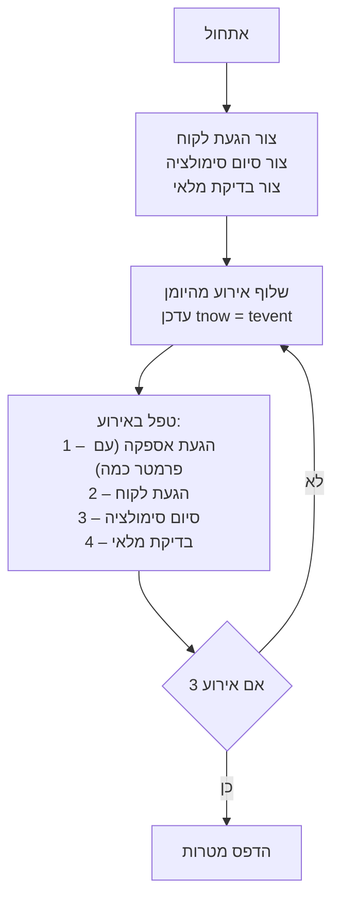

#### ניתוח תוצאות
- רוצים להבין משהו מהפלט
  - נרצה לבנות רווחי סמך
  - אם יש כמה מדדים — אי־שוויון בונפרוני

#### השוואה בין חלופות
- רוצים להגיע למסקנות מהתוצאות
  - עבור שתי חלופות: מבחן t מזווג ומבחן Welch
  - עבור יותר חלופות:
    - השוואה לסטנדרט
    - כל ההשוואות
    - בחירת החלופה הכי טובה (h1)
    - בחירת m שמכילות את הכי טובה (h2)
    - בחירת m הכי טובות (h3)
- וגם דיברנו על CRN והפחתת שונות

####
 
  

####
!! סימולציה — סיכום
SIMULATION — SUMMARY

נמרוד טלמון

---

## שיעור 13 — שאלות פתוחות
*(שאלות חופשיות בכיתה)*
